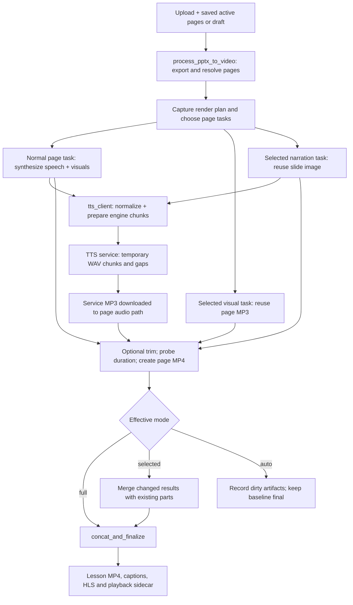

# Partial rerender and AI Visual Designer integration review

Reviewed 25 October 2026, Europe/Istanbul. Repository: `VisusVision/TalkingSlides`.
Source commit: `ea04701d9495da290c173a3bc3101a9a5dd6a1ec` on
`feature/ai-visual-designer`. This is an architecture/source audit. **Only this
document is changed; no implementation, commit, push or activation is performed.**

**Recommendation: REVISE_P1_BEFORE_IMPLEMENTATION.** Keep the independently
authenticated producer ledger, but clarify origin-versus-consumption lineage,
speech-versus-caption identities and references to existing Job/page manifests
before freezing its contracts. Existing per-page narration and selected
recomposition already exist on GitHub. No second TTS pipeline is justified.
The larger goal of efficient dynamic regeneration is partly implemented, not
universally achieved by every current render mode.

## 1. Verified local and remote state

| Check | Observed result |
|---|---|
| Branch and HEAD | `feature/ai-visual-designer`, `ea04701d9495da290c173a3bc3101a9a5dd6a1ec` |
| Starting worktree / index | Clean; no staged, unstaged or nonignored untracked files |
| Local branch / remote-tracking ref | Both point to the same SHA above |
| Local-only / tracking-only commits | Both `origin/feature/ai-visual-designer..HEAD` and its reverse are empty |
| Live GitHub branch | Read through the GitHub REST ref resource; also points to the same SHA |
| Partial-render implementation difference | None in the tracked files of this checkout. HEAD equals the live remote commit and local tracked content has no diff |
| Other local implementation | No additional nonignored source files; ignored-file name inspection found generated/dependency material, no additional partial-render implementation |

The live comparison used a read-only request to
[`git/ref/heads/feature/ai-visual-designer`](https://api.github.com/repos/VisusVision/TalkingSlides/git/ref/heads/feature/ai-visual-designer).
No `git fetch`, pull, push, merge, reset, rebase, checkout or ref update was run.
The local top commits are `ea04701` and `fe0ee50` (provenance design), `601979d`
(3B-6 final report), then the preceding deployment implementation commits. There
are **zero unpushed commits in this checkout**. This does not inspect another
computer's unshared filesystem or certify what is deployed in production.

Read-only checks included `git status --short --branch`, `git branch
--show-current`, `git rev-parse HEAD`, `git log -10 --oneline --decorate`, both
diff stats, `git for-each-ref`, both commit-range logs, and `git ls-files --others
--exclude-standard`. Source/test inspection used `rg`, bounded file reads and AST
function-location inspection. No application import, service startup or synthesis
was needed. Existing generated test caches are not evidence of a new test run.

## 2. Verified data flow

All locations below refer to the source commit above. `tasks.py` abbreviates
`services/worker/tasks.py`; other abbreviated paths are explicitly introduced.

The diagram's TTS branch is invoked by normal and narration-only tasks, not by a
successful visual-only task. The normal task's image construction and speech
synthesis both feed its page video. Private Phase 3B execution is a separate
**authorization/orchestration wrapper around shared media helpers**; it does not
enter this lesson finalization flow.

| Stage | Exact implementation evidence | Meaning |
|---|---|---|
| Initial export | `tasks.py::export_project` 8254; `scripts/pptx_extract.py::extract_speaker_notes` 1603 | Extracts source images/notes. Notes fall back to source text. The exporter is invoked before dirty-page planning even when only one page will render |
| Page identity / splitting | `scripts/text_segmentation.py::build_slide_page_structure` 226; `tasks.py::export_project` 8348 onward | Zero-based source index and split index; keys `s{source+1}-p{split+1}`. Long-text splitting is used for whiteboard/nonvisual sources; normal source-mapped PPTX/PDF pages keep their source mapping rather than always splitting |
| Saved input resolution | `tasks.py::_sync_transcript_pages_from_export` 3531; `_build_render_slides_from_draft` 3718; `_draft_render_tts_settings` 3700 | Active saved text/scene/order or saved draft can replace export descriptors. Reads are mutable, not a durable immutable execution capture |
| API selection | `core/views.py::_reserve_transcript_rerender_job` 6979; `ProjectRerenderView.post` 10907 | Targeted ordinary edits select page keys; structural/full or dirty-draft work selects full. A generic rerender without a dirty draft defaults to auto |
| Dispatch planning | `tasks.py::_build_dirty_dispatch_plan` 1824; `process_pptx_to_video` 10287, especially 10549 onward | Stores a Job-scoped planner manifest and chooses full/selected/auto. Selected mode takes the requested targets directly; auto compares fingerprints and reusable files |
| Narration preparation | `tasks.py::synthesize_and_render_slide` 8877; `scripts/tts_client.py::_prepare_text_with_settings` 134, `synthesize_with_service_with_metadata` 138 | One synthesis call per rendered page, supplying the entire page narration. Client preprocessing builds a separate spoken chunk plan |
| Engine execution | `tts_service/main.py::_prepare_request_for_tts` 980; `_synthesize_xtts_v2` 737; `synthesize` 1199 | Service can resplit/filter chunks, retry smaller pieces, switch to CPU or fall back to gTTS/silent audio. The service joins speech into one MP3 |
| Page audio/video | `tasks.py::synthesize_and_render_slide` 8985, 9047, 9058; `scripts/ffmpeg_helpers.py::create_slide_video` 150 | Optional MP3 trim, duration probe, then H.264/AAC page MP4. Ordinary encoding converts audio to AAC and may pad the slide hold |
| Selected reuse | `tasks.py::recompose_visual_only_slide_segment` 8531; `recompose_narration_only_slide_segment` 8662 | Actual implemented page optimizations, not just proposed manifest action names |
| Assembly / persisted output | `tasks.py::merge_and_finalize_segments` 9966; `concat_and_finalize` 9343; `_sync_lesson_segments` 6238 | Reuses unselected part files, concatenates, writes captions and lesson packaging; synchronizes mutable LessonSegment paths and playback metadata |
| Auto result recording | `tasks.py::record_dirty_render_dispatch_result` 10192 | Records dirty page output references while retaining the previous authoritative MP4/SRT. A done Job here does not prove a new assembled lesson |

`services/api/core/models.py::TranscriptPage` (874) is unique by project/page key
and holds source/split/order, narration, subtitle chunks and mutable timing.
`LessonSegment` (1242) is unique by **project/segment_order**, holds
`segment_tts_path`, slide/avatar paths and pause; it has no immutable Job, producer
receipt or stable-page FK. It is not a missing feature, but it is not a trust
ledger. Its rows are updated/deleted by `_sync_lesson_segments` as order changes.
`Job` identifies ordinary executions and URLs; an ordinary Celery task ID is not
a monotonic claim generation or proof of actual speech production.

### Artifact inventory and lifecycle

Let `S` be ordinary `STORAGE_ROOT`, `P` the project, and `n` the current one-based
**output position**, which may differ from the source slide number.

| Artifact | Actual path/representation | Lifecycle and reuse |
|---|---|---|
| Uploaded source | `S/uploads/P/lesson.*` | Persisted mutable source; looked up again for normal rerender |
| Source raster/background/notes | `S/P/images/*`, `S/P/source_backgrounds/*`, note text below workspace `notes` | Persisted project workspace output of extraction, not immutable per-Job artifacts. `extract_speaker_notes` itself appends a `notes` directory to its output argument, so the worker's passed notes directory can produce `S/P/notes/notes/slide-n.txt` |
| Per-page speech | `S/P/audio/slide_{n:03d}.mp3` from export/active/draft descriptors | Persisted and explicitly reused by visual recomposition; may be overwritten by synthesis, trim or another attempt. Standard task output is MP3, not a retained page WAV |
| Service speech copy | `TTS_AUDIO_DIR/{uuid}.mp3`; default `storage_local/tts` in the service's filesystem | Persisted service output offered through `/audio/{filename}`; downloaded by the client. No receipt/Job/page identity is established by its UUID. Separate storage mount visibility cannot be inferred from equal relative path names |
| Engine speech pieces | `TemporaryDirectory()/chunk_000.wav`, `chunk_i_retry_j.wav`; `gap_i.wav`, CPU/retry gaps, `concat.txt` | **Temporary.** Joined into MP3; directory removed on exit. No durable per-chunk artifact table or reusable chunk byte identity |
| Saved subtitle chunks | `TranscriptPage.subtitle_chunks` and draft page JSON; copied to task/result and playback final segments | Persisted authored/readability chunks, not the actual engine-call chunk list |
| Prepared speech chunks | Client `prepare_effective_tts_input` output and HTTP `chunks`/`chunk_pause_ms`; service's safe chunk plan | In-memory/request data. Returned normalization metadata is useful, but no immutable complete engine-call/audio-piece mapping is persisted |
| Subtitle timing | `TranscriptPage.chunk_timeline`, start/end/duration; playback `timeline`, final SRT/VTT | Persisted derived data. `allocate_chunk_timings` weights chunk text length across the speech window. It is not acoustic alignment or a list of chunk WAV durations |
| Rendered page raster | Exported image, or `part_n.whiteboard.png`, `.overlay.png`, `.avatar-safe.png` alongside parts | Project workspace artifacts; narration-only can reuse a cached final slide image without repainting it |
| Page MP4 | `S/P/parts/part_{n:03d}.mp4` | Persisted and reused during selected merge. Position-based mutable filename, not an artifact identity |
| Recompose staging | Hidden sibling temp audio/part and backup files containing process/time tokens | Normally cleaned/replaced by the task. Exception rollback is not a multi-file crash transaction or a cross-attempt fence |
| Ordinary avatar output | Avatar storage root under `P/avatar_segments/avatar_n.mp4`, lesson overlay state in sidecar | Existing separate behavior. Narration-only optimization defers enabled-avatar cases; do not redesign avatars for this integration |
| Lesson output | `S/P/P.mp4`, `P.srt`, `P.vtt`; draft final output under `S/P/draft_renders/draft-*/` | Persisted full lesson. Draft-specific final directories protect prior final bytes; intermediate audio/parts remain project-scoped |
| Playback state | `S/P/playback_assets.json` | Persisted mutable project sidecar: arrays, `final_segments`, normalization metadata, timelines, HLS/avatar/protection state and both planner manifests |
| Job render plan | `S/projects/P/renders/JobID/render_plan.json` | Job-scoped inputs/current manifest plus stage results. Individual JSON replacement is atomic; file remains mutable and is not authenticated production provenance |
| TTS hash-cache utility | `tts_service/tts_cache.py::TTSHashCacheStore`: configured root / hash prefix / key MP3 + JSON/lock | A utility with tests, **no production caller in the inspected service/client path**. Its presence does not establish live page or chunk synthesis caching |
| Phase 3B private pins | Separate `VISUAL_RENDER_PRIVATE_ROOT`, owner/project content pins and Run/generation attempt directories | Persisted immutable private inputs/results, no public path alias. Referenced history retained; report-only inventory does not delete it |

### Three chunk concepts must remain distinct

`text_segmentation.py::split_narration_chunks` (152) generates readability/subtitle
chunks (defaults 120/30 characters); `build_slide_page_structure` also splits
pages (420/140). TTS preprocessing applies normalization, glossary/overrides,
language limits and pause rules. The service's `_ensure_xtts_safe_chunks` can
resplit or omit nonalphabetic chunks. Recovery can synthesize multiple pieces for
one prepared chunk. There is no guaranteed one-to-one subtitle→engine→WAV map.
Changing one saved subtitle string does not imply that one corresponding WAV can
be replaced, nor that current subtitle timing measures that waveform.

## 3. Current invalidation and execution behavior

There are two useful, complementary existing planners:

- `services/api/core/render_planner.py::build_render_planner_manifest` (137),
  `plan_render_dirty_slides` (258): canonical per-page fingerprint of text/chunks,
  image token/hash/source mapping, timing, voice/language/provider/settings,
  avatar, resolution and pipeline version; detects insert/delete/order changes.
- `services/worker/partial_render_manifest.py::build_partial_render_manifest`
  (355), `build_expected_partial_render_manifest` (736),
  `classify_partial_render_changes` (834): separate display, narration, subtitle,
  effective TTS input/settings, avatar, background/layout and structural/source
  hashes. Version 1/hash semantics 2; output duration is metadata, pause is
  structural. `sequence_hash` includes page/order/structural hashes. Job identity
  changes the outer manifest hash but does not alone dirty unchanged pages.

`build_partial_render_plan` (925) emits report-only `*_future` recommendations.
That naming does **not** mean all corresponding functionality is absent: runtime
decision helpers already consult the classifier for selected visual/narration
optimization. Nor does it mean the plan is a general execution scheduler. Both
planners also have opt-in private dependency validation added in Phase 3B-2;
ordinary callers omit it and keep legacy hashes/classification.

### Mode is part of the answer

| Mode / entry | What actually happens |
|---|---|
| Selected, explicit target keys | `_build_dirty_dispatch_plan` chooses those keys and labels others reusable without running the auto planner's reusable-artifact validation branch. It tries all-target visual-only eligibility; otherwise all-target narration-only eligibility; otherwise normal page synthesis for each target. Mixed visual/narration target sets do not get independent per-target action selection |
| Auto, valid baseline | Dirty pages only are dispatched, but each uses normal `synthesize_and_render_slide`, even for visual-only dirtiness. Unchanged pages get no page task. Callback records dirty artifacts and preserves baseline final output rather than assembling a new lesson |
| Auto, zero dirty | No page tasks/concat; Job returns baseline URLs. Export/input resolution/moderation/planning have already occurred, so this is not zero overall work |
| Missing baseline/planner error/full | All pages use ordinary synthesis/render and normal finalization |
| Dirty draft requiring render | API and worker force full mode; every page is rendered. Cover-only/non-video drafts have a separate promotion/no-render path. Do not generalize the full-render statement to those cases |
| Selected successful finalization | `merge_and_finalize_segments` builds results for all pages and calls `concat_and_finalize`; unchanged page MP4s are read again, not individually synthesized/re-encoded by concat. `concat_videos` uses `-c copy`; HLS packaging likewise uses video/audio copy. Lesson captions/packaging/sidecar are regenerated; optional existing avatar/protection work can add processing |

### Requested cases A–J

| Case | Verified current behavior and limits |
|---|---|
| A. Visual-only | Selected optimization can reuse the existing page MP3 and avatar assets, render a new page image/video, and leave sibling parts untouched. MP3 bytes survive but audio inside the **new ordinary MP4 is re-encoded/padded**, not packet-copied. Cue timing is recomputed at finalization, not preserved verbatim from a sealed baseline. Missing prerequisites or any task exception can fall back to normal TTS. Auto regenerates speech for the dirty page; render-required draft regenerates every page |
| B. Narration-only | Selected optimization with avatar disabled and all non-targets unchanged reuses the cached page raster, synthesizes the entire affected page, optionally trims, and replaces its audio/part via temp/backups. Missing cached image/non-target artifacts, structural/mixed changes or enabled avatar rejects this optimization and uses ordinary target rendering. Auto rerenders all artifacts for dirty pages; draft is full |
| C. One subtitle chunk | Subtitle chunks are part of core transcript identity and partial `_PLAN_TTS_REASONS`; a change can route selected work through narration-only TTS for the **whole page**, even with the same spoken narration. The TTS call uses narration text, not that subtitle array. API narration edits normally rebuild subtitle chunks (`views.py` 8523–8528; `_set_draft_narration` 7846); no durable per-chunk audio replacement is implemented. A purely cosmetic subtitle segmentation edit has no dedicated caption-only execution route |
| D. Insert/remove/reorder | Core planner marks new/removed/moved positions; shifted indices are dirty. Partial classifier reports structural/sequence changes and disallows the narrow recomposition optimizations. Existing structural/draft edit routes request full work. Selected mode itself is not a safe general structural scheduler. Filename positions and LessonSegment order can be reassigned. A removal is not a synthesis task for a nonexistent page, but final assembly/order must change |
| E. Split source | Export supports multiple output pages with common source index and different split indices/keys, normally one MP3 and part per **output page**. A re-split can change boundaries, keys and downstream positions; both affected split content and sequence require validation. Existing source-index truthiness bugs can corrupt mapping for source zero (below) |
| F. Change voice | Core global voice/provider/language/settings fingerprints dirty all pages. Selected partial eligibility sees summarized voice in TTS settings, but only requested targets are dispatched; narration-only rejects changed non-targets and falls back to normal **targets**, rather than expanding to every globally affected page. Thus selected requests cannot by themselves establish correct global voice invalidation |
| G. Change model/lexicon | Explicit canonical model/settings/override fields can affect partial TTS identity; effective spoken-text normalization can change the partial input hash. However ordinary worker core inputs do not measure loaded weights, voice WAV contents, environment dictionaries or cached in-memory resolver state. An unrepresented model/file change can be missed by auto planning. Phase 3B private descriptors represent these dependencies when explicitly supplied; they are not populated by ordinary production TTS |
| H. No narration | Export can create empty narration. Active/draft resolution may refill from notes/source; normal/narration-only tasks ultimately use stripped narration or invent `Slide N.` (and normal task may use editor paragraphs). This is not a deliberate narration-free segment contract. Private narrated proof needs exact nonempty associated speech; invented fallback is ineligible |
| I. Missing/corrupt audio | Auto marks a page dirty for missing required artifacts, then runs its ordinary synthesis path. Core checks stored expected content hashes when present; worker-generated artifact maps generally contain paths/scope, **not byte hashes**. Auto adds nonempty-file checks, not full decode/authentication. Selected visual runtime checks file existence and later probes duration; corruption may trigger TTS fallback. Narration-only probes unchanged audio, but does not authenticate it. Selected merge can still fail on a missing unselected part; it does not universally heal all dependencies |
| J. Interrupted/retried/superseded | HTTP synthesis has up to three attempts and may produce a fresh UUID MP3 per real call. Page task has `max_retries=2` but re-raises errors; that declaration alone is not automatic `self.retry`/autoretry. Repeated page execution writes deterministic paths. Recompose temp replacement/rollback helps ordinary exceptions, but a process crash between multiple replaces is not atomic. Finalization/dirty callback check latest Job at entry; per-page writes and later finalizer writes lack private Run generation fences |

Display edits may also change narration automatically when it was not customized
(`views.py` 8515 onward). Such an edit is not genuinely visual-only at the
dependency level. Likewise changing source text can legitimately change a
text-grounded visual candidate. The requirement is to avoid **unnecessary** work,
not to retain a diagram whose grounding is no longer valid.

### Reuse checks are not producer authentication

Core `_artifact_reasons` (492) compares byte hashes only when an expected hash is
present. `_planner_artifacts_by_page_key` (1657) creates path/scope descriptors,
without generating such a producer hash. The partial classifier's
`_missing_required_artifacts` (1882) checks reference presence, not file integrity.
Runtime `_resolve_existing_artifact_path` (2276) resolves an existing file; it is
not the private owner-scoped no-follow import boundary. A cache flag, path,
nonzero size, successful duration probe or fresh hash is useful engineering
information but cannot prove who generated an earlier narration.

`TTSHashCacheStore` has per-key lock/sidecar and temp replace helpers. Its
validation can accept an ID3 header even when duration probing fails, its files
and sidecars are separate replaces, and its TTL cleanup is not reference-aware.
It must not be activated as the private trust authority or private GC. There is
no live service/client import of this store in the traced path.

## 4. Risks, identity and concurrency

1. **Source zero is not absence.** `_sync_transcript_pages_from_export` uses
   `source_slide_index or index or order` in template selection and DB assignment
   (3559, 3577); `_build_render_slides_from_draft` does likewise (3739, 3747).
   For an output split at index 1 whose source index is 0, that expression can
   resolve to 1. A draft page from source 0 moved to display index 2 can resolve
   to source 2. Existing private `page_identity`/snapshot paths preserve explicit
   zero. Future adapters must reject ambiguous input, use `is None` semantics,
   and preserve source/split/key independently of order. Do not infer stable
   identity from `slide_002.mp3`, source index alone, or LessonSegment order.
2. **Shared intermediate paths can change beneath a baseline.** Even auto dirty
   mode, which preserves the authoritative lesson MP4, overwrites project audio
   and part filenames. The old sidecar can still point at those newly written
   bytes. A failed or superseded Job can leave such changes. Private pins and
   expected producer identities must precede reuse; a done baseline cannot repair
   this association retrospectively.
3. **Selected is narrower than a full dependency validator.** Visual eligibility
   is all-target and does not require every non-target page unchanged; narration
   eligibility does. The generic selected dispatch branch does not add all
   globally dirty non-targets. Its merge rebuilds untouched results with current
   descriptor text plus existing files; `_cached_slide_images_for_unchanged_pages`
   verifies a visual subset, not every audio dependency. New current text can
   therefore be paired with old audio if callers mis-scope targets. Future
   dependency planning must examine all pages before dispatch, then choose actions
   per page. No audit finding here authorizes changing current behavior.
4. **Mutable baseline/input reads.** Export and saved-page sync precede planning;
   draft pages/settings are separate live reads; language/avatar/profile resources
   can drift. Merge rereads the project sidecar rather than an immutable baseline.
   `_baseline_job_from_playback_assets` can fall back to URL/latest-done Job.
   Captured render plans help avoid hashing output paths as new inputs, but are
   mutable JSON and not a publication transaction.
5. **Finalization is not private acceptance.** Captions now come from result
   descriptors, which protects against rereading newer transcript text at that
   step. But draft promotion still reads/promotes the then-current draft, and
   timeline/LessonSegment/files/sidecar/Job completion are not one atomic release.
   Latest-Job entry checks do not prevent stale file writes later. Keep Phase 3B
   claim generation, leases, cancellation, source rechecks and receipt acceptance.
6. **Fallback and metadata drift.** Successful visual recomposition returns
   `provider=cached`, empty rules and fallback=false. Normalization metadata can
   be preserved for some merge paths, but it is not the original signed producer
   identity. TTS service success can contain incomplete/recovered chunks or
   provider fallback. Reuse must carry the original authenticated lineage, not
   relabel it as a new successful synthesis.
   VoiceProfile speed/pitch and project speech-speed/gain metadata also do not
   prove the engine applied those controls: the inspected worker/client service
   request does not pass them as effective engine arguments. Preserve current
   conservative invalidation and reject unsupported nonneutral private controls;
   do not alter ordinary synthesis to make metadata look accurate in this audit.
7. **Boundary churn can over-invalidate.** Global positions, whole-lesson absolute
   offsets, full visual revision, changing Job IDs and cue grouping should not be
   the speech cache key. Conversely page/source/split mapping, spoken plan, actual
   dependencies and owner scope cannot be dropped to obtain more cache hits.
8. **Packaging and export are separate costs.** Selected reuse avoids page
   synthesis, not whole-source export or lesson repackaging. Rebuilding lesson
   SRT offsets after one page's duration changes is necessary; resynthesizing
   later pages to move their offsets is unnecessary. Existing concat/HLS helpers
   stream-copy codecs; do not describe packaging as automatic full re-encoding.

## 5. Desired dependency-aware behavior

This section is a future design target, not a claim that the current scheduler
implements the matrix. Normal rendering can regenerate through its existing
authorized TTS path; Phase 3B private previews remain **reuse-only** and must fail
closed on absent/untrusted narration. Private-preview failure never authorizes
ordinary TTS as a fallback.

| Change | Speech | Visual/frame | Page video and captions | Other pages |
|---|---|---|---|---|
| Visual-only, exact speech/cues still eligible | Reuse original receipt and bytes | Regenerate affected scene/frame | New affected MP4 using existing helper; preserve eligible local cues | Reuse verified artifacts; no speech/visual generation |
| Narration-only | Regenerate affected page through existing TTS; new actual observation | Reuse if independent grounding/layout remains valid | Rebuild affected MP4/cues; recompute lesson offsets later | No synthesis/repaint for unchanged dependencies |
| Both | Regenerate affected speech only | Regenerate affected visuals | Rebuild affected page | Reuse others |
| Subtitle grouping/timing only, identical actual speech plan | Reuse speech | Reuse frame | Reallocate/validate cues; reuse video bytes if recipe does not burn captions or change hold/duration | Shift absolute caption offsets if needed; no TTS |
| Identical page and current authorization | Reuse verified speech | Reuse verified frame | Reuse verified part/result; private identical execution returns existing Run/receipt | No media task |
| Add/remove/reorder | New page needs its own speech; remove synthesizes nothing; reorder preserves existing speech only if stable mapping/semantics unchanged | Reuse unchanged frame identities | Rebuild assembly/order/timeline; reuse compatible parts | Index shifts alone do not regenerate speech/images |
| Source re-split | Regenerate speech for changed speech boundaries; unchanged split can reuse only exact identity/plan | Reuse only unaffected grounded visuals | Rebuild affected parts and sequence | Never source-index-only or positional reuse |
| Voice/sample/model/preparation/pronunciation policy | Invalidate pages that consume changed dependency/profile | Reuse independent frame | Rebuild affected page audio/video/cues | Unaffected language/voice/resource scopes reuse |
| Font/rasterizer/image dependency | Reuse valid speech | Invalidate consuming frames | Rebuild affected video; keep compatible cues | No global TTS invalidation |
| Codec/mux/hold dependency | Reuse speech if its derivation is unaffected | Reuse frames | Rebuild only required derivation/video/timing | A container change is not a new speech event |
| Missing raster or MP4 with valid speech | Reuse validated speech | Recover exact pinned raster or rerender affected frame | Rebuild only missing derivative | Do not resynthesize to heal a missing video |
| Missing/untrusted speech | Ordinary authorized path may regenerate affected speech; private preview denies | Reuse valid visuals | No private eligible result until genuine producer evidence exists | No blanket rebuild or historical certification |

Do not promise term-level lexicon selectivity before capturing actual dependency
usage. Initially the affected scope is all pages using that loaded lexicon/profile
or language resource. Unknown influence is conservatively invalidated. Merely
changing an unrelated voice or visual renderer must not invalidate another
explicitly independent speech profile.

### Minimal dependency graph and identities

| Node | Inputs it must commit | Outputs / consumers |
|---|---|---|
| Stable page binding | Owner/project, stable key, explicit source/split, captured source lineage; optional existing TranscriptPage ID | Immutable scope for speech/visual/caption nodes; order is a separate use-site value |
| Speech request/plan | Exact protected text, prepared spoken text, concrete language, actual ordered engine chunks and pauses, selected/actual voice/provider/settings/sample and loaded model/config/preprocess/lexicon identities | Producer observation and original audio. Distinct requested/actual hashes; unsupported fallback never hidden |
| Audio derivation | Authenticated parent audio identity, actual processing operations/recipe and native dependencies | Eligible final audio bytes, packet hash, measured duration/activity. Neither scene font nor lesson absolute start is an input |
| Visual frame | Scene/candidate/grounding, display content where consumed, raster/SVG/font bytes, geometry and renderer/runtime | Validated frame. Does not depend on narration simply because the page has narration; explicit grounding dependencies still apply |
| Local captions | Authored subtitle chunks, authenticated audio duration/window, allocator/policy/version | Local cues/cue hash; separate from engine chunks and speech-input identity |
| Page video | Verified frame + eligible audio + local hold/video recipe/runtime; captions only if recipe consumes them | Page MP4 and validated output receipt |
| Lesson assembly | Ordered page identities/accepted part bytes, durations, local cues, packaging/protection/avatar policy | Final offsets/MP4/HLS/sidecar. Future normal publication authority remains a separate decision |
| Live authorization | Current owner/source/consent/producer/evidence/deployment epochs, cancellation and worker generation | May deny any reuse/delivery; never supplies replacement content or substitutes a cache key |

A semantic key answers whether recomputation is necessary; an artifact digest
answers whether bytes match; authenticated lineage answers who produced them;
live policy answers whether they may be used now. None substitutes for another.
Keep full capture revision and origin Job manifest for audit, but do not use the
entire lesson/snapshot revision as every node's cache key. Existing private Runs
retain their full source revision and conservative live invalidation; finer
cache keys do not permit completing a stale Run after a source edit.

### Chunk-level reuse decision

Defer durable chunk-audio caching from P1 and the initial integration. Page-level
reuse already saves the expensive work across unchanged pages. There is no
persisted speech-piece inventory to adapt today. A future chunk experiment would
need authenticated lossless piece outputs, complete ordered coverage, pinned
sample/model/settings, normalization/segmentation context, exact pause/gap recipe,
sample rate/channel/trim provenance, failure lineage and bounded retention.
Sentence edits can merge/split neighboring engine chunks; a stable index alone
is insufficient. Context-sensitive pronunciation/prosody can change neighboring
audio even when a text fragment is identical.

Only if measured inference savings justify storage/complexity should a separately
authorized design reuse exact independently scoped engine-call units. Join
lossless inputs and encode the final page derivative once; never concatenate
arbitrary MP3 pieces and claim unchanged AAC packets. Recompute/validate page
duration and all local cues after joining. Retain normal full-page synthesis as
the authorized ordinary fallback; no chunk-cache requirement, GPU or iOS
dependency belongs in baseline P1 CI.

## 6. Phase 3B: reuse, adapters and boundaries

Compared with the [Phase 3B design](AI_VISUAL_DESIGNER_PHASE3B_DESIGN.md),
[consolidated status](AI_VISUAL_DESIGNER_PHASE3B.md),
[3B-6 report](AI_VISUAL_DESIGNER_PHASE3B6.md) and
[production provenance design](AI_VISUAL_DESIGNER_PRODUCTION_PROVENANCE_DESIGN.md):

| Capability | Assessment and reuse decision |
|---|---|
| Per-output-page TTS, MP3 paths, selected tasks and merge | Already implemented. Reuse source/page descriptors and existing calls; do not introduce a second narrator, queue or lesson renderer |
| Dirty-page / component classifications | Already implemented in both planners. `core/visual_render_planning.py::snapshot_planner_inputs` and `build_snapshot_planning_manifests` already adapt frozen snapshots into them; `compare_snapshot_plans` remains execution-disabled |
| Completed AI-designed scene | `worker/completed_scene.py::compose_frozen_frame` 18 produces validated pinned PNG from completed SVG or original raster. Reuse it. Passing a completed SVG through ordinary custom/source-background overlay mode would duplicate text and is incorrect |
| Media encoding | Existing `scripts/ffmpeg_helpers.py::create_slide_video` has an explicit `verified_aac_copy=True` recipe. `worker/visual_segment_tasks.py::execute_private_segment` 81 calls it with the frozen frame and pinned AAC. This is shared media infrastructure, not a new video pipeline |
| Identical private request / attempt recovery | Existing immutable Run execution hash, Job, generation/token/lease, dispatch intent and receipt acceptance provide dedupe/fencing. Use them rather than ordinary latest-Job or RenderFollowUpIntent semantics |
| Authenticated reuse dependencies | `core/visual_design/segment_dependencies.py` already represents synthesis/caption/visual dependencies; both planners validate opt-ins. Small adapter work is to populate them from genuine accepted producer evidence; descriptors alone are not that authority |
| Producer source | Genuinely missing. `visual_segment_runs._producer_dependencies()` remains `None`. Per-page MP3/path metadata does not implement `ProducerTrustSource.lookup/currently_authorized` or establish an independent expected proof hash |
| Native eligible audio | Ordinary output is often trimmed MP3/padded AAC in part MP4. Private v1 needs authenticated AAC-LC M4A with supported processing provenance, packet hash and measured window. The proposed producer WAV→AAC derivative is additional **audio finalization**, not new synthesis or a second lesson pipeline; it still needs separate authorization and acceptance |
| Caption bridge | Current private `_request` requires saved baseline cues. Proposed sealed `result_allocator.v1` adapter remains necessary for a producer derivative with different duration. Existing allocator can be reused; baseline cues cannot be copied onto different audio by assertion |
| Ordinary selected task as private worker | Unsafe wholesale reuse: mutable paths, `cached` metadata, TTS fallback, ordinary trim/re-encode and finalizer side effects conflict with reuse-only private execution. Share pure helpers/input adapters, retain the private controller |
| Deployment / delivery / retention | 3B-6 records isolated Redis/container evidence, not production enrollment. Default slim API native mismatch, expiring independent enrollment, real proxy/slow-stream/capacity and coordinated retention prerequisites remain. `_deployment_ready()` is still literal `False` |
| Save & Rerender / lesson publication | Normal full/selected/auto behavior remains unchanged. Applying designs into normal lessons, exact-revision assembly/promotion and public playback are later separately authorized work; this audit does not implement Phase 3C |

Unnecessary duplication would be another TTS API, engine/preprocessor algorithm,
worker queue, page-status state machine, caption allocator, generic renderer or
wholesale replacement of the planners. Necessary separate boundaries are the
producer authority/ledger, immutable private storage/import, current authorization,
attempt fencing and nonpublishing result delivery. Sharing legacy finalization to
avoid that separation would discard security properties, not reduce duplication.

## 7. Required P1 contract adjustments

The previous design already explicitly documents per-page MP3, selected visual
and narration recomposition, cached metadata and partial merge. **It does not
assume per-slide narration is absent.** Its main need is authenticated evidence,
not discovering an audio file. Its field/schema proposal is appropriately
additive but leaves reuse lineage and key granularity insufficiently explicit
for the dynamic requirement. The following amendments belong in P1's reviewed
specification; this audit changes neither that prior document nor code.

| Amendment | Minimal contract/schema consequence |
|---|---|
| One execution per real synthesis, not every use | Define `AudioProducerExecution` as the actual page synthesis context with original ordinary Job and attempt lineage. An unchanged page reused by Job B does not get a fake new engine execution/observation and does not synthesize again to acquire a B identifier |
| Origin versus later consumption | Keep immutable origin Job/run/manifest/page association on the producer receipt. Add an explicit immutable reuse/consumption binding shape referencing the original receipt plus consuming Job/manifest/page/order/source capture when needed. It may fit the proposed artifact-reference/qualification record; do not mandate a redundant second status table. P1 defines/validates it but creates no live bindings |
| Reference existing objects, freeze their relevant values | Reuse Job FK, project/owner, stable page key/source/split and optional TranscriptPage FK. Capture exact consumed payload/hash once because those rows are mutable and a draft page may not have a final row ID. LessonSegment order/path is a locator, never canonical source identity. Job-scoped `current_manifest` can supply the captured input values only when sealed by the new authority, not by trusting the current sidecar |
| Separate speech, captions, sequence and visuals | Speech-input identity commits the actual prepared engine plan, not subtitle grouping or absolute lesson offsets. Caption identity commits authored chunks, policy and measured audio. Assembly binding owns order; visual identity owns selected scene/fonts. The complete signed envelope still binds all required values; no field is removed to improve cache hits |
| Preserve actual processing edges | Reference the signed producer original and immutable final audio once; new video composition uses that existing audio, not a new production event. A required new audio format/trim derivation has its own authenticated parent/operation, without calling TTS again |
| Bounded chunks without a new chunk store | Store a bounded ordered actual engine-call/coverage manifest and distinct authored subtitle array/hash. No durable per-piece audio table/cache/GC is required for P1. P2 observations later fill the actual engine plan; contract fixtures must not masquerade as production observations |
| Keep immutable producer baseline and current Run distinct | `SegmentAudioProof.baseline` and `ProducerAssociation.baseline_*` keep their origin meaning. Do not replace them with the latest Job when audio is reused. A private `SegmentRequest.page.order` comes from its own frozen snapshot; existing validation separately binds exact page/source/split. New consuming-job bindings are evidence of reuse, not retroactive origin certification |
| Avoid manufacturing new proofs for cache bookkeeping | Same receipt reused under unchanged speech/caption dependencies remains the same receipt. Changed caption provenance cannot mutate the old `baseline.cues_hash`. P1 must represent/reject that mismatch. A future restricted publisher may append an explicitly parent-linked, qualified derived caption/usage record and, if needed, new strict proof projection over the **same authenticated audio**, without pretending synthesis occurred. P4 must specify/test that path before consuming it |
| Do not equate dependency-descriptor churn with new synthesis | Existing private descriptors include receipt, baseline and validation hashes. A new authorization binding/key or caption record may change descriptor equality without changing speech bytes. Keep strict v1 hashes unchanged; a future action adapter must distinguish revalidation/rebinding from TTS work instead of blindly executing a `tts_settings_changed` recommendation |

The existing `SegmentAudioProof`, snapshot and request schemas/hashes remain
unchanged. Its nested baseline and cue association cannot be rewritten in place.
The production envelope can carry extra lineage and the independent expected
proof digest. Owner/project/page checks, signatures, immutable artifact handles,
revocation/control roles, current required resource profiles and genuine
observation remain necessary exactly as in the prior design.

Existing normalization/partial-render metadata supplies candidate captured
**inputs and locators**, not missing historical actual model/sample/lexicon or
complete chunk observations. New authority must capture/authenticate them at
generation/publication. Legacy and unauthenticated cached audio stays ineligible.
No scan/backfill may turn a current path hash into a historical producer receipt.

The prior P3 initial full-render-only qualification is a conservative acceptance
restriction, not a reason to force full lesson synthesis to acquire receipts.
Preserve it until selected/auto qualification is separately proven; emit no
accepted receipt for an unqualified observation. Later selected consumption must
name the actual original accepted audio. An auto done Job with baseline URLs is
not new lesson qualification. Availability can remain incomplete while ordinary
partial rerender continues working normally.

## 8. Minimal future sequence and exact change surfaces

Every row requires separate implementation authorization. P1 is revised first;
there is no prerequisite to rewrite partial rerender or to integrate unpushed code
from this checkout. Future file names are proposals, not files created here.

| Step | Scope / prerequisites | Likely files and exact functions | Stop / acceptance boundary |
|---|---|---|---|
| 1. Revised P1 only | Pure execution/observation/receipt/consumption contracts, inactive ledger/control schema, signatures/real PG role tests. Existing rows referenced, no backfill or live hooks | New `core/visual_design/producer_contracts.py`; registered producer models in `core/models.py` or explicit model module; additive migration; narrow role/provisioning scripts and contract/PG tests | Prove origin/reuse, speech/caption/order separation and key/DB isolation. Stop on ambiguous lineage or locking. `_producer_dependencies=None`, readiness=false |
| 2. Existing producer observation, shadow only | P1 accepted, operator keys/resource/sample identity and approved capture policy. Observe only actual new synthesis; one adapter used by normal and narration-only tasks | `tasks.py::synthesize_and_render_slide`, `recompose_narration_only_slide_segment`, shared caller/context helper; `scripts/tts_client.py::synthesize_text_with_metadata` and service caller; `tts_service/main.py::_get_xtts_model`, `_synthesize_xtts_v2`, `_prepare_request_for_tts`, `synthesize`; reuse existing preprocessing | No normal-default behavior change or replacement speech API. Capture exact Job/page origin and complete engine coverage. Reused visual task carries existing origin handle, no new engine observation. GPU-independent protocol tests plus separate actual-engine acceptance |
| 3. Producer publication / lineage | Authenticated new observations; approved publisher/native recipe/private producer storage; actual consumed response and baseline qualification | Proposed `core/audio_producer_ledger.py`, `audio_producer_publication.py`; narrow management/reconciliation command; reference/intent models if absent; shared media validation/storage helpers | Derive eligible AAC from authenticated original once, not per preview. Real PG/media/crash tests. Preserve original MP3/ordinary trim; no historical repair or full-render-for-receipts policy |
| 4. Closed private adapter | Accepted receipts plus current policy, approved caption/usage association | `core/visual_segment_runs.py::_producer_dependencies`, `_proof_from_source`, `_request`, `_producer_current`; `core/visual_segment_artifacts.py` trust interfaces; proposed production adapter; existing `visual_render_planning.py::snapshot_planner_inputs` | Populate existing dependency descriptors, sealed cues and current producer checks in isolated acceptance. Preserve Run generation/source revocation and zero TTS fallback. Production availability remains closed |
| 5. Ordinary dynamic planner proposal, separate scope | Revised dependency graph/identities accepted, immutable per-use references and global target closure specified; ordinary compatibility policy and tests | `core/render_planner.py::_slide_render_inputs`, `_input_change_reasons`, `plan_render_dirty_slides`; `worker/partial_render_manifest.py::build_partial_render_manifest`, `build_expected_partial_render_manifest`, eligibility/action helpers; `tasks.py::_build_dirty_dispatch_plan`, `_sync_transcript_pages_from_export`, `_build_render_slides_from_draft`, `process_pptx_to_video`, both recompose tasks, merge/input capture helpers | Fix zero mapping; compute all affected pages, then per-page reuse/repaint/resynthesize/caption-only actions. No second queue. Changing draft/auto assembly or promotion behavior is **not P1–P4** and requires its own later authorization; stop rather than silently activate publication |
| 6. Deployment enrollment / operational acceptance | Producer engineering accepted plus separate operator-controlled images/roles/live evidence | Separate enrollment module/control data and narrow checks around `visual_segment_dispatch._deployment_ready`; deployment tests/Compose only as justified; streaming/retention modules only under their own scope | Independent expiring enrollment, mount/UID/runtime/queue/Redis/proxy/capacity/backup and revocation acceptance. An engineering report never activates production. No destructive GC |

In step 5, existing `core/views.py::_reserve_transcript_rerender_job`,
`ProjectRerenderView.post`, transcript/draft setters and `core/drafts.py`
capture/promotion interfaces are **future review surfaces**, not permission to
change Save & Rerender now. A planner-only improvement must not be presented as
an atomic release/publication solution. Normal full-lesson AI-design integration
and Phase 3C remain excluded from this audit and P1–P4.

Reuse `scripts/text_segmentation.py::allocate_chunk_timings` rather than adding
another allocator; `scripts/ffmpeg_helpers.py::create_slide_video`, `concat_videos`
and caption writers rather than another encoder/assembler. Existing defaults and
legacy golden fingerprints stay compatible. No new runtime dependency, GPU or
iOS requirement follows from this review.

## 9. Required acceptance tests for later implementation

Existing coverage was **read, not rerun**:

- `tests/integration/test_partial_render_manifest.py`: real task-dispatch choices,
  fake-TTS/media visual-only and narration-only execution, fallback/rollback,
  auto dirty/no-op, selected merge, captured input fingerprints, sidecar metadata,
  later subtitle offset shifts and private dependency opt-in golden compatibility.
  Relevant functions include `test_visual_only_recompose_reuses_audio_avatar_and_replaces_only_target_part`,
  `test_narration_only_recompose_regenerates_tts_and_reuses_cached_slide_image`,
  `test_auto_render_dispatches_only_dirty_slide_and_records_non_authoritative_plan`,
  `test_finalize_records_narration_only_recompose_and_shifts_later_subtitle_timestamps`.
- `test_render_planner_foundation.py`: per-page/global dirtiness, optional stored
  artifact hash corruption, structure/order, stable canonicalization and private
  opt-in compatibility. Its corrupt-artifact test supplies an expected hash;
  that is not proof that normal sidecars store authenticated hashes.
- `test_partial_rerender.py`: source upload, metadata/cover no-render, prediction
  endpoint no mutation, dirty-draft prediction and sanitized reports. A prediction
  is not an execution or provenance test.
- `test_render_job_scoped_foundation.py`, `test_draft_rerender_promotion.py`:
  scoped Job/finalizer handling, result-based caption snapshots and draft behavior.
  Preserve these assertions; do not read them as proof of a final revision CAS.
- `test_visual_render_planning.py` and Phase 3B contract/artifact/Run/API/media/
  dispatch/retention suites: preserve immutable private semantics and nonpublishing
  gates. Recorded 3B-6 hosted/container results are historical evidence, not newly
  executed acceptance for this audit's proposals.

Concrete additional or expanded acceptance matrix:

| ID | Test | Required outcome |
|---|---|---|
| T01 | Five-page baseline, change only one visual; instrument TTS, raster, FFmpeg and file hashes | One affected frame/video; zero speech calls, unchanged sibling bytes; preserve actual producer lineage. Test selected, proposed auto/draft adapters separately, not only classifier output |
| T02 | One narration edit with independent cached visual and avatar disabled | One page TTS; reuse exact frame; rebuild its video/cues; sibling speech/visual bytes unchanged; later caption offsets move correctly |
| T03 | Change one subtitle grouping/text item with identical actual spoken plan | Speech key/audio remain unchanged; update/reject caption binding explicitly; no fake new synthesis. Old proof/cues immutable; unsupported private cue association denies |
| T04 | Mixed visual-only, narration-only, both and unchanged targets | Independent per-page actions after global dependency closure; no all-target optimization fallback causing unnecessary TTS on visual-only pages |
| T05 | Insert/delete/reorder, including moved source zero and order `[0,2,0]` source mapping with distinct splits | Exact keys/source/split retained; no positional audio swap; unchanged audio/frame reuse; no task for removed page; assembly order/captions validated |
| T06 | Source 0 split 1 at output index 1; source 0 draft moved to index 2; missing/duplicate identities | Zero never replaced by index/order; ambiguous inputs denied; future active/draft/export/private adapter tests cover the same mapping |
| T07 | Voice/sample/global model/lexicon change with selected keys omitting an affected page | Dirty closure includes every consuming page or rejects incomplete targets before dispatch; unaffected profiles remain reusable; new sample bytes at same path detected by captured authority |
| T08 | Change font/rasterizer only, video recipe only, caption allocator only | Only dependent derivations invalidated; zero unrelated TTS; old immutable receipt still historical, current policy enforced |
| T09 | Missing MP4/image with valid audio; missing/zero/truncated/swapped MP3; forged optional hash | Regenerate only necessary ordinary artifacts; private path denies unauthenticated/mismatching bytes. Decode failure not accepted by ID3 header or duration alone |
| T10 | Job B reuses genuine audio produced by Job A | No new engine call/observation; unchanged origin receipt/proof; explicit B consumption binding if required, cross-owner/project/source/split substitution denied |
| T11 | Historical MP3/cache/sidecar with perfect current hashes but no authenticated observation | Ordinary behavior unchanged; no producer ledger acceptance or private eligibility, no backfill |
| T12 | Provider fallback, filtered numeric chunk, partial chunk recovery, model/sample/resource drift | Genuine observed actual behavior; unsupported/incomplete profile ineligible; no forged full-coverage or neutral-control claim |
| T13 | Change chunk length/neighboring sentence/pause or locale | Recompute full ordered speech plan and only claim reuse for identical authenticated units; no subtitle-index→WAV assumption; no chunk cache required for initial release |
| T14 | Source/edit B while A exports, waits, composes or finalizes; change sidecar baseline at merge | Frozen input/output association remains A; private live checks reject stale source; no falsely qualified newer draft/Job or latest-sidecar substitution |
| T15 | Duplicate broker delivery, worker crash between temp replacements, stale generation resumed after newer completion | Private generation/token/receipt fence wins; accepted bytes immutable; ordinary failure/recovery assertions retained; no stale attempt overwritten into new authoritative associations |
| T16 | Auto dirty-only done Job and zero-dirty no-op | No new full-lesson qualification from done status/baseline URLs; no new producer execution for unchanged pages; stage-only files cannot alter an accepted receipt |
| T17 | Producer/consent/evidence revocation after pinning and during streaming | Deny at dispatch, claim, completion and resumed streaming boundaries; no positive permission cache outliving current control epoch |
| T18 | Guess private hashes/paths through media/HLS/share/token/generic Job routes | No private audio/frame/MP4/caption exposure; result URL/task-purpose isolation preserved |
| T19 | Forged receipt/signature, wrong key/purpose, modified original/final bytes, cross-page consumption | Trusted lookup/signature/scope/native verification fails; current paths/hashes never replace independent expected proof authority |
| T20 | Identical repeated private request, unchanged visual dependency and receipt | Same deduplicated Run/result, no extra synthesis/render; changing one page does not create work for unrelated pages |
| T21 | Empty narration and whitespace/fallback cases | Existing ordinary default behavior regression-covered; private exact protected text/caption semantics never silently changed to invented narration |
| T22 | Real built API/worker with Redis/PostgreSQL, compatible native identities and shared private volume; expire enrollment, drift mount/runtime; slow proxy/disconnect | Retain 3B-6 engineering checks, add production-specific enrollment/proxy limits before availability; tests cannot auto-enroll or enable execution |

Tests should first extend the named existing suites instead of duplicating them.
Contract/planner protocol tests use deterministic stubs and known engineering
fixtures; real PostgreSQL role/concurrency tests establish fences/lock ordering,
real media tests establish bytes/packet identity, and separate built-container/
Redis/proxy tests establish deployment behavior. No GPU is required for baseline
CI; actual future XTTS observation acceptance still needs its approved runtime.
Run relevant ordinary draft, captions, avatar, Job scope, HLS/publication and
private-isolation regressions when a later code change touches those surfaces.

## 10. Audit validation and decision

Validation for this document is source/architecture inspection, live read-only
remote ref comparison, source-function/path checks, Markdown/code-fence/table
review, and final patch-scope/whitespace checks. No application, Redis, Docker,
FFmpeg, frontend, browser, migration or dependency-audit suite was executed for
this document. No runtime pass or CI result is claimed. The final working tree
is expected to contain this new, uncommitted review document only.

The production provenance design's core trust boundary remains necessary. The
smallest next engineering task is still pure contracts and an inactive ledger,
after the amendments above are accepted. Actual producer hooks, selected/auto
qualification, dynamic normal-render routing, deployment enrollment and rollout
are distinct later tasks. Existing code supplies reusable per-page narration,
rendering, timing helpers and manifests; it does not supply independent production
attestation or universally correct fine-grained invalidation.

There is no locally divergent partial-rerender implementation to integrate first
in the audited checkout. Production audio/preview gates remain closed, ordinary
rendering/publication is preserved, and no destructive retention is introduced.

**REVISE_P1_BEFORE_IMPLEMENTATION**
