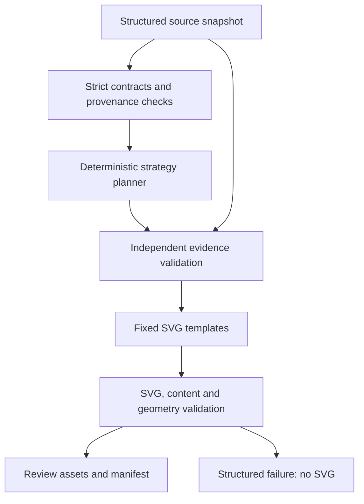

# AI Visual Designer — Phase 1

## 1. Architecture and boundaries

This is an executable, deterministic, preview-only prototype. It transforms **explicit structured evidence** into educational SVGs; it does not extract evidence from prose, call a language model, or integrate with the lesson/video pipeline.

Implemented against `feature/ai-visual-designer`, verified at baseline `1b13d04591b5fdda1001ae277a1d097067a42ad4`. The branch matched the expected baseline before implementation. No existing repository files or dependencies were changed.



| Module | Responsibility |
| --- | --- |
| `services/api/core/visual_design/schemas.py` | Immutable JSON contracts, strict nested fields, resource limits, canonical serialization and versioned hashing |
| `evidence.py` | Rebuild allowable semantic layouts and required labels from source evidence |
| `planner.py` | Conservative strategy choice; minimal future `VisualPlanner` protocol |
| `svg_renderer.py` | Fixed templates and conservative text wrapping; `render_preview` returns a result without writing files |
| `validation.py` | Source/plan identity, evidence fidelity, visible labels, template positions, arrows, bars, safe SVG and bounds |
| `__init__.py` | Small public API; importing it performs no application I/O |

All six modules use the Python standard library. They have no Django, ORM, settings, Celery, Ollama, HTTP, filesystem, subprocess, or GPU dependency. The separate documentation helper writes synthetic examples only.

This representation planner does not duplicate `core.render_planner` or the worker's partial-render manifest. Those existing components classify lesson rendering work; this package chooses an educational representation from evidence. Neither imports the other.

## 2. Contracts

Construct with `SlideSourceSnapshot.from_dict(mapping)` / `.from_json(text)`, similarly for `VisualPlan` and `VisualPreview`. Objects retain a frozen canonical JSON string; `to_dict()` returns a fresh copy. No type coercion, default indices, destructive text normalization, or unknown-field acceptance occurs. Invalid input raises `DesignError`, exposing a stable `code` and explanatory message.

### SlideSourceSnapshot (`slide-source.v1`)

Required fields:

- `schema_version`.
- `project_id`, `page_key`: opaque strings, independent of display order or transient database page IDs.
- `source_slide_index`, `split_index`: explicit nonnegative integers; `0` is preserved, booleans and numeric strings are rejected.
- `original_display_text`, `protected_narration`: exact authored strings. Narration is never used to infer facts or emitted into previews.
- `source_revision`: explicit `sha256:<64 lowercase hex>` digest supplied by the source adapter.
- `evidence`: an explicit list, possibly empty.

Optional fields: `original_asset_ref` (null or an opaque `asset:<id>`, never a URL/path), and up to two `neighboring_context` objects containing `project_id`, `page_key`, `source_revision`, `display_text`. Neighbor identities must belong to the same project, differ from the current page, and be unique. Context is retained and hashed, but is not diagram evidence.

Each evidence record has exactly `id`, `kind`, `source_revision`, `locator`, `verified`, `data`. Evidence revisions must match the snapshot. IDs are unique and locators are required. **`verified` is an assertion made by a trusted source adapter/teacher, not a proof established by this prototype.** The package verifies preservation and structure, not external truth.

| Kind | Exact `data` fields | Required evidence |
| --- | --- | --- |
| `process` | `steps`, `order`, `relationship` | 2–6 uniquely identified steps with exact labels; order references every step once; relationship must be `sequence` |
| `comparison` | `categories`, `items` | 1–4 unique common categories; exactly two named concepts, each with a value for every category |
| `numeric` | `measure`, `unit`, `points` | Named measure, nonempty common unit, 2–6 uniquely labeled finite numeric values, absolute magnitude at most 10^12 |
| `preserve` | `reason` | Explicit reason the original visual should remain |

The source adapter must establish comparable categories, units and provenance. This schema does not discover tables, charts, speaker notes or PPTX coordinates. Existing extraction does not supply a complete semantic manifest; the fixtures explicitly author their evidence. Missing extraction metadata is not manufactured.

### VisualPlan (`visual-plan.v1`)

Exact fields: `schema_version`, `source_identity`, `source_hash`, `strategy`, `rationale`, `layout`, `required_labels`, `evidence_refs`, `template_version`, `fallback_reason`.

`source_identity` includes project, stable page key, source/split indices and source revision. `source_hash` binds the complete immutable snapshot, including narration and context. `template_version` is `educational.v1`. `fallback_reason` is explicitly null for direct evidence-backed choices and a string for planner fallbacks.

Layouts are a closed union:

- Preserve: `asset_ref`.
- Typography: `text` (exact original display text).
- Flowchart: `heading`, `evidence_id`, `steps`, `order`, `relationship`.
- Comparison: `heading`, `evidence_id`, `categories`, `items`.
- Chart: `heading`, `evidence_id`, `measure`, `unit`, `points`.

For diagrams, `heading` retains the complete original display text. The evidence record is copied faithfully; no rewriting, summarization, unit conversion or inference occurs. If that text cannot fit the header, rendering fails explicitly. Required labels contain every selected evidence label/value and the display text. References, layout and labels are independently reconstructed from the snapshot during validation; a provider-supplied number cannot override an evidence record.

### VisualPreview (`visual-preview.v1`)

Exact fields: `schema_version`, `source_hash`, `plan_hash`, `renderer_version`, `width`, `height`, `svg`, `status`, `warnings`, `errors`, `contains_text`, `strategy`.

`renderer_version` is `svg-educational.v1`; dimensions are exactly 1920×1080. Status is `valid`, `preserved`, or `invalid`. A valid result contains SVG, `contains_text=true`, and no errors. Preserved and invalid results contain no SVG and `contains_text=false`; invalid results require errors. Preserved means no generated replacement, **not** that the original asset contains no text. A missing original asset produces a warning. Assets are never dereferenced here.

Preview deserialization also checks the safe SVG dialect. Source fidelity still requires `validate_plan(snapshot, plan)` and `validate_svg(svg, plan)`; a standalone preview contract is not an authorization token or a factual certificate. Future storage must verify the expected source, plan and preview hashes before serving/using an artifact.

### Hashes and revisions

Every contract exposes `content_hash`. Serialization uses sorted keys, compact UTF-8 JSON, exact Unicode and finite JSON numbers, with no timestamps or randomness. SHA-256 input is prefixed with `visual-design-hash.v1`, the contract schema version, and the canonical payload. Array order remains significant; absent optional fields and explicit null are distinct inputs. JSON `12` and `12.0` are retained distinctly. This is a documented Python JSON contract, not RFC 8785/JCS.

Identical validated inputs produce identical plan JSON, SVG bytes, preview JSON and hashes under the same versions. Change a template, rendering rule or font-width configuration only with an appropriate version bump. Source edits invalidate old plans even if an external adapter mistakenly retains the same source revision. Hashes detect changes; they do not establish who approved content.

## 3. Strategy behavior

| Strategy | Selection and result |
| --- | --- |
| `preserve_original` | A verified preservation record takes precedence; also the safe fallback when an original asset exists or display text is empty. No replacement SVG is invented. |
| `typography_only` | Nonempty original display text with insufficient/ambiguous evidence and no asset. Formats authored text without supporting the claim or inventing relationships. |
| `flowchart` | Exactly one verified process record, explicit sequence only. Source order, not storage-array order, determines arrows and positions. |
| `comparison` | Exactly one verified two-concept comparison with complete shared categories. Values remain attached to their original concept/category cells. |
| `chart` | Exactly one verified numeric record with a common unit, nonnegative values and a positive maximum. Horizontal bars share a zero origin; exact original values are labeled. |

Multiple records (unless preservation applies), unverified records and prose-only claims fall back conservatively. Negative/all-zero chart datasets fall back with a reason. Tiny positive bars below two canvas pixels fail with `chart_resolution`; they are not rounded into apparent zero values. No causal arrows, invented ranks, scientific illustrations, or arbitrary visual operations are supported.

Contract acceptance is distinct from template capacity: process evidence can contain up to six steps, while this first template renders at most four. Long words, dense tables, too many steps or other unfit content return `invalid`, with a code such as `text_overflow` or `layout_limit`, and no partial SVG. The caller retains the original visual. No content is silently truncated and no smaller font is silently substituted.

## 4. Evidence and validation guarantees

The checks do not rely on an LLM:

1. Validate strict shapes, versions, source indices and identities, revision provenance and process references.
2. Reconstruct the semantic layout from authoritative evidence; compare exact canonical values, labels, units and relationships.
3. Require the exact required-content list. Narration has no writable field in a plan.
4. Render through fixed templates only, escaping XML text and attribute values. No input SVG/HTML field exists in a plan.
5. Parse generated XML and enforce an element/attribute allowlist: SVG root, rectangles, lines, triangle arrows, positioned text and tspans. No scripts, event handlers, external resources, CSS, URLs, images, foreignObject, DTDs/entities, executable expressions, transforms or arbitrary paths.
6. Check finite geometry, canvas bounds, text line spacing/widths, exact visible labels, their template cells, sequence arrow direction/count, and evidence-proportional chart bars. Comparison values cannot simply swap columns while retaining the same label inventory.
7. Return structured errors with no SVG on failure. Valid outputs carry a font warning rather than claiming cross-platform pixel identity.

Limits include 65,536 UTF-8 bytes per contract, depth 12, 4,000 JSON nodes, 12 evidence records, 50,000 SVG bytes, and 600 SVG elements. Field-specific text/list limits are enforced in `schemas.py`. Nonfinite numbers, boolean chart values, unsupported evidence, unknown nested fields, duplicate JSON keys, bidi/control characters and unpaired surrogates are rejected.

Text support is intentionally bounded: printable ASCII, Turkish letters, nonbreaking space, and selected quotation/dash/bullet punctuation. Whitespace is reflowed for layout; exact authored strings/provenance remain in the source and exact `aria-label` values. The SVG uses DejaVu Sans regular/bold, 30–48 px in these templates. Fixed conservative glyph-width bounds avoid a font library dependency. All 116 supported glyphs were checked against installed regular/bold DejaVu Sans metrics; no bound violation was found. Fonts are not embedded. Different font substitution/shaping is outside the fit guarantee and must be verified before real Studio/media use. Arbitrary foreign SVG is not accepted as a design-provider output; this validator is tailored to this renderer, not a general SVG sanitizer.

## 5. Preview examples and reproduction

All review artifacts are outside public media paths:

- [Responsive review index](visual_design_phase1/previews/index.html) — open locally with sibling SVG files.
- [Contact sheet](visual_design_phase1/previews/contact_sheet.svg) — self-contained vector summary.
- [Manifest](visual_design_phase1/previews/manifest.json) — strategy, rationale, fallback, validation, warnings and source/plan/preview hashes for all five fixtures.

| Fixture in `tests/fixtures/visual_design/` | Strategy | Result / SVG in `docs/visual_design_phase1/previews/` |
| --- | --- | --- |
| `process.json` | `flowchart` | `valid` — [process.svg](visual_design_phase1/previews/process.svg); explicit data-recording sequence |
| `comparison.json` | `comparison` | `valid` — [comparison.svg](visual_design_phase1/previews/comparison.svg); conduction/radiation categories |
| `numerical_chart.json` | `chart` | `valid` — [numerical_chart.svg](visual_design_phase1/previews/numerical_chart.svg); exactly 12 and 18 fidan |
| `preserve_original.json` | `preserve_original` | `preserved` — no replacement SVG; synthetic opaque original-asset reference |
| `insufficient_evidence.json` | `typography_only` | `valid` — [insufficient_evidence.svg](visual_design_phase1/previews/insufficient_evidence.svg); authored “B is better.” retained without a new comparison/chart |

All fixtures use `source_slide_index=0` and `split_index=1`. Turkish characters and XML-sensitive text are exercised. The contact sheet's preservation tile is a status explanation, not a fabricated original slide.

From the repository root:

```bash
python docs/visual_design_phase1/generate_previews.py
PYTHONPATH=services/api python -m unittest discover -s tests -p 'test_visual_design*.py' -v
```

The generator performs no network/model calls, writes only this documentation preview directory, and exits unsuccessfully if a fixture fails. The tests require the checked-in artifacts to match newly generated bytes/hashes.

Minimal in-memory use:

```python
from core.visual_design import SlideSourceSnapshot, DeterministicPlanner, render_preview

snapshot = SlideSourceSnapshot.from_dict(source_mapping)
plan = DeterministicPlanner().plan(snapshot)
preview = render_preview(snapshot, plan)
result = preview.to_dict()  # inspect status/errors before displaying SVG
```

## 6. Executed tests and review

Python 3.12.14, standard-library runner, no Django installation or application settings:

```text
PYTHONPATH=services/api python -m unittest discover -s tests -p 'test_visual_design*.py' -v
Ran 42 tests in 0.116s
OK
```

Executed tests:

- `tests/test_visual_design_contracts.py`: strict nested schemas, source/split identity, zero handling, immutable state, canonical hashes, versions, unsafe text/preview rejection, numeric and payload limits.
- `tests/test_visual_design_planner.py`: five expected outcomes, repeatable planning, narration preservation, explicit ordering, conservative fallbacks, stale-source detection, authoritative values/units/references and blocked socket/HTTP calls.
- `tests/test_visual_design_svg.py`: byte-repeatable SVGs, XML parsing/escaping, exact labels/values, meaningful geometry, swapped comparison columns, changed sequence arrows, active/external operation rejection, invalid chart geometry, overflow/resource/template limits and artifact/manifest consistency.

Also executed the preview generator successfully (four valid SVGs plus one preserved result), rasterized the contact sheet with the already installed Inkscape, inspected it visually, and checked all supported glyph bounds with already installed Pillow and DejaVu Sans fonts. Neither tool is needed by production modules or baseline tests; no dependency file changed. Inkscape emitted a GtkRecentManager initialization warning while exporting successfully.

The complete added-file diff was reviewed for Phase 1 scope. No existing pipeline, Studio, draft, publication, dependency or public-media file changes are included. Full Django/integration suites, browser/mobile device testing, Docker, Ollama, FFmpeg, XTTS and GPU checks were **not run**. They are not dependencies of this isolated baseline.

## 7. Known limitations

- Evidence is supplied explicitly; no PDF/PPTX semantic extraction, image understanding, scientific truth verification, or unit-dimension validation exists here. Teacher/source-adapter verification remains necessary.
- One complete evidence record per diagram. No multi-record synthesis, omissions chosen by an LLM, mixed units, unit conversion, negative charts, causal graphs, timeline, animation or image generation.
- Conservative text support and fixed templates can reject otherwise useful slides. No automatic rewrite, summarization, font reduction or arbitrary-font fit guarantee.
- Schema validation and hashes provide reproducibility/integrity, not ownership authorization, signatures or teacher approval. No approval state or database exists in Phase 1.
- Snapshots are conservatively invalidated by narration/context edits. That invalidation must not itself become a command to regenerate TTS.
- Valid SVG serialization does not guarantee identical pixels on every browser/OS. Real delivery needs a pinned font/rasterization policy and device checks.
- There are no live API, Studio, draft, worker, source-extraction or published-media integrations. The review index is documentation, not a second editor.

## 8. Future Ollama integration

`VisualPlanner.plan(snapshot) -> VisualPlan` is the only provider extension point. A future adapter may reuse Lesson Intelligence provider availability/resilience and progressive orchestration outside this package. Lesson Intelligence prose findings are contextual hints, not verified chart/relationship evidence.

Require structured plan JSON, parse it through `VisualPlan`, independently validate against the snapshot, then use the same deterministic renderer. Reject hallucinated fields, altered evidence values and unsupported operations. Keep the deterministic fallback available. Do not let Ollama generate SVG/HTML or mark its own facts verified. No provider registry, network client, model dependency, prompt infrastructure or background scheduling has been added here.

## 9. Future Visuals ✨ Studio integration

Extend the existing Studio Intelligence panel with **Analysis** and **Visuals ✨** tabs. Reuse existing page selection, scene preview and private-draft mechanisms. Candidates can expose rationale, warnings, source/plan/preview hashes and the preserve-original choice. Support original/suggestion comparison, per-page generation/regeneration, selection and rejection, with responsive mobile stacking.

Selecting a validated visual should update the editor preview and working draft immediately. Saving persists a private draft only; it must not enqueue rendering or change published playback. Keep narration editing separate. Only **Save & Rerender** authorizes applying selected designs to video output. Persist candidate provenance/approval/version history separately from canonical approved narration; verify project ownership and private artifact access at the future API boundary.

Before remote Phase 2 work, define the trusted snapshot adapter and narrowly scoped request/status/selection contracts. Add stale-result checks against current stable page key and content hash; cancel/ignore outdated requests. Reuse progressive scheduling with a separate low-priority visual queue so visual failure cannot fail or delay normal rendering. Persistence, queues, API endpoints and UI changes need separate authorization/design.

## 10. Draft, rendering and publication safeguards

Future integration must retain source page/split identity and hashes, never derive stable identity from a display index or truthiness fallback. Preserve recoverable original scenes and the exact approved design version.

All generated Phase 1 SVGs are completed scenes with text (`contains_text=true`). Existing custom-background behavior can add transcript text overlays, so it cannot safely consume these SVGs unchanged. A later explicit completed-scene contract/mode must suppress duplicate overlays; **no scene mode or render-manifest change is implemented here**.

Map selected visual content/version hashes into existing render-planner/partial-render fingerprints. Do not create another dirty-page planner. Keep audio identity independent of visual identity; visual-only edits should reuse narration audio only where current eligibility/segment compatibility permits. Developer has limited selected-render visual-only reuse, not a blanket guarantee that draft Save & Rerender avoids XTTS. Maintain page mapping, timing/subtitle synchronization and fall back safely when structure/timing changes require more work.

Current draft handling must not be assumed revision-safe for publication. Before media integration, freeze an immutable draft revision including chosen design IDs/hashes, render exactly that revision, and promote only the exact rendered revision after validation and moderation. Do not promote a newer mutable draft, replace a published MP4 early, or bypass publishing policy. Existing approved playback must remain available until its validated replacement is ready. These are future requirements, not fixes delivered by this prototype.

**Phase 2 recommendation:** proceed with source-adapter trust/provenance, private suggestion storage, isolated scheduling and the existing Intelligence panel's preview/selection workflow. Keep video application in a later phase, gated on immutable rendered-revision publication and completed-scene semantics.
