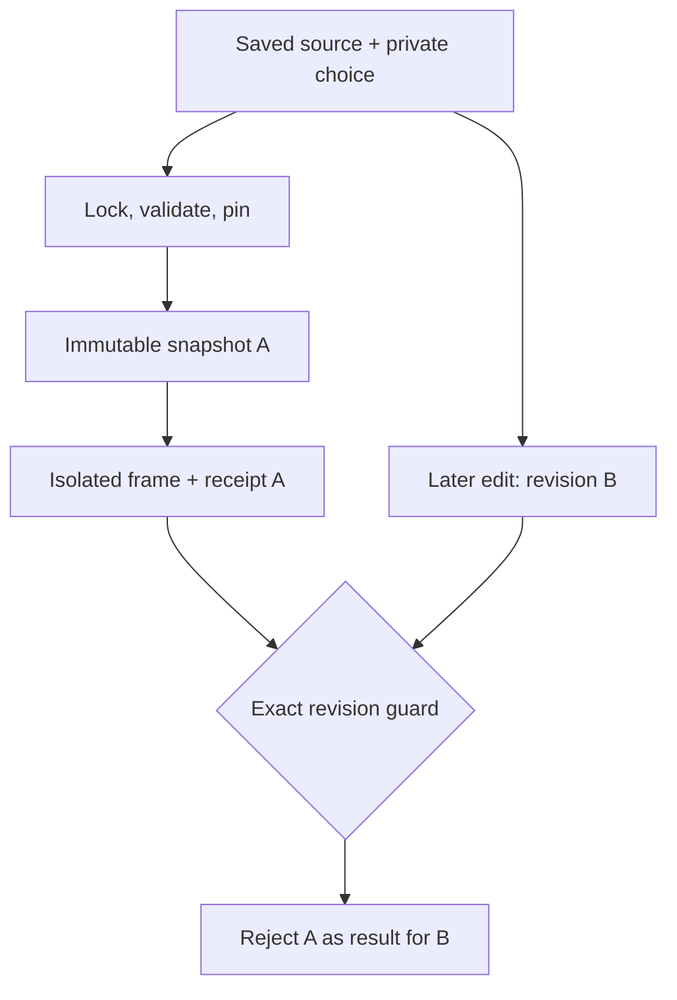

# Phase 3A — Immutable render snapshots and completed-scene prototype

Baseline: `4ece7539ad5c6c635eb97306e9a27126bc435f63`, feature branch only. This is an engineering foundation and an **isolated raster-frame** proof, not a publishing implementation or a new rendering queue.

## Verified existing integration points

| Existing code | Verified behavior and narrow future integration |
|---|---|
| `services/worker/tasks.py::_scene_background_image_for_render` (~3422–3442), `_normalize_scene_mode_for_render` (~3502–3533) | Resolves original/custom/source-background raster paths; unavailable custom or source-background can fall back to whiteboard. Completed SVGs must not be passed as ordinary custom backgrounds. |
| `tasks.py::_render_visual_only_slide_image` (~8416–8524), `synthesize_and_render_slide` (~8877–9038) | Original uses its flattened image, whiteboard renders display text, and custom/source-background invoke `_render_transcript_overlay_image`. Both paths would add duplicate display text if fed an already completed design as a custom background. |
| `tasks.py::_render_transcript_overlay_image` (~3115), `_make_whiteboard_image` | Established text/HTML/layout rasterization remains unchanged. Stage 3A supports existing modes in the frozen representation but does not duplicate these compositors. |
| `tasks.py::_build_render_slides_from_draft` (~3718–3820), `_draft_render_tts_settings` (~3700) | Reads current mutable draft pages and TTS settings separately. It currently uses `page.get("source_slide_index") or display_index`, which can map legitimate source index zero to the display index on a later split page. **Unchanged here; must be fixed before the Stage 3B bridge.** The new snapshot path uses exact integers, never that fallback. |
| `tasks.py::process_pptx_to_video` (~10287–10749) | Exports source media, reads/synchronizes pages, prepares language/TTS/avatar settings and dispatches work. The snapshot/prototype is not called from this task. |
| `tasks.py::_caption_duration_for_slide` (~1203), `_build_page_timeline_from_render_results` (~1212–1267) | Captions follow narration chunks and audible duration, excluding end hold; chunk timelines are absolute lesson offsets. The snapshot retains supplied chunks/timing without generating subtitles or audio. Missing saved-draft timing values remain null/empty, not copied from an incompatible active revision. |
| `tasks.py::recompose_visual_only_slide_segment` (~8531–8615), `scripts/ffmpeg_helpers.py::create_slide_video` | Existing visual-only reuse and H.264/AAC composition are the future video integration points. No second video compositor or TTS system was added. |
| `tasks.py::concat_and_finalize` (~9808–9825), `core/drafts.py::promote_project_draft` (~235–335) | Finalization calls promotion; promotion locks Project and reads its **then-current** `draft_data`. It does not prove that those bytes were rendered earlier. Active video replacement/publication remains unsafe for a new revision bridge without an atomic revision guard. Neither function was modified. |
| `core/render_planner.py::build_render_planner_manifest`, `plan_render_dirty_slides`; `worker/partial_render_manifest.py::build_expected_partial_render_manifest`, `classify_partial_render_changes`, `build_partial_render_plan` | Established dirty-slide/fingerprint/classification contracts are reused by an opt-in adapter; no parallel dirty-slide planner or production scheduler exists. |

## Immutable contract

`core/visual_design/render_snapshot.py` defines `visual-render-snapshot.v1`, `visual-render-revision.v1`, `completed-scene.v1` and `visual-frame-receipt.v1`. These contracts are pure and provider/ORM independent. Canonical exact-Unicode finite JSON determines the revision and snapshot SHA-256 hashes. Stored contract objects expose copies and cannot be mutated. Limits: 32 pages, 4 MiB JSON, 120,000 nodes, depth 32, bounded strings and finite numbers. Invalid/missing indices, ambiguous/duplicate keys or orders, unsupported modes and unknown top-level fields fail explicitly. Zero indices/times remain zero.

The payload captures:

* Project/owner identity; exact effective saved page order, stable keys, source and split indices.
* Verbatim authored display/narration/rich text/editor documents, whiteboard flags, subtitle chunks, available chunk timeline/start/end/duration inputs.
* Effective active versus saved ordinary draft mode, saved draft project fields/metadata, source revision/hash stamps and private selection versions.
* Voice provider/ID/language/speed/pitch and canonical effective project TTS settings. Render defaults are explicit: current pipeline version, 1920×1080, 25 fps, service TTS mode, auto language hint, default pause 2.2 seconds, narration-sidecar policy. These are captured defaults, **not an executed TTS contract**; Stage 3B must resolve language/provider/model/sample dependencies explicitly.
* Independently validated selected candidate UUID, exact source and **distinct evidence-enriched design-source hash**, plan/preview hashes and full schema/template/renderer metadata. Grounding/source excerpts, optional model proposal and immutable source-bound teacher confirmation are copied into the snapshot.
* Explicit completed-scene text ownership, retained narration/subtitle enablement and original-scene recovery metadata.
* Content-addressed SVG/raster/font references, never mutable paths as the actual render input.

`VisualRenderSnapshot` (migration **0041**) stores immutable JSON plus snapshot/revision hashes, owner/project and creation time. Same validated input deduplicates to the same private row. Its immutability is enforced at normal model writes; reads also recompute hashes and independently validate pinned data to detect bypassed/SQL tampering. Database-administrator forgery of an entire record and its hashes is outside this application trust boundary; these hashes are integrity identities, not digital signatures.

## Explicit capture and private access

`core/visual_render_snapshots.py` locks owner Project → saved pages → private selections → voice/profile rows, matching existing mutation lock order. Capture uses only server-owned saved state and Phase 2B `verified_preview` / selection identity checks. It validates current Phase 2C teacher confirmations, pins media, reconstructs frozen evidence, then rereads source/settings/selection/media identities before creating the row. Genuine revision conflicts return 409 and no snapshot/job/publication write. A later edit cannot mutate A; a future capture or guarded result for B has a different revision.

Owner-only endpoints, separate from Studio saving:

* `GET /api/v1/projects/{id}/visual-render-snapshots/` → current revision hash; **does not create a snapshot**.
* `POST` same path → only `{ "expected_revision_hash": "sha256:…" }`; captures explicitly. Browser-supplied SVG/pages/candidate metadata/settings are rejected.
* `GET .../visual-render-snapshots/{uuid}/` → owner-only metadata after historical integrity validation. No raw SVG, filesystem locator or snapshot payload is exposed.

Responses are private/no-store under the existing visual API authorization/security conventions. No Studio button or Save/Save & Rerender handler calls these endpoints. Internal callers use `current_render_revision`, `freeze_render_snapshot`, and owner-authorized `read_render_snapshot`.

## Private media and rendering boundary

`PrivateRenderAssets` uses content-addressed project namespaces outside public `STORAGE_ROOT`. An **explicit absolute** Django setting or environment `VISUAL_RENDER_PRIVATE_ROOT` is required; unconfigured capture fails clearly. Configure a persistent, private filesystem location, not an ephemeral container directory. The API image adds only fontconfig and DejaVu core fonts, already present in the worker image; no Python dependency changes are needed. Both API and any future worker must use the same persistent, private, access-controlled storage. This stage does not change Compose volume topology; a deployment must mount/configure that location before the explicit engineering API can be used. No new public media mount/URL is created. Pins use private files and no-overwrite atomic links, not mutable source aliases. Every boundary read verifies byte size and SHA-256. Source locators must be relative existing project-owned raster paths; traversal, foreign projects, absolute paths, URLs and symlink escapes fail. Per asset limit: 8 MiB; capture media budget: 32 MiB. Font files are pinned once by hash and copied into an isolated fontconfig environment for each rasterization.

The existing source adapter fingerprint is retained as the authoritative source identity. It is **not** redefined as the evidence-enriched plan hash. Frozen assets remain usable if a source path is later replaced; current revision comparison detects that replacement. Whole PPTX/PDF/source-document re-extraction is not supported by this prototype and cannot silently reopen an unpinned upload.

`worker/completed_scene.py::compose_frozen_frame` is a plain function, **not a Celery task**. It accepts a trusted frozen contract and matching private asset store. Before consuming a generated design it independently:

1. Reconstructs original base source and deterministic/confirmed evidence without querying latest mutable rows.
2. Validates source/proposal/confirmation identities, strict plan/preview versions, hashes, deterministic preview regeneration and the existing SVG dialect/semantic validation.
3. Reads exact pinned fonts and SVG bytes; runs FFmpeg's installed librsvg decoder with only file/pipe protocols and fixed scale/pad parameters, no shell, 20-second timeout, one 1920×1080 PNG frame.
4. Verifies PNG dimensions and nonblank pixel output, pins the frame privately, and returns a non-publishing content-addressed receipt.

The shared `ffmpeg_helpers._run` gains **optional** timeout/environment arguments; all existing invocations retain their previous defaults. No production FFmpeg command or TTS behavior was changed.

`completed_generated` + `display_overlay=none` means the design owns display text. `narration_enabled=true` and `subtitles_enabled=true` remain required. Original/whiteboard/custom/source-background modes remain separate. The isolated prototype composes completed SVGs and pinned original rasters. It explicitly fails for missing originals, whiteboard/custom/source-background composition and unsupported inputs rather than silently emitting incomplete visuals or applying an overlay twice. The established overlay renderer is reserved for the Stage 3B adapter.

## Planner contract and artifact safety

`core/visual_render_planning.py` feeds frozen pages into both existing planners. Candidate, source, grounded source, plan, preview, renderer/template and asset hashes participate in visual identity. Core image fingerprints and existing partial layout hashes detect visual changes. Two **opt-in** fields (`snapshot_timing_identity`, `snapshot_voice_identity`) add exact frozen timing/voice dependencies to established structural/TTS hashes. Production callers do not supply them, so their existing fingerprint bytes/classifications remain unchanged; current regression suites verify this.

| Change | Established result through snapshot adapter |
|---|---|
| Unchanged inputs and valid required artifacts | Eligible reuse; actual artifact gate remains required |
| Visual identity/layout change only | `ImageChanged` / partial visual reasons → `recompose_visual_only_future`; narration/TTS hashes stay eligible |
| Narration, voice ID/profile speed/pitch, language or TTS change | TTS reasons → `rerun_tts_avatar_future` (existing action name; avatars stay disabled here) |
| Page order/split/structure or frozen timing change | Structural reasons → safe broader/full-rerender recommendation |
| Missing/corrupted artifact | Existing core existence/hash gate marks it dirty; adapter feeds failed artifact availability into the existing partial classifier, preventing a false `reuse_all` recommendation |

These reports have `execution_enabled=false`; no result is sent to dispatch. Source-bound candidates may also acquire a new visual identity after narration edits/regeneration: conservative extra visual work is acceptable, stale selection reuse is not. The prototype cannot promise audio artifact reuse without the existing runtime eligibility/integrity checks.

## Revision guard, not publication

`require_rendered_revision(frozen, receipt, current_revision_hash)` checks exact snapshot/revision/page/frame identity and rejects receipt A paired with current B. A frame receipt has `publishing_allowed=false` and cannot authorize publishing, moderation, MP4/HLS replacement or promotion. A future job must bind a persisted snapshot ID/hash and its resulting media manifest to that revision. The current revision must be recomputed **inside the same transaction and lock scope as any future promotion**, and exactly that frozen revision must be applied. A read-only check followed by an unlocked call to today's mutable `promote_project_draft` is insufficient.



Snapshot A remains readable from its own historical evidence/assets after current source/selection changes. Tests also simulate live approval tampering: this blocks **new** capture without retroactively rewriting the already frozen, previously verified historical attestation in A. Explicit approval revocation/security invalidation policy for running jobs remains a Stage 3B decision.

## Reproducible media proof

Run:

```bash
PYTHONPATH=services/api:services python docs/visual_design/phase3a/generate_prototype.py --output /tmp/visual-render-examples
```

No production lesson/database records, GPU, Ollama, new Python dependency or model download is required. It uses the established FFmpeg installation with librsvg, fontconfig/DejaVu Sans, and existing Pillow. Five synthetic fixtures produce flowchart, comparison, verified **12/18 cm** chart, typography and preserve-original frames. Pinned intermediate files/fonts live in a temporary private store; only explicitly synthetic documentation frames are exported.

Committed examples: `docs/visual_design/phase3a/frames/{flowchart,comparison,chart,typography,preserve_original}.png`, `manifest.json` (snapshot/revision/frame hashes), and `index.html`. All five are 1920×1080 and were visually inspected. Integration tests verify valid PNG/nonblank output, exact chart data/units and SVG labels, repeatable frame bytes on the same runtime/fonts, absence of drawtext/subtitle overlay commands, and pixel-identical same-resolution original fallback. This is **frame acceptance**; no narrated segment, final lesson MP4, audio, subtitle file or HLS output was produced.

## Verification

Local focused backend run: **387 passed, 2 skipped, 63 subtests passed** (22.68 seconds), including existing planners/partial rendering/draft promotion and Phase 1–2C tests. The skips are PostgreSQL-only concurrency assertions; CI runs them on PostgreSQL. This includes the final voice/timing contract, pin integrity, stale selection, immutable approval and storage-configuration safeguards.

Django check: no issues. Migration consistency check: no changes detected. Actual local FFmpeg/librsvg raster integration succeeded; this is not a mocked-media claim. CI requires the decoder/font runtime and sets `VISUAL_MEDIA_REQUIRE=1`, so media acceptance cannot silently skip there. The PostgreSQL job now includes snapshot capture versus simultaneous selection restore.

Frontend source/dependencies are unchanged. Locally, `npm ci`, all **350 frontend tests**, and the production build passed; both npm audits reported **zero vulnerabilities**. The existing HLS chunk-size warning remains. Hosted Chromium continues to run under the full existing workflow. Final executed counts, npm audit results, Docker/full-backend/PostgreSQL/Chromium gates and commit SHA are reported with the [feature-branch CI run](https://github.com/VisusVision/TalkingSlides/actions?query=branch%3Afeature%2Fai-visual-designer) in the completion report. Security checks are retained.

## Remaining limitations and Stage 3B prerequisites

* Snapshots explicitly reject enabled avatar rendering until avatar/source/model/runtime media are pinned. TTS settings are captured but this stage does not pin model weights, voice samples or implement synthesis from snapshots.
* Only completed generated scenes and original raster fallbacks have isolated composition acceptance. Existing whiteboard/custom/source-background rendering is not duplicated; wire it through the established renderer in Stage 3B. An absent original raster has a clear failure policy; no source-file re-extraction or unverified substitute is attempted.
* No automatic capture on save, no normal render dispatch integration, no TTS/subtitle changes, no publication/promoter activation and no new queue. Existing mutable draft/render/promotion risks are **not claimed fixed** for the current production execution path.
* The report-only adapter imports the existing worker partial-manifest module and runs in the repository/worker package layout. The current API Docker image does not package worker modules; exposing this planner adapter inside API dispatch requires a reviewed shared-contract packaging change in Stage 3B. Snapshot capture itself does not import worker modules.
* Stage 3B must fix the legacy index-zero fallback, route all task inputs through the persisted immutable revision, freeze effective language/provider/model/voice and any remaining media dependencies, bind artifact receipts, and atomically promote exactly the rendered revision after moderation. It must also retain valid approved playback until replacement is fully verified.
* Private CAS configuration/shared-volume lifecycle, retention/orphan cleanup (including pins left after a rolled-back capture), quotas, in-flight revocation and publication failure recovery require explicit production policy. No retention worker was added. Current local filesystem hard-link semantics are required; S3 pinning is unsupported.
* Media pixel determinism is asserted only for identical installed FFmpeg/librsvg/fonts. The snapshot pins font bytes and SVG renderer identity; it does not pin the operating-system rasterizer binary. No claim of universal cross-runtime pixel identity or scientific factual truth is made.

Recommendation: proceed to a **separate Stage 3B design/review** after this foundation's CI and local media checks, keeping authoritative publication gated until exact-revision promotion and source-asset coverage are implemented.
