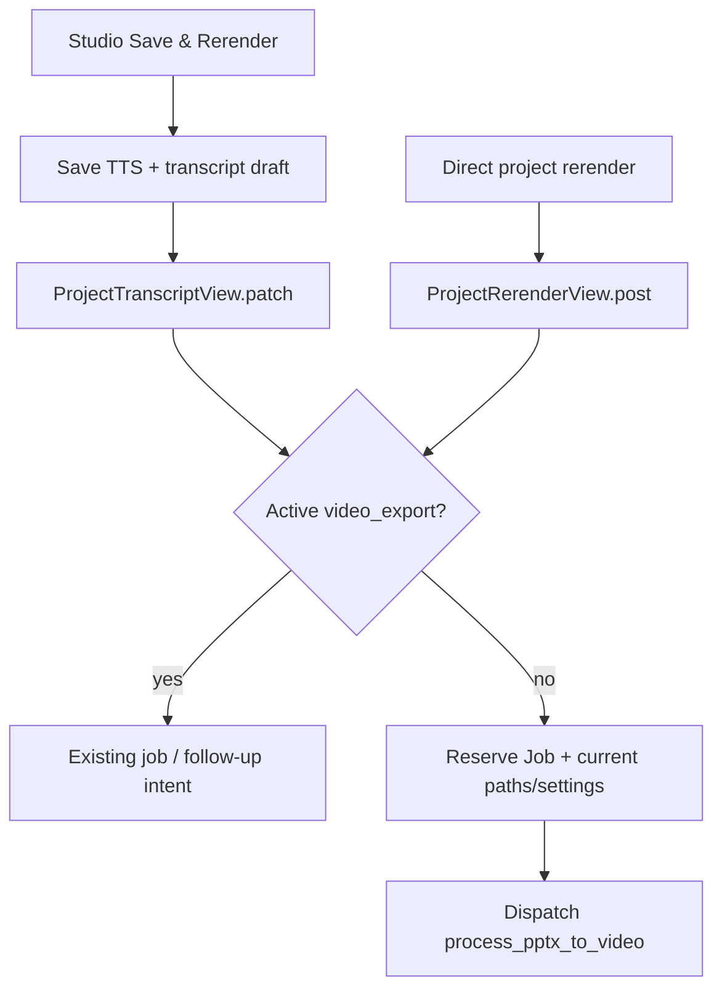
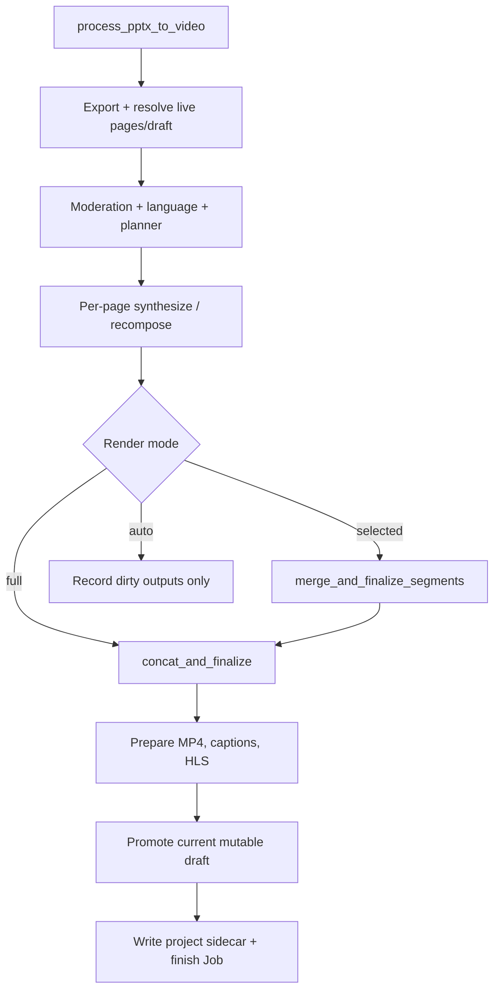
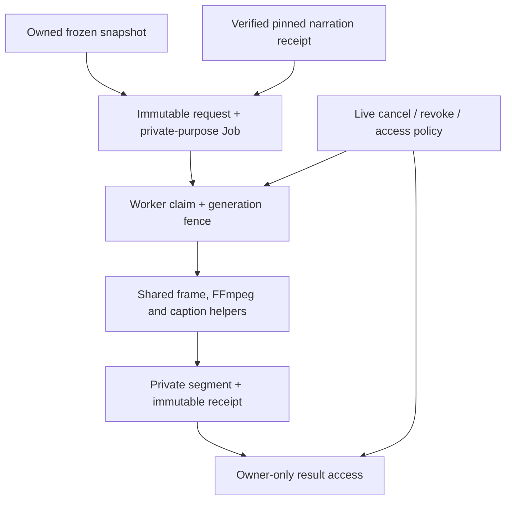

# Phase 3B design — private narrated segments from immutable visual snapshots

## Decision and review boundary

**Recommendation: READY_FOR_3B_IMPLEMENTATION, restricted to private, explicitly requested narrated segment previews.** Do not connect normal Save & Rerender, authoritative finalization, or publication in 3B. Those changes belong in a separately authorized **3C**. This decision means the bounded implementation below can start; it does not mean today's snapshot is a complete synthesis recipe or that arbitrary existing audio is eligible for reuse.

Reviewed branch: `feature/ai-visual-designer`. Local and GitHub HEAD both matched **`4ef6b01fe48a0cb798769c8983b2a3a6d9ea07f2`**. The working tree was clean before this review. All implementation findings and line references below refer to that commit. This review changes only this document: no migration, application code, media generation, task dispatch, or publication is performed.

The smallest useful next increment is **one saved page + one frozen selected design/original raster + one eligible pinned narration asset → private MP4/SRT/VTT + integrity receipt**. Reuse Phase 3A validation/rasterization and `scripts.ffmpeg_helpers.create_slide_video`; keep orchestration, paths and completion separate from authoritative lesson finalization. A purpose-specific task adapter is necessary; a second scene engine, codec implementation, caption allocator, dirty-slide planner or provider stack is not.

| 3B includes | Deferred to 3C or a separately reviewed extension |
|---|---|
| Strict execution/receipt contracts referencing the existing immutable snapshot | Full-lesson assembly and authoritative playback |
| Bounded, reuse-only narration from a verifiable producer receipt | Fresh XTTS/gTTS/ElevenLabs generation and complete synthesis dependency attestation |
| Private task/job identity, cancellation, fenced retries, approval revocation enforcement | Normal Save & Rerender and follow-up-intent integration |
| Completed SVG and original-raster scene composition; compatibility regression tests for existing modes | Frozen whiteboard/custom/source-background composition bridge |
| Owner-only private status/download, existing render queue, no new production queue | Studio video-preview controls, public tokens, HLS, release promotion/rollback |
| Deterministic synthetic inputs and real FFmpeg segment acceptance | GPU/voice-quality acceptance and avatar rendering |

Real-lesson availability is conditional: **legacy audio with incomplete provenance is unsupported**, not automatically trusted, resynthesized, or replaced with silence. There is no reason to migrate old test lessons specially. Use fresh, attested artifacts when their producer is ready. Engineering fixtures can establish the private segment contract without asserting that current legacy baselines already satisfy it.

## 1. Verified current pipeline

### 1.1 Studio → API → dispatch

* `services/frontend/src/pages/Studio.jsx::handleGlobalEditorSave` **L5827–5933** saves TTS settings first, then invokes `TranscriptEditorPanel.save` with `triggerRerender`. It can separately call `promoteProjectDraft` for saved non-render changes. The rerender button is wired at **L7778–7788**. `handleRerenderProject` **L4498–4532** is another direct project-rerender entry point; it is not the only path.
* `services/frontend/src/components/studio/TranscriptEditorPanel.jsx::saveTranscript` **L1306–1389** builds save options, calls `updateProjectTranscript` at **L1346**, and exposes save through `useImperativeHandle` at **L1391**. `services/frontend/src/api.js::updateProjectTranscript` **L1528–1547** maps those options to `trigger_rerender` and defaults `draft_only` to true at **L1531–1532**. Unsaved browser state is saved before a normal rerender; it is not an immutable worker revision.
* `services/api/core/views.py::ProjectTranscriptView.patch` **L8333–8467** saves `draft_data`, runs draft/source moderation and, when render-required, calls `_queue_or_record_transcript_rerender(..., full_rerender=True, use_draft=True)`. Non-render draft changes can instead call `promote_project_draft` at **L8442**. Structural-action rerenders also request full-project work (**L9934–10050**).
* `_queue_or_record_transcript_rerender` **L7030–7079** locks Project. An active `video_export` merges a `RenderFollowUpIntent`; otherwise `_reserve_transcript_rerender_job` **L6977–7014** creates a pending Job, picks the current `uploads/{project}/lesson.*`, reads voice/avatar/TTS settings, and passes mutable source paths plus `use_draft` to Celery. `_dispatch_render_job` **L5393–5406** sends `job_id` explicitly, then records Celery's task ID. Dispatch is after the reservation's atomic block, not an atomic database/broker transaction.
* `ProjectRerenderView.post` **L10905–11026** is a parallel entry: active-job deduplication, dirty-draft moderation, optional non-render promotion, current upload/voice/settings resolution, pending `video_export`, then the same dispatcher. Its draft branch forces `render_mode=full`.



The direct rerender endpoint returns the active job; transcript updates can record a follow-up intent. These behaviors must not be collapsed into one assumed mechanism. The private Visuals selection save is still separate from these dirty flags and dispatchers (`core/visual_drafts.py::decide_visual_draft`, **L125–168**).

### 1.2 Worker → media → finalization

`services/worker/tasks.py::process_pptx_to_video` **L10287–10809**:

1. Resolves/updates the render Job, then calls `export_project.apply(...)` inline (**L10328–10347**). `export_project` **L8254–8409** reads the uploaded source and regenerates extracted/raster assets in the project workspace.
2. In draft mode, reads current saved pages via `_build_render_slides_from_draft` and current draft TTS settings via `_draft_render_tts_settings` (**L10348–10350**). Otherwise `_sync_transcript_pages_from_export` reads/writes current active pages (**L3531–3697**).
3. Runs source, visual-asset and OCR moderation (**L10358–10476**), detects language and writes a project language sidecar (**L10478–10480**), resolves avatar settings including a current-profile fallback (**L10492–10532**).
4. Reads the current project playback sidecar and builds `_build_dirty_dispatch_plan` (**L10549–10571**, helper **L1824–1950**). Drafts force full rendering. Selected mode can use visual-only or narration-only recomposition after eligibility checks (**L10633–10723**).
5. Dispatches a chord of per-page tasks. Full mode calls `concat_and_finalize`; selected mode calls `merge_and_finalize_segments`; auto mode calls **`record_dirty_render_dispatch_result`**, which records dirty artifacts and keeps the baseline authoritative output (**L10728–10752**, **L10191–10281**). Auto dirty rendering is not already a complete publication path.



`synthesize_and_render_slide` **L8877–9329** invokes `tts_client.synthesize_text_with_metadata`, composes a raster scene, optionally trims narration silence, probes duration, and uses the established media helpers. It declares `max_retries=2` but re-raises errors; that declaration alone does not establish automatic retry (`self.retry`/autoretry). Any explicit retry can overwrite deterministic workspace paths. `recompose_visual_only_slide_segment` **L8531–8654** reuses an existing audio file and calls the same `create_slide_video`; it is working functionality, not merely a planned classifier action.

`concat_and_finalize` **L9343–9957** checks whether the Job is latest once at entry, sorts results, writes LessonSegment state (**L9451**), concatenates video, builds captions from result descriptors, packages HLS and manifests, promotes a live draft (**L9808–9826**), writes `{project}/playback_assets.json` (**L9832**), finishes the Job and drains follow-up work (**L9882–9895**). Draft final files use a unique `draft_renders/draft-*` directory (**L9453–9460**), protecting the previous MP4's bytes. Intermediate `images/audio/parts` paths remain project-scoped. These filesystem/database writes are not one publication transaction.

Important existing protections to keep: job-scoped updates and stale-job entry guard; captions assembled from rendered results instead of latest transcript rows; unique draft final-output paths; atomic replacement of individual JSON files. None proves that the draft promoted is the revision rendered.

## 2. Mutable inputs and writes after dispatch

This inventory covers the traced full/draft/selected/auto paths and their follow-up/provider/finalizer dependencies. Current security-policy reads are distinguished from authored render inputs: a live ban/revocation must still be enforceable; it must not supply replacement lesson content.

| Read/write surface and exact location | A/B or integrity risk | Immutable-path rule |
|---|---|---|
| Uploaded `lesson.*`, export tools and source asset files: `export_project` L8254–8409; `_workspace` L350–363 | Source path/content, converter/runtime or generated image may change before execution; same project files can be overwritten | No export/re-extraction in 3B. Consume pinned snapshot rasters/SVG/fonts only; converter/document pinning is a later extension |
| Live active rows: `_sync_transcript_pages_from_export` L3531–3697 | Later edits, structure/order or scene changes enter A; sync also mutates active pages | Never call sync for a snapshot task |
| `Project.draft_data` pages/settings: `_build_render_slides_from_draft` L3718–3826; `_draft_render_tts_settings` L3700–3715 | Separate queries can combine pages from A and settings from B; blank strings can fall back to exported text | Snapshot supplies exact authored strings/order/settings; no legacy draft-resolution helpers and no invented `Slide N` narration |
| Scene paths and current filesystem: `_scene_background_image_for_render` L3422–3442, `_render_visual_only_slide_image` L8416–8523 | A filename does not freeze pixels; permissive missing-background fallback changes a selected scene | Materialize validated private pins; selected-design failure is terminal, not a silent whiteboard/original substitution |
| Current moderation pages, assets and run results: process L10358–10476; draft moderation helpers L3863–3988 | Audit for B could be treated as approval of A; helpers also update Project/draft moderation | Bind future render-specific scans to snapshot/asset hashes. 3B never invokes Project-writing moderation wrappers |
| Language detection and sidecar: `_detect_language_from_slides` L2775 onward; process L10478–10480 | `auto`, algorithm/config changes and latest sidecar are not a resolved language identity | Resolve a concrete language in the frozen execution contract; never reread the language sidecar |
| Avatar/profile/placement/assets: process L10492–10532; `_get_teacher_avatar_config` L6315 onward; overlay tasks L6580 onward | Profile/source/consent/model/placement can change after base dispatch; asynchronous overlay may target a different base | 3B rejects enabled/requested avatar work. 3C needs pinned dependencies, current consent gate and exact base-release binding |
| Current playback sidecar/baseline: process L10549; `_baseline_job_from_playback_assets` L1801–1821; merge L9987–10046 | Baseline can change at start/merge; helper can fall back to latest completed Job; deterministic paths can contain another run's bytes | Pin one explicit baseline receipt and all reused bytes before dispatch. No latest-job/sidecar fallback in execution |
| Captured job render plan: `_read_render_plan` L1596–1605, `_planner_manifest_with_captured_inputs` L1700–1730 | The job-scoped input manifest is useful but is still a mutable filesystem JSON file, reread during finalization | Freeze/hash the exact planning manifest in the request/receipt; stage-results updates cannot redefine render inputs |
| Provider preprocessing/config/glossaries: `tts_client` L134–189; `tts_preprocess/effective_input.py` L120–187; `config.py` L51–63; `glossary.py` L98–139 | Same narration/settings can normalize or chunk differently with environment/lexicon changes | Freeze prepared spoken text/chunks/pauses/rules plus resource/version identities before any future synthesis |
| Voice WAV/model/provider fallback: `tts_service/main.py` L643–730, L753–762, L1199–1323; client L213–275 | `{voice_id}.wav` is mutable; model/provider can change or return silent fallback with HTTP 200 | 3B uses pinned eligible audio only; fresh synthesis requires a separate strict dependency/response contract |
| Worker FFmpeg/fonts/trim/protection config: tasks L9047–9059, L9559; `_worker_protection_mode` L863 onward | Settings and native binaries can change composition/timing; trimming cached audio in place would corrupt its identity | Pin font/audio bytes, bind a supported execution recipe/runtime; never trim/mutate a reused pin; no HLS/protection processing in 3B |
| Visual-only failure fallback: `recompose_visual_only_slide_segment` L8641–8654 | An exception invokes `synthesize_and_render_slide.apply`, which can regenerate audio under current provider/sample/runtime state | Reuse the compositor, not this fallback policy; private reuse-only failure must never invoke TTS |
| Job selection/update: `_resolve_render_job_id` L449–466, `_update_render_job` L439–446, `_is_current_render_job` L469–473 | Latest-job fallback can update a different purpose/job; entry-only stale check does not fence later writes | Mandatory scoped run/job IDs, purpose check, lease generation and final CAS; no fallback-to-latest helpers |
| Segment/timeline persistence and final outputs: finalizer L9451–9483; `_sync_lesson_segments` L6238–6268 | Writes derived state before publication acceptance; non-draft final files can overwrite active bytes | Private outputs/receipts only in 3B; delay all canonical row/timeline writes until 3C promotion transaction |
| Promotion: `core/drafts.py::promote_project_draft` L254–330 | Locks Project but reads its then-current draft, upserts/renumbers pages, deactivates others and clears the whole draft | Future promotion must apply the frozen payload under exact-revision CAS, never call today's mutable promoter as-is |
| Sidecars/final completion/frame audit: finalizer L9712–9895, L9898–9902 | Project sidecar, `done`, ready status and latest-job frame audit can expose/attribute the wrong release | Stage a complete immutable release first; exact-ID moderation and atomic active-release switch in 3C |
| Follow-up drain: `_dispatch_claimed_render_followup_intent` L568–636 | Rereads current Project/upload/voice/settings and mutable intent metadata after completion | 3B never drains intents. 3C records a new explicit snapshot request; an intent is not authority to publish an unspecified later draft |

Moderation fan-out also reads current AgentRun/AgentFinding, PublicationBlockEvent and AdminReviewRequest state (`tasks.py L4022–4107, L4189–4380, L4666–4769, L5098–5395`). These belong to the live control/audit plane; future scan acceptance must name A's hashes. `_mark_project_ready_after_successful_render` (L676–697) and post-render analytics/profile lookups are additional current-state reads with side effects, not immutable render inputs. The private wrapper must not call these completion hooks.

Individual atomic sidecar replacement does not atomically coordinate MP4, HLS, subtitles, transcripts and Job visibility. The current stale-job guard is a useful optimization, not the promotion linearization point.

## 3. Immutable handoff and minimal persistence



Content flows only from frozen inputs. Live policy can deny execution/delivery; it cannot substitute newer source content. No arrow enters normal finalization or publication.

### 3.1 Preserve Phase 3A's meaning

Reuse `core/visual_render_snapshots.py::freeze_render_snapshot/read_render_snapshot` **L166–199**, `core/visual_design/render_snapshot.py::validate_frozen_design` **L154–195**, and `worker/completed_scene.py::compose_frozen_frame` **L18–61**. Keep authoritative source hash and grounded design-source hash distinct. Resolve the candidate only from owner/project/page-bound server records. A teacher confirmation is frozen historical evidence, not perpetual permission to deliver a revoked design.

The v1 snapshot's `render_config` explicitly says **`purpose=isolated_frame.v1`** and strict equality is validated. It cannot be relabeled as a fully resolved TTS/job contract. Add a supplementary **`visual-segment-request.v1`**, leaving existing v1 payloads/hashes unchanged. A future full synthesis snapshot may require a new version; do not broaden v1 silently.

### 3.2 Proposed immutable request fields

All fields are required unless explicitly nullable. Canonical serialization, exact Unicode, finite numbers, domain-separated hashes, strict fields/version allowlists and bounded payloads follow Phase 3A. Server constructs this object; browser may identify a snapshot/page and expected hashes, not submit it.

| Group | Frozen values |
|---|---|
| Identity | schema version; owner/project IDs; snapshot UUID, snapshot hash and authored revision hash; exactly one stable `page_key`; page order, source slide index and split index copied from the snapshot |
| Scene binding | Scene type, `contains_text`, candidate/proposal IDs when present, authoritative source revision/hash, grounded design-source hash, plan/preview hashes, schema/template/renderer versions and pinned SVG/raster/font refs; explicit original fallback ref/policy |
| Narration binding | Verbatim protected narration; its exact hash; recorded effective spoken text/hash and concrete language; verified producer receipt ID/hash and baseline Job/run ID; **audio bytes hash/size/type**, measured audible duration and applied-processing provenance |
| Audio mode | Exactly `reuse_verified_audio.v1` in initial 3B. Recorded provider/fallback status, voice ID and applicable voice/settings/sample/model dependency identities must be explicit; unsupported/unknown required dependencies fail eligibility. No `auto`, placeholder provider, or permission to synthesize on failure |
| Captions/timing | Verbatim saved subtitle chunks, validated page-local cue text/times, cue origin/hash, caption policy/version, audio duration, hold seconds, target duration and time base; snapshot's original absolute timings retained separately |
| Recipe | `purpose=private_visual_segment.v1`, 1920×1080, 25 fps, H.264/AAC/yuv420p, encoder/options version, trim policy `reuse_without_reprocessing`, font/rasterizer identity, media runtime/build identity and supported tolerance/limit profile |
| Authorization provenance | Selected version and frozen confirmation hash; current approval/revocation checks are control-plane gates, never sources of replacement content |
| Baseline proof | Explicit baseline project/page/Job/run IDs; immutable manifest/producer-receipt hash; all input artifact expected hashes. A freshly computed hash of an arbitrary current path is not proof that the baseline produced it |

`execution_hash = H("visual-segment-request.v1", canonical_request)` is independent of mutable Job status, request timestamps and retry counters. Idempotency identity includes owner/project, snapshot hash, page key, audio/receipt/cue hashes and recipe version through this hash. Exact retries return the same private run; do not randomize designs or infer a new source revision.

### 3.3 Proposed records and broker message

The current Job schema (**models.py L463–505**) has no snapshot FK, immutable request, idempotency key, lease/fence or cancellation record; its status set is pending/running/done/failed. Recovery/follow-up helpers are not already an immutable private-run controller.

Reuse the existing **Job** lifecycle and add a distinct `job_type=visual_segment_preview`. Do **not** use `video_export`, `tts_render`, or put private MP4 paths into ordinary `Job.result_url`/`srt_url`. Existing public selectors explicitly choose completed `video_export` (`views.py:: _latest_completed_video_export_job`, **L5320–5324**; `ProjectSerializer.get_latest_job`, **L1126–1129**). A distinct purpose plus blank generic result URLs prevents accidental selection; also audit generic Job listings/notifications and enforce purpose-specific access.

Propose one small **VisualSegmentRun** extension record: UUID; project/owner; snapshot FK and copied snapshot/revision hashes; one page key; candidate/proposal FK when relevant; immutable request JSON and execution hash; unique `(project, owner, execution_hash)`; one-to-one Job; dispatch task ID; monotonic attempt/claim generation and lease deadline; cancellation timestamp/reason; immutable completed receipt reference/hash. Job remains the status/progress source. Do not duplicate all four Job statuses in a competing state machine. Terminal cancellation/revocation uses the private run's explicit reason and a failed terminal Job; private serialization distinguishes these outcomes. A successful receipt is append-only and never replaced by a retry.

For inferred proposals enabled in 3B, add a narrowly scoped append-only **VisualEvidenceRevocation** keyed to the existing proposal/confirmation, owner and project, with timestamp/reason. `VisualEvidenceReview` stays immutable. Its present one-to-one confirm/reject model cannot implement withdrawal (`visual_evidence.py::review_proposal`, **L126–131**). A revocation is permanent for that confirmation; a future reapproval/grant-version workflow is a separate decision. If this small revocation primitive is deferred, **teacher-inferred candidates must remain disabled for segment generation**, rather than shipping an unenforceable promise.

Persisted message, illustrative field types only:

```json
{
  "run_id": "<server UUID>",
  "execution_hash": "<sha256 digest>",
  "attempt_generation": 1
}
```

No SVG, media URL, filename, narration override, `use_draft`, latest-source flag, or browser-selected provider belongs in the message. The worker looks up the run, requires matching Job/project/owner/purpose, validates snapshot and request hashes and reads the pinned assets. Do not resolve a missing run/job through project-latest helpers.

### 3.4 Creation, dispatch and retry protocol

1. Owner-only explicit private request names snapshot/page and expected snapshot/revision hashes. Reject unknown writable fields and all cross-owner/project candidates. Unsaved browser edits are never inputs; the UI/engineering caller must save ordinary/visual drafts separately and capture a current snapshot first.
2. Resolve an explicit eligible baseline/producer receipt, copy and verify audio and cues into private content-addressed storage, and form the immutable request. Filesystem hashes cannot be transactional: pin bounded inputs outside long locks where practical, then recheck source/selection/receipt identities under locks before committing. Orphan pins have a retention grace period.
3. In one short database transaction use the existing Project → pages → selections → voice/profile lock order, then any proposal/review/revocation rows, then Job/Run in consistent sorted order. Recheck that the captured authored revision is still current, confirmation remains valid, owner remains authorized and baseline expected hashes match pinned copies. Deduplicate by execution hash; create a new-purpose Job/Run only once. A duplicate existing historical run can be returned as historical metadata; it must not trigger a new stale-source render.
4. Persist a Celery UUID and pending-dispatch state before commit. Send the tiny message on the **existing render queue** via `transaction.on_commit`, using that UUID. Record dispatch outcome. `on_commit` alone does not solve broker failure: an explicit retry/reconciliation command must republish a committed pending Run with the same request and fenced attempt identity. Do not reuse `RenderFollowUpIntent`, which means latest mutable lesson work.
5. Worker atomically claims a bounded lease/generation. Duplicate delivery of a live claim does no work; duplicate delivery after verified success returns the same receipt. Expired claims require explicit compare-and-swap takeover with a higher generation. Every completion requires the still-current generation, uncancelled/unrevoked control state and valid pinned inputs.
6. Render in an attempt-specific private directory. Never hold Project locks during FFmpeg, and never share output filenames with another attempt. Commit a receipt/Job completion only after probing and hashing outputs. A lost lease/cancelled/failed attempt cannot publish a receipt; its temporary files can be cleaned after a grace period.
7. Retry only classified transient I/O/worker failures, with a bounded count (initial maximum two retries) and backoff. Bad SVG/hash/approval/schema/source scope and unsupported provenance are terminal. Retry does not read new source, choose a different provider, or silently regenerate audio. A missing/corrupt pin is a failure, not permission to use its old mutable path.

Suggested initial bounds: one page/request; maximum 120-second audio/segment including hold; narration input ≤16 MiB, MP4 ≤32 MiB, each caption file ≤128 KiB; request/receipt JSON ≤1 MiB; attempt media budget ≤64 MiB. Keep existing snapshot/SVG/font limits unchanged. Use bounded streaming writes and subprocess/probe deadlines; reject over-limit input/output. These are proposed engineering limits, not current measured product capacity. Quotas/rate limits and at most one running private segment per owner/project prevent queue flooding. Redis task priority/fairness is not assumed. Sharing a concurrency-one render queue can cause head-of-line delay even without a dependency; start with operator-controlled idle-time runs. Teacher-facing availability requires a measured contention budget and an explicitly reviewed capacity/routing policy. No render/TTS/avatar dependency chain or new production queue is added.

## 4. Audio, subtitles and scene compatibility

### 4.1 What must actually be frozen

`VoiceProfile` stores provider, voice ID, language, speed and pitch (**models.py L132–148**); Phase 3A captures them. That does not prove the current renderer applies every field. In the inspected path, `synthesize_and_render_slide` passes voice ID, language and project TTS settings to the client, not the VoiceProfile speed/pitch as synthesis controls. The client records project `speech_speed`/`volume_gain_db` in metadata (**tts_client.py L210–212**) but does not send them as provider controls in its request (**L159–189**). Do not claim these settings have an audio effect merely because they are hashed. Preserve conservative invalidation and explicitly reject unsupported nondefault control semantics until implemented/tested in a later synthesis stage.

| Dependency | 3B reuse-only rule | Requirement before fresh synthesis / 3C |
|---|---|---|
| Authored narration | Exact snapshot text/hash must match the producer association; never reconstruct it from a slide image or model | Freeze both authored text and effective spoken text; never rewrite protected narration |
| Voice/provider | Recorded actual provider/voice and full supported settings must match eligibility; preserve original provenance, not `provider=cached` as its replacement | Resolve provider, explicit fallback policy and actual result provider; requested `xtts_v2` currently can fall back to gTTS/silence, so preference alone is insufficient |
| Voice sample | Require expected sample identity when the audio association depends on a mutable cloned voice; do not hash today's WAV and claim it produced yesterday's audio | Pin sample bytes under an internal sample identity; existing service opens `STORAGE_ROOT/voices/{voice_id}.wav` by mutable name. Require service-side consumption/attestation of the pinned identity, never an arbitrary WAV URL |
| Model/runtime | Existing audio bytes are the replay input; producer identities remain recorded and required provenance cannot be guessed | Attest model/config/checkpoint/tokenizer identities and service build; no large weight duplication per page. Reject runtime mismatch rather than selecting a new model silently |
| Language | Concrete recorded and verified effective language; `auto` is not an execution value | Freeze detector/version and resolved language from exact source, pass it consistently; service also detects language at `main.py L1223` |
| Pronunciation | Verify frozen override/settings and prepared-spoken/chunk identity against producer receipt | Freeze technical/abbreviation/mixed-word overrides, normalization mode, unknown-word strategy, glossary/lexicon hashes, normalizer/segmenter/config versions, chunk text/pauses. `prepare_effective_tts_input` calls code using environment/file resources despite its broad no-filesystem docstring |
| Processing | Reuse the exact post-processing audio bytes/duration; no in-place trim, speed, volume or pitch operation | Freeze effective supported controls, trim settings, output format/sample rate and chunk-concatenation policy; output receipt records measured actual processing |
| Avatar | Snapshot and request must have avatar disabled; no profile fallback | Pin consent/source/model/engine/placement and base-release identity, and enforce current consent/revocation before any delivery |
| Captions | Freeze saved authored chunks and validated cues. Display text in a completed scene does not disable captions | Keep original-language captions separate from normalized spoken text and separate from design labels; translations need independent revision identities |

An exact audio checksum proves byte identity, not that the audio narrates a particular text or was made by a particular voice. A trusted producer receipt establishes that association. A path, duration, a successful HTTP response or a newly invented receipt derived only from today's mutable sidecar does not.

### 4.2 Compatibility matrix

| Change/input | Visual frame | Narration/audio | Captions/timing | 3B / 3C result |
|---|---|---|---|---|
| Completed generated SVG, `contains_text=true` | Phase 3A validated full scene; **no display overlay** | Retained eligible pinned narration | Retained authored cues; no burned-in duplicate display text | Supported in private 3B |
| Original raster / restore-original state | Exact pinned original; no new overlay | Same eligibility rules | Same cue rules | Supported when a valid original pin exists; missing original fails |
| Whiteboard | Existing `_make_whiteboard_image` semantics | Retained | Retained | Existing normal pipeline unchanged; frozen bridge deferred until font/layout/overflow behavior is validated |
| Custom background | Existing transcript overlay, fit and scale | Retained | Retained | Normal pipeline unchanged; 3C must materialize pinned background and reuse existing overlay helper |
| Source background | Existing supported-source checks and overlay | Retained | Retained | Same deferred bridge; do not re-extract an unpinned document or silently fall back |
| Visual-only selected-design change | New frame/segment | Reuse only if semantic TTS/voice and producer evidence match | Same audio-local cues and hold when unchanged | Existing planner says visual recomposition; eligible private run does not call TTS |
| Narration / pronunciation / language / voice change | Visual may also become stale through source binding | Cached audio invalid | Need matching audio/cues | 3B returns unsupported/audio-ineligible; later stage may synthesize from a complete recipe |
| Reorder only | Page identity and frame unchanged | Per-page audio can remain reusable | Lesson absolute offsets change | Private single-page local cues remain valid; full assembly needs existing structural planner in 3C |
| Split/merge/delete/restore | Stable page/source/split mapping must match | No positional or source-slide-only audio reuse across split changes | Recompute/validate broader timing | New snapshot; fail unsafe partial reuse |
| Invalid selected asset | No substitute | Do not spend TTS resources | No result | Terminal integrity error. Explicit teacher restore creates a different request |

For a segment, local time starts at zero. Copy baseline cue text/times by stable page key, converting absolute times only using the frozen matching page offset. Validate finite, ordered, nonoverlapping intervals inside the audible window; hold is outside that window. If reliable cues do not exist, use the existing result-only caption allocator **before dispatch** with pinned measured audio duration and a versioned policy, and freeze its output. Do not reread active TranscriptPage rows through `build_subtitle_cues_from_transcript_pages` during execution.

The existing `_caption_duration_for_slide` / `_build_page_timeline_from_render_results` / `_fallback_cues_from_render_results` (**tasks.py L1203–1266, L1449–1491**) and `text_segmentation.allocate_chunk_timings` are the reusable algorithms. Factor or call their pure result-based logic; do not implement another allocator. This is approximate duration allocation, not word-level forced alignment. Generated label text must never replace narration/subtitle text. Blank narration requires an explicit later silent-slide policy; do not invent narration or silently count fallback silence as narrated acceptance.

## 5. Completed-scene composition seam

`_SCENE_BACKGROUND_MODES` currently contains only original/whiteboard/custom/source_background (**tasks.py L3201**). Normal background normalization and both rendering branches add transcript overlays for custom/source-background (**L8471–8494**, **L9016–9039**). Passing a completed design through those modes is incorrect.

For 3B, the trusted scene descriptor selects Phase 3A `compose_frozen_frame`; its returned validated 1920×1080 PNG becomes the input to existing **`create_slide_video(frame, pinned_audio, private_attempt_output, duration_sec=audio_duration+hold)`**. No call to export, draft resolution, `_render_transcript_overlay_image`, avatar safe-area transformation or display-text normalization is made for a completed generated scene. Keep `narration_enabled=true`, `subtitles_enabled=true`, `display_overlay=none` and original-scene recovery metadata. Do not modify active editor scene/background fields to get this behavior.

The wrapper must use the shared compositor, not call `synthesize_and_render_slide` or `concat_and_finalize` wholesale: those functions have provider/mutable-state or canonical-write side effects. Likewise, the current visual-recompose task assumes mutable paths and rewrites provenance to `cached` with empty normalization/fallback details (**L8597–8607**); preserve actual producer provenance in the new receipt instead. Its exception handler also calls full synthesis at **L8649–8654**; a private visual-only failure must not inherit that fallback. A narrow extraction of an existing pure helper is acceptable if tests prove legacy defaults unchanged.

Add optional bounded timeout/runtime/output parameters to the established FFmpeg helper as needed, preserving all existing defaults. Explicitly validate/pin its inputs and enforce the selected 25-fps recipe; today's helper does not set an explicit `-r` (**ffmpeg_helpers.py L179–211**). Do not hand-code an alternative encoder command. Probe output for a video and nonempty audio stream, 1920×1080, intended codec/pixel format/fps, duration within a specified initial tolerance of two 25-fps frames (80 ms), and valid caption timing. Sample first/middle/last decoded frames for nonblank content and inspect fixture layouts. Bit-identical encoding across different native runtimes is not an acceptance promise.

Return **`visual-segment-receipt.v1`**, not a widened `visual-frame-receipt.v1`: request/execution hash, snapshot/revision/page identities, candidate/source/design hashes, exact input frame/audio/cue hashes, producer provenance, recipe/runtime versions, attempt generation, output MP4/SRT/VTT hashes/sizes/types, measured stream properties/durations, validation outcome, and `publishing_allowed=false`. Hash the canonical receipt and store it privately. A frame or segment receipt never authorizes a full-lesson publication.

## 6. Source index zero, splits and reorder fix plan

Verified unsafe truthiness expressions:

* `tasks.py::_sync_transcript_pages_from_export` **L3559, L3577**: `source_slide_index or index or order`.
* `tasks.py::_build_render_slides_from_draft` **L3739, L3747**: export-template fallback and `page.get("source_slide_index") or display_index`.
* `views.py` visual-asset moderation descriptor **L7299**: `page.source_slide_index or page.order or 0`.

The last site can misattribute moderation evidence after a reorder even if rendering is corrected. Expressions such as `int(page.source_slide_index or 0)` at **L3667** preserve zero but still hide missing/invalid identity; do not mechanically replace every `or` without understanding its domain.

**Rule:** validate integer identity explicitly (exclude bool, negative, malformed and missing persisted values); only `None` may invoke a documented extraction-time fallback. Separate source index from display order and one-based source slide number. A reorder must never derive a new source index from position. Splits retain the same source index and distinct split index/stable page key. Never use temporary draft IDs or source index alone as a unique page identity. Do not use `first_template` as an unverified substitute when a requested source template is missing.

3B's snapshot adapter already bypasses the unsafe legacy builder; add regression fixtures and strict mapping assertions there first. Patch and test the five legacy sites in a small separately reviewable prerequisite commit **before any 3C normal-render bridge is enabled**. This review does not authorize the patch. Do not rewrite unrelated extraction logic.

Required example: source indices `[0, 2, 0]`, split indices `[1, 0, 0]` after reorder, with three stable keys and display positions `[0, 1, 2]`. Every frame, narration, cue, plan, artifact and moderation locator must retain those exact associations. Also test split zero, page order zero, missing identity, deliberately mismatched source template, and an unchanged original source slide reused by two different splits.

## 7. Planner and artifact reuse contract

Reuse `core/visual_render_planning.py::{snapshot_planner_inputs,build_snapshot_planning_manifests,compare_snapshot_plans}` **L9–66**, `core/render_planner.py::{build_render_planner_manifest,plan_render_dirty_slides}`, and the established `worker/partial_render_manifest.py` classifier/eligibility functions. Do not create a parallel dirty-page planner. The 3A adapter is report-only (`execution_enabled=false`); classification is not execution eligibility.

A verified 3A gap to close in this adapter: the current completed image identity (`visual_render_planning.py L22–28`) does not include pinned fonts or native rasterizer identity. Add those to its image dependency hash. Core planner TTS canonicalization (`render_planner.py L353–376`) whitelists existing settings; arbitrary new provenance keys can be dropped. Add explicit, typed, **opt-in** synthesis dependency hashes to the existing core/partial manifests and their existing invalidation reasons for sample/model/preparation-resource changes; do not hide them in an unrecognized metadata field or fake voice ID. Use versioned private dependency semantics, fail comparisons with incompatible baselines safely, and prove byte-identical legacy manifests when the opt-in fields are absent. Actual audio-byte hashes remain an independent artifact/receipt integrity gate and part of the private request identity, not proof of semantic narration correctness. No new planner is needed.

Visual identity includes scene type/text ownership, candidate/source/grounded-source/plan/preview hashes, template/renderer and pinned asset/font identities. Audio identity includes authored/effective spoken input, concrete language, supported voice/provider/settings, preparation resources and producer/audio hashes. Caption identity additionally includes exact cue text/local times and hold/timing policy. Selection-history timestamps alone must not invalidate audio. A narration edit can conservatively invalidate the source-bound visual as well; it must never leave stale evidence selectable.

| Established classification | Eligibility/action for private 3B |
|---|---|
| Unchanged + all required receipts/assets valid | Return the existing verified private result; no composition or synthesis |
| Visual change only | Recompose with exact eligible pinned audio/cues; assert zero model/network calls |
| Narration/voice/provider/language/preparation change | Audio invalid; unsupported in reuse-only 3B; no automatic TTS fallback |
| Structural/timing change | Existing structural/full-render recommendation; no positional partial reuse. A separate current single-page request may proceed only with a fully matching new audio association |
| Missing/corrupt/foreign artifact or unknown hash semantics | Fail private request with a precise reason; later full synthesis is a separate explicitly authorized request |

Current core checks compare expected hashes only **when supplied** (`render_planner.py L462–485`); `_planner_artifacts_by_page_key` supplies paths/project/page, not byte hashes (**tasks.py L1657–1673**). The visual-only runtime eligibility helper mainly checks semantic hashes, presence and old artifacts (**L2399–2488**); `_resolve_existing_artifact_path` **L2276–2287** permits an existing resolved absolute path without project-root confinement. These helpers cannot alone establish the new private security boundary.

For each reused artifact require: owner/project/page/purpose and exact baseline ID; supported manifest/hash semantics; expected producer hash and provenance; canonical source/narration/TTS match; approved non-silent actual provider; validated content type/size/duration; root confinement and no symlink escape; copied private pin verified against the **preexisting expected** hash. Recheck on worker read and before accepting completion. Never trust browser artifact paths, `exists=true`, duration alone or `tts_provider=cached` as a producer identity. Missing expected provenance yields `audio_provenance_unavailable` / `audio_ineligible`, not a guessed valid receipt.

A trusted producer receipt must be emitted while the actual source inputs/audio output are known, or supplied by an explicit reproducible engineering fixture. A migration that hashes existing files and retroactively asserts model/sample/narration provenance is prohibited. Extending the existing producer to emit complete receipts is a separate small change when the necessary TTS service attestation exists; it must precede enabling reuse for those real lessons. This does not require a second audio cache or synthesis implementation.

## 8. Concurrent edits, cancellation and approval policy

| Event after reservation | Private 3B behavior | Future publication behavior |
|---|---|---|
| Text/scene/asset edit or split/merge/delete/reorder | A may finish entirely from its pins, marked historical/stale when listed; never rewrite its request from B. New requests require the current saved revision | A cannot promote as B; require a new render. Deleted project/owner access cancels or makes the run inaccessible |
| Select another candidate / restore original | Keep A immutable; current selection becomes B. Old run cannot alter the editor selection; an explicit cancellation may stop it | Source + selection revision CAS rejects old result |
| Reject a suggestion | This is a design-choice event, not withdrawal of a previously confirmed educational fact. Current draft metadata changes; optional explicit run cancellation is clear | Result is no longer the selected revision; cannot promote |
| Revoke inferred-evidence confirmation | Append revocation under Project lock, fence/cancel affected active Runs, deny new runs and private result delivery; retain historical confirmation/snapshot for audit | Reject promotion and invalidate affected candidate releases according to content policy; no mutation of the old snapshot |
| Owner cancels Run | Increment fence/cancel state transactionally; worker checks before expensive work and receipt commit; private GET refuses cancelled/revoked results | Cancellation is not successful publication. Broker revoke alone is insufficient |
| Provider/model/sample disappears or changes | No synthesis in 3B; pinned eligible audio remains byte-stable. Missing required provenance/pin fails closed | Fresh synthesis must validate runtime dependency identities; do not use a new voice/model on retry |
| Renderer/security denylist, ownership loss or global content takedown | Current control policy can deny execution/serving without rewriting historical inputs | Security/takedown wins over any previously approved publication |
| Two workers/retries complete out of order | Only current attempt generation can commit one immutable receipt | Same job/release CAS; no late older result can replace a newer active release |

Approval revocation must be checked at reservation, worker claim, receipt commit **and every private asset access**. Existing frozen-attestation validation alone is intentionally insufficient for revocation. Serialize revocation and completion with the same Project/control lock order; if revocation wins first, completion fails, and if it follows completion, serving is denied. Bytes already downloaded cannot be recalled. Do not claim stronger revocation than the delivery mechanism provides.

The future revision CAS also requires a writer audit: all source/page/selection/voice-setting changes must honor compatible row locks/revision counters. Asset and voice-sample replacement must use immutable content versions with a pointer update under the relevant lock; a Project lock cannot serialize an unrelated in-place filesystem overwrite. Current legacy code does not establish that invariant everywhere. Until established, an exact-current-source promotion claim remains blocked even if the rendered snapshot itself is sound.

Current-status reads are permitted only to label results stale or enforce authorization/cancellation/revocation; they must never become render content. A completed A can remain an owner-only historical artifact after ordinary edits, but cannot be presented as the current design or as published/applied.

## 9. Atomic promotion and release design — 3C only

Keep the current authoritative playback until a complete replacement passes integrity, moderation and revision acceptance. A private segment is not a release and must never call `promote_project_draft`, `_sync_lesson_segments`, `_update_transcript_timeline`, `_write_playback_sidecar`, `_mark_project_ready_after_successful_render`, completion notifications or follow-up drain.

For 3C, introduce a small immutable **release manifest + active-release pointer** (schema/API review required). Merely setting a private Job to `done` is not publication permission. Today playback selects the latest completed `video_export`, while `_playback_sidecar_for_job` reads a single project sidecar regardless of the Job named by the caller (**views.py L1082–1087, L5320–5324**). Both selectors must change together. Do not rely on completion timestamps to select authoritative playback.

Proposed publication protocol:

1. A job is permanently bound to snapshot A/execution recipe and one explicit baseline release. Every page result/receipt and final assembly must prove exact page set/order, no duplicates/missing results, matching snapshot/revision hashes and eligible audio/caption identities. A stale-worker guard is checked again at acceptance, not only task entry.
2. Assemble into a release/attempt-specific staging namespace using existing concatenate/caption/HLS helpers. Validate MP4, SRT/VTT, HLS playlists/segments/keys, playback assets, planner/partial manifests and source provenance. No mutation of current public paths, canonical transcript/timing rows or Job visibility yet. Avoid any per-page stale-audio substitution.
3. Moderate the exact frozen source, selected assets and rendered result, with policy/version and artifact hashes in the release report. Teacher evidence confirmation is not content moderation. The current post-completion frame audit (**tasks.py L9898–9905**) is too late to be a prerequisite for this new promotion. Required secure-HLS packaging or moderation failure must block the candidate release, not become a success warning. Recheck current project-wide bans separately.
4. Store completed release artifacts immutably and durably **before** the database switch. A filesystem rename and database transaction cannot form one distributed atomic commit; use immutable versioned paths plus a database pointer as the linearization point. Unreferenced staged output after a crash is garbage, not a partially published release.
5. In one short transaction lock Project, relevant pages/selections/voice/control rows, Job/Run/release in the agreed order. Require authorized owner; expected active baseline release; current publish attempt/fence; no cancellation/revocation; successful exact-artifact moderation; and current saved authored revision equal to A. Recompute the authored/source/selection/voice identities before applying any output-derived timing. Do not compare only `updated_at`, page keys or “latest job.”
6. Apply **A's frozen ordinary project/page payload**, exact scene/design binding and derived timeline; deactivate only pages excluded by that accepted page set; preserve stable source/split/page identities. Clear the saved draft only if the exact draft/selection revision consumed is still A. Atomically update active release ID, Job acceptance/result metadata and moderation acceptance. If B exists, make no canonical changes and leave B intact; mark A's result historical/conflicted. A future explicit restore/render is a new revision, not forced promotion over B.
7. Commit. The read path resolves one release ID and its matching immutable MP4/HLS/subtitle/sidecar bundle for the whole playback session. Cache invalidation/notifications occur on commit and cannot choose another revision. Metadata-only/non-render promotion must participate in compatible revision locking before this feature's normal Save workflow is enabled.

`require_rendered_revision` (**render_snapshot.py L198–211**) is a useful **precondition**, not a publication transaction or authorization. Checking it, releasing locks, then calling today's `promote_project_draft` would still race. Its frame receipt is not a full-video receipt; 3C needs a release receipt proving every page and the assembled outputs. Frozen revision equality is checked **before** the draft-to-active transition; do not expect the post-promotion active/draft representation to hash identically after that transition.

Rollback: preserve the prior accepted immutable release and its source/timeline/design revision. Under the same pointer/control locks, switch the complete bundle together only if that older release remains authorized and passes current safety policy. Do not copy old MP4 bytes over a new filename, restore only one sidecar, or silently discard a newer working draft. Active lesson text/timing must correspond to the playback release; a pointer-only rollback without revision-consistent transcript metadata is insufficient.

Moderation failures of a candidate revision should not falsely approve or replace the previous approved revision. A project-wide takedown must still block old releases. Public token/grant/heartbeat/share-link/HLS-key rules must be release-bound; determine whether existing sessions may finish an older still-approved release, and rotate/revoke grants on security rollback or takedown. Retained previous files alone do not guarantee playback safety.

## 10. Private storage and package boundaries

Phase 3A's `PrivateRenderAssets` (**L15–64**) requires an explicit absolute `VISUAL_RENDER_PRIVATE_ROOT`, excludes public storage/static/media trees, verifies project confinement and hashes, and uses private 0700 directories/0600 files. Its asset contract allows bounded SVG/raster/font files, **not MP4/audio/captions**. Do not add these types to `visual-frame-receipt.v1` or raise the old limits globally. Add a strict private media reference contract/storage adapter reusing the confinement/atomic pin primitives, with the separate 3B limits and typed validation above.

Deployment proposal: one persistent private filesystem volume at an identical absolute path in API and render worker, e.g. `/var/lib/talkingslides-private`; explicit environment/setting in both; project/content-addressed input objects and attempt/run-scoped output objects. Mount it into neither frontend, public media server/nginx, MinIO public bucket nor TTS service for reuse-only 3B. Existing Compose currently mounts only shared `storage_local` for these services (**infra/docker-compose.yml L62–88, L185–210**); the private volume is not already configured.

Verify identical effective UID for API/worker or deliberately redesign ACL handling: 0700/0600 will not work merely because groups match. Provision the private mount with controlled ownership; do not use the public local-storage entrypoint's permissive 0777 repair behavior for it. Verify restart persistence, cross-container writes/reads, symlink defenses and a negative public-media access test in **built images**, not just bind-mounted development.

API image copies `services/api` and avatar code (**Dockerfile.api L35–39**); worker copies API, worker, scripts and TTS preprocessing (**Dockerfile.worker L170–174, L208**). Development Compose bind mounts worker/scripts/preprocessing into API, hiding missing packaged imports. Keep pure snapshot/segment/receipt contracts in `core/visual_design`, already packaged in both images. Keep planner execution, FFmpeg and any producer resolution requiring worker modules **in the worker**. The 3A planner adapter imports `worker.partial_render_manifest`; do not import it in API request handling. API can validate stored pure contracts/ORM records and send a task by name. A later shared-module extraction must have one implementation and built-image import tests, not copy the partial planner into API.

Owner-only private status/list/cancel/result endpoints can reuse `OwnerVisualView` conventions. Allow only explicit run/asset roles, not arbitrary relative paths. Validate owner/project/purpose and current revocation on each GET/HEAD/Range; serve correct `video/mp4`, subtitle and JSON types with private/no-store, nosniff and appropriate range handling. Do not issue public lesson media tokens or place experimental assets under public result URLs. If a later UI uses authenticated Blob URLs, bound memory and revoke URLs on project/page switch/unmount; do not inject SVG/HTML or embed bearer tokens in URLs. No Studio UI is required for the first engineering increment.

Cleanup must distinguish live leases, completed receipts, pinned snapshot dependencies and unreferenced failed-attempt objects. Retain audit metadata; delete only objects unreferenced by active/completed runs/releases after a configurable grace period. No synchronous “delete project directory” routine or TTL may remove inputs of a live run. Pinning/GC is initially local filesystem only; do not imply S3 consistency or distributed hard-link semantics have been verified.

## 11. Integration-point change ledger

Everything in “minimal change” is proposed future work. Test IDs refer to section 13. No listed code/model change is performed by this review.

| Existing function/module | Proposed minimal change | Immutable inputs / validation boundary | Failure behavior | Coverage | Stage |
|---|---|---|---|---|---|
| `core/visual_render_snapshots.py::freeze/read` | Reuse without mutating v1; private request references a saved snapshot | Owner, snapshot/revision, candidate/confirmation, pinned design integrity | 404 scope; 409 stale/incompatible; no Job | A1–A4 | 3B |
| `core/visual_design/render_snapshot.py` | Supplement with pure segment request/media/receipt schemas | Strict versions/fields, source vs design identity, size/time limits | Structured unsupported/integrity errors | A2, A5 | 3B |
| `core/models.py::Job`, `VisualRenderSnapshot` | New private Job purpose + one Run extension, immutable request/receipt, idempotency/fence fields | Server identity and purpose FK/unique constraints | Never fallback to `video_export` or latest Job | J1–J5 | 3B |
| `visual_evidence.py::review_proposal`, `VisualEvidenceReview` | Separate append-only revocation and affected-run fencing; keep old confirmation immutable | Exact proposal/confirmation/owner/source hash | Deny new/ongoing/result access after revoke | C2–C4 | 3B before inferred candidates enabled |
| `core/visual_render_assets.py::PrivateRenderAssets` | Reuse pin/confinement primitives; separate typed bounded media store | Hash/size/type/project; expected producer identity | No external path or mutable fallback | S1–S4 | 3B |
| Existing artifact/producer metadata | Define trusted audio receipt; consume only supported receipts, reject incomplete legacy association | Narration, actual provider/voice/settings/sample identities, expected audio hash | `audio_provenance_unavailable`; no model call | A6, M2, P3 | 3B consumer; producer completion before live eligibility |
| `views.py::_dispatch_celery_task`, Job status conventions | Purpose-specific owner request/status/cancel/download; commit-aware dispatch/reconcile | Persisted Run ID/execution hash/attempt only | Retry transport safely; cancelled/revoked terminal states explicit | J1–J5, S5 | 3B |
| `worker/celery_app.py`, existing render queue | Discover a small private task adapter; no new queue, chord finalizer or provider | Claim/fence/allowlists before work | Bounded retries/deadlines; no canonical side effects | J3–J5, M5 | 3B |
| `worker/completed_scene.py::compose_frozen_frame` | Reuse validated frame; explicit completed-scene text ownership | Snapshot-bound SVG/fonts and current allowed renderer | Invalid selected scene fails | M1–M3 | 3B |
| `scripts/ffmpeg_helpers.py::create_slide_video`, probe/caption helpers | Reuse codec path; add optional bounded execution parameters if necessary | Pinned frame/audio, fixed recipe and durations | Invalid/blank/no-audio output never receives successful receipt | M1–M5 | 3B |
| `tasks.py::_fallback_cues_from_render_results`, `text_segmentation.allocate_chunk_timings` | Reuse/factor pure logic and freeze local cues; no live transcript cue builder | Authored chunks + measured pinned audio/hold | Missing/overflowing/contradictory cues fail; no invented labels | M4, P4 | 3B |
| `core/visual_render_planning.py`, core/partial planners | Worker-only adapter; add missing font/runtime visual identity and explicit opt-in TTS dependency identity + strict receipt eligibility | Frozen semantic fingerprints and expected byte hashes | Missing baseline/hash fails reuse; does not launch TTS | P1–P5 | 3B |
| Compose/Docker/private asset APIs | Shared private mount + real image import/runtime checks | Same private root/UID and supported runtime identity | Feature unavailable if mount/runtime/private routing unsafe | S1–S5 | 3B |
| Legacy source mapping: tasks L3559/3577/3739/3747; views L7299 | Replace truthiness fallbacks with explicit validated source identity; retain page/split keys | Integer-zero aware mapping independent of display order | Missing persisted identity/template fails instead of using first slide | A3, P5 | Regression fixtures 3B; fix before 3C legacy bridge |
| `tts_client`, `tts_service/main.py`, preprocessing resources | Future pinned dependency/request/attestation boundary; strict actual-provider response policy | Prepared text/config/lexicons/sample/model, actual effective controls | No silent or alternate-provider success unless explicitly allowed for that recipe | T1–T4 | 3C/separately authorized fresh-TTS extension |
| Studio save, `_reserve/_dispatch_*`, `RenderFollowUpIntent` | Capture/bind exact snapshot rather than `use_draft`/current paths; idempotent future intent | Render-authorized saved revision and explicit baseline | Conflicts retain B; no implicit latest-draft publication | R1–R4 | 3C |
| Original/whiteboard/custom/source-background helpers | Pinned-asset adapter to existing renderer with explicit completed-scene branch | Scene mode, fit/scale/fonts, exact text and source metadata | Invalid selected/overflowing scene fails under defined policy | M3, R2 | Existing modes regression in 3B; frozen bridge 3C |
| `merge_and_finalize_segments`, `concat_and_finalize` | Separate pure assembly from canonical effects; immutable baseline/results and release receipt | Exact ordered page set and all segment/artifact hashes | Never merge latest sidecar or partially commit playback | R3–R6 | 3C |
| `core/drafts.py::promote_project_draft` | Apply frozen revision under atomic CAS; no mutable-draft reread | Expected live authored revision, frozen pages/selection and result timeline | A/B conflict leaves active state/B unchanged | R1–R4 | 3C |
| Moderation, PlaybackTokenView/MediaStreamView, ProjectSerializer | Exact-release moderation and one active-release selection across all assets/access | Accepted manifest/release ID, current policy/grants | Old approved playback retained unless takedown; revoke unsafe grants | R5–R7 | 3C |

## 12. Security and concurrency threat analysis

| Threat | Required invariant / negative test |
|---|---|
| Forged snapshot/candidate/audio receipt or cross-owner IDs | Owner/project/page/purpose FKs plus independent hash/schema checks at API and worker; browser cannot supply a render payload |
| A manifest points at B's mutable file | Require preexisting expected producer digest, private copy and rehash; replace public path after dispatch and prove output still uses A |
| Path traversal, URL fetch, symlink or external SVG resource | Server-only CAS locators; strict SVG dialect; project confinement and safe file/protocol allowlists; no arbitrary FFmpeg filters/commands |
| TOCTOU around source capture/pinning | Recheck source/selection/receipt under the same lock boundary as reservation; immutable pins are the actual execution inputs |
| Old callback/retry wins a race | Explicit IDs and generation CAS on completion/cancellation/revocation; no latest-job update helper |
| Broker/DB split-brain or duplicate delivery | Persist dispatch intent first, bounded replay/reconciliation, idempotent claim and one accepted receipt |
| Confirmation withdrawn while work runs | Separate revocation record/control checks through serving; historical snapshot remains immutable but does not override revoked permission |
| Old/new draft promotion interleaving | No 3B promotion. 3C locks every writer and performs authored-revision/active-release CAS with frozen payload application |
| DoS via media/probing/JSON | Hard byte/duration/page/node limits, bounded stream writes, subprocess deadlines, one active private run/project/owner and explicit quotas |
| Public exposure through ordinary video Jobs/paths | Separate purpose, blank generic media URLs, private volume and owner-only role-based delivery; public selectors and negative token tests |
| Native raster/codec runtime drift | Supported recipe/runtime identities and pinned fonts; reject incompatible worker instead of asserting universal deterministic pixels |
| Partial release / HLS-key mismatch / stale playback sidecar | Immutable release bundle + atomic pointer, grant/session release binding, complete rollback tests in 3C |

This is an architecture threat analysis, not a new repository-wide vulnerability scan. Existing source/planner hashes are integrity identities, not cryptographic signatures against an administrator capable of rewriting all database rows and assets.

## 13. Ordered implementation and acceptance plan

### 13.1 Proposed small commits for separately authorized 3B

1. **Pure contracts and fixtures.** Create `services/api/core/visual_design/segment_contracts.py`, `tests/test_visual_segment_contracts.py`, and `tests/fixtures/visual_segments/` with a small genuine recorded narration fixture/known transcript and trusted fixture receipt. No model download. Preserve the Phase 3A schema. Acceptance: strict deterministic identity, audio/scene/source separation, zero/split mapping, unsupported provenance tests.
2. **Private artifact eligibility.** Create `services/api/core/visual_segment_artifacts.py` for bounded media pins/receipts; extend private storage primitives only where shared, without widening v1 image/font semantics. Add `tests/integration/test_visual_segment_artifacts.py`; extend `core/visual_render_planning.py`, `core/render_planner.py` and `worker/partial_render_manifest.py` only for the opt-in dependency identities described in section 7. Acceptance: hash/type/root/producer/size checks and pinned-input mutation tests. Do not certify existing artifacts retroactively.
3. **Persisted private request and control gates.** Extend `core/models.py` with the private Job purpose/Run and, before inferred evidence support, append-only revocation; add the next additive migration(s), `core/visual_segment_runs.py`, and `tests/integration/test_visual_segment_runs.py`. This is proposed future schema work, not included in this review. Acceptance: owner auth, immutable request, deterministic deduplication, source checks and real PostgreSQL races.
4. **Reuse the media compositor.** Create `services/worker/visual_segment_tasks.py`; register in `worker/celery_app.py` on existing render queue. Reuse `completed_scene`, `create_slide_video`, probes and existing caption algorithms; optional shared-helper extraction must preserve legacy defaults. Add `tests/integration/test_visual_segment_media.py` and reproducible private examples. Acceptance: real narrated 1920×1080 MP4 + SRT/VTT, exact input identity, frame/text/number fidelity, audio duration/streams, no overlay, no TTS/network, no canonical writes.
5. **Narrow private API/dispatch.** Create `core/visual_segment_views.py`, add owner-only routes in `core/urls.py`, and explicit pending-dispatch reconciliation (small management command if needed). Add `tests/integration/test_visual_segment_api.py`. Do not expand `views.py` or connect Studio save. Acceptance: scoped status/cancel/range delivery, no generic result URL, idempotent broker-failure recovery, no leakage to playback/catalog/latest video job.
6. **Image/storage packaging and review.** Update `infra/docker-compose.yml` and built-image smoke checks for private volume/UID/import/runtime requirements; extend `.github/workflows/ci.yml` only to run the new PostgreSQL/media/import checks. Add `docs/AI_VISUAL_DESIGNER_PHASE3B.md` implementation report. Accept the standalone engineering feature only after all gates below; default live availability off if no real audio producer meets eligibility. No GUI or new queue is required.

The first safe execution task is commit 1 only: supplementary pure request/media/receipt schemas plus fixture-driven tests, with the existing snapshot v1 unchanged. Later implementation authorization should name the reuse-only restriction and stop conditions explicitly.

### 13.2 Acceptance tests

| ID | Required test / proof | Runtime |
|---|---|---|
| A1 | Owner-only snapshot/run APIs; cross-project/owner/page/purpose attempts fail; no browser SVG/audio path/settings injection | Django/SQLite + PostgreSQL |
| A2 | Unknown fields/versions, forged hashes, nonfinite/oversized values, unsupported asset types and frame-vs-segment receipt confusion fail | Pure Python |
| A3 | Index zero, split 1/0 and reorder `[0,2,0]` mapping stay stable across snapshot, receipts, cues and planner; missing/duplicate identity fails | Pure/backend |
| A4 | Snapshot A and request remain unchanged after saved draft/selection/asset changes to B; new stale request conflicts, historical result never updates B | Backend + PostgreSQL |
| A5 | Same inputs hash identically; only actual recipe/audio/cue/visual dependencies change the relevant identity; retry metadata does not rewrite content | Pure Python |
| A6 | Expected baseline receipt binding checked before pinning; same-sized swapped audio and an arbitrary path hashed “now” do not acquire producer provenance | Backend |
| J1 | Concurrent identical requests create one Run/Job and at most one accepted receipt; unrelated normal video Job unaffected | PostgreSQL |
| J2 | Commit→broker failure, duplicate delivery, retry after send-before-record and reconciliation preserve exact request/task identity | Mock broker + DB |
| J3 | Lease expiry/takeover fences a late earlier attempt; completion/cancellation races are atomic | PostgreSQL |
| J4 | Permanent validation failure is terminal; transient retry count bounded; no latest-source/provider/audio fallback on retry | Worker unit |
| J5 | No Project/draft/active page/LessonSegment/video_export/sidecar/publication mutation; monkeypatch production finalizers/dispatchers/TTS calls to fail if invoked | Backend/worker |
| M1 | Flowchart, comparison, exact 12/18-unit chart, typography and original fallback each produce valid 1920×1080 H.264/AAC narrated segment + SRT/VTT | Real FFmpeg/librsvg/fonts; no GPU |
| M2 | Pinned genuine narration fixture has correct association, nonempty decoded audio, duration and hold; swapped, corrupt or silent-fallback audio rejected | Real media + provenance fixtures |
| M3 | No transcript overlay on completed text; no missing labels/clipping/blank frames; original raster recovered faithfully; legacy modes keep current behavior | SVG + sampled raster inspection + existing scene tests |
| M4 | Captions preserve authored text/characters, fit audio-local bounds, exclude hold, survive reorder/absolute-offset conversion; approximate alignment labeled accurately | Pure captions + real probe |
| M5 | Timeouts, oversized output, malformed media and missing codec/fonts fail without a successful receipt or canonical output | Media integration |
| P1 | Unchanged inputs reuse verified artifacts/result without TTS/FFmpeg work | Existing planner adapter tests |
| P2 | Visual-only change retains eligible audio hash and uses existing recomposition classification, zero TTS calls | Existing core/partial planners |
| P3 | Both planners account for narration, normalization/lexicon, language and supported voice/settings/sample/provider dependency changes; font/runtime-only changes invalidate visuals without TTS; unknown legacy provenance is unsupported | Deterministic metadata fixtures |
| P4 | Cue/hold/timing changes affect the right identity; audio reuse never implies unchanged whole-lesson caption offsets | Planner/caption tests |
| P5 | Split/merge/structure or missing/corrupt artifact uses existing safe classification; no positional/source-slide-only reuse | Existing planners + strict asset adapter |
| C1 | Ordinary edits/select/reject/restore mark current-vs-historical correctly and never mutate old Run payload | Backend |
| C2 | Revoke confirmation before claim, during FFmpeg and concurrently with completion: no accepted/delivered revoked result | PostgreSQL + paused worker |
| C3 | Revocation cannot be undone by retrying old confirm; frozen historical attestation remains unchanged | Backend |
| C4 | Cancel/ownership loss/project deletion/renderer disallow prevents future delivery; downloaded-byte revocation limitation is documented | API/control tests |
| S1 | API and worker built images share private pins across restart; stable UID/permissions; unconfigured/read-only/wrong root fails clearly | Docker Compose |
| S2 | Public media/static/token/share/HLS endpoints cannot retrieve private SVG/audio/MP4/captions, including guessed hashes | Backend negative access tests |
| S3 | Absolute/foreign/traversal/URL/symlink inputs rejected at import and render boundaries | Backend/worker |
| S4 | GC never removes live inputs/accepted receipts; failed attempts/orphan pins are cleaned only after safe grace/reference checks | Storage/lease tests |
| S5 | Owner GET/HEAD/Range/content types/private headers work; revoked/foreign run access denied; API image imports pure contracts without worker mounts | API + built images |

Existing regression coverage to retain: `test_visual_render_snapshots.py`, `test_completed_scene_prototype.py`, `test_visual_render_planning.py`; all Phase 1–2C suites; `test_render_planner_foundation.py`, `test_partial_render_manifest.py`, `test_partial_rerender.py`, `test_render_job_scoped_foundation.py`, `test_draft_rerender_promotion.py`, Studio draft isolation/management/visual-assets suites, secure playback and active-render dedupe/follow-up/recovery suites. In particular, existing caption-snapshot tests at `test_render_job_scoped_foundation.py` **L266–348** prove result-based caption behavior, not exact draft promotion.

Run full backend CI, PostgreSQL races, Django checks/migration consistency, built API/worker import/private-mount smoke and real media acceptance before declaring implementation complete. Keep frontend tests/build/Chromium and both npm audits green if UI/API client or packaging is affected; baseline no-GPU tests must use deterministic provider stubs and genuine fixture audio, not pretend a tone is narrated speech. Fresh XTTS sample/model and audible quality verification requires a configured TTS runtime/GPU later, not baseline CI.

3C must additionally prove:

* **R1:** render A then edit B before finalization; no B promotion, draft clearing, timeline or active-release mutation; promotion and source edit serialize on PostgreSQL.
* **R2:** completed/legacy scene modes, zero/split/reorder identities and exact authored text survive the normal-render bridge.
* **R3:** full/selected/auto/follow-up routes use explicit snapshots/baselines and correctly handle missing/duplicate/mismatched page results; unchanged segments cannot come from latest sidecar.
* **R4:** cancellation/newer job/lease takeover at every acceptance boundary prevents stale commit; non-render save also participates in compatible revision control.
* **R5:** exact-artifact moderation and required HLS packaging failure leave approved playback unchanged; explicit global takedown still revokes it.
* **R6:** crash before/after durable staging, pointer transaction, notification and cleanup yields either old complete release or new complete release; rollback restores matching transcript/timing/sidecars without discarding a newer draft.
* **R7:** MP4/HLS keys/segments/subtitles/avatar tracks/grants/heartbeat/catalog/watch all resolve the same accepted release under concurrent replacement; old tokens obey the chosen session/takedown policy.
* **T1–T4:** exact model/sample/resource attestation; effective nondefault control behavior; strict provider/no-silent-fallback policy; service/runtime drift and retry safety. No metadata-only speed/pitch claim counts as synthesis verification.

## 14. Open decisions and stop conditions

Recommended defaults are explicit so implementation can remain small:

1. **Stage boundary:** accept private, one-page, reuse-only narrated segments first. Normal Save & Rerender, scene application, final lesson publication and fresh synthesis remain 3C/separate authorization. Do not present an engineering MP4 as applied/published.
2. **Eligible narration origin:** require a trusted producer receipt with the necessary exact source/voice association. Current path-only baselines are not grandfathered. Human decision: whether to prioritize producer attestation next or accept fixture-only/unsupported real-lesson coverage for the first private increment. Either choice must be stated before activating a teacher-facing button.
3. **Confirmed inference:** implement append-only revocation gates before enabling those candidates, or initially allow source-backed deterministic designs only. Do not reinterpret reject/restore as evidence revocation. Permanent revocation is the initial default; reapproval semantics need later grant versioning.
4. **Playback policy:** proposed later default is preserve the old approved release for ongoing authorized sessions, while global takedown/revocation can deny all affected sessions. Release-bound grant/rollback behavior requires human product/security judgment before 3C.
5. **Retention/resources:** proposed byte/duration/concurrency limits are conservative pilot limits. Owner quota, completed-preview retention, orphan grace and recovery retention must be configured before wider access. No unbounded cache or heavy model dependency is introduced here.

**Stop and report, without unsafe controls, if:** snapshot/source/selection identities cannot be rechecked; a selected design fails independent validation; baseline audio association or expected hashes are missing; actual provider is silent fallback/unknown where verification is required; private assets are reachable through public storage; API/worker built-image imports/mounts diverge; cancellation/revocation/lease fencing cannot be enforced; repeated requests can overwrite another run; media checks cannot establish valid narrated output; or a proposed shortcut calls the current mutable promoter/finalizer.

Full production integration is **not ready to enable** under today's mutable path. The narrow 3B implementation can start with the contract/receipt/fixture commit above, followed by private execution gates. No separate Phase 3A rewrite, second pipeline, or premature publication switch is justified.

## Review verification

This document was produced from local source inspection and a GitHub ref check at the stated HEAD. Important source line ranges, functions, storage/image packaging, provider/preprocessing behavior and existing regression tests were inspected. Proposed code paths, fields, migrations, queues, APIs and acceptance tests are designs, not implemented capabilities. Documentation path/anchor checks and `git diff --check` are appropriate validation for this docs-only change; application/media/browser suites are not claimed rerun by this review. The previously reported Phase 3A CI run is historical evidence, not a test execution for the proposed 3B implementation.
