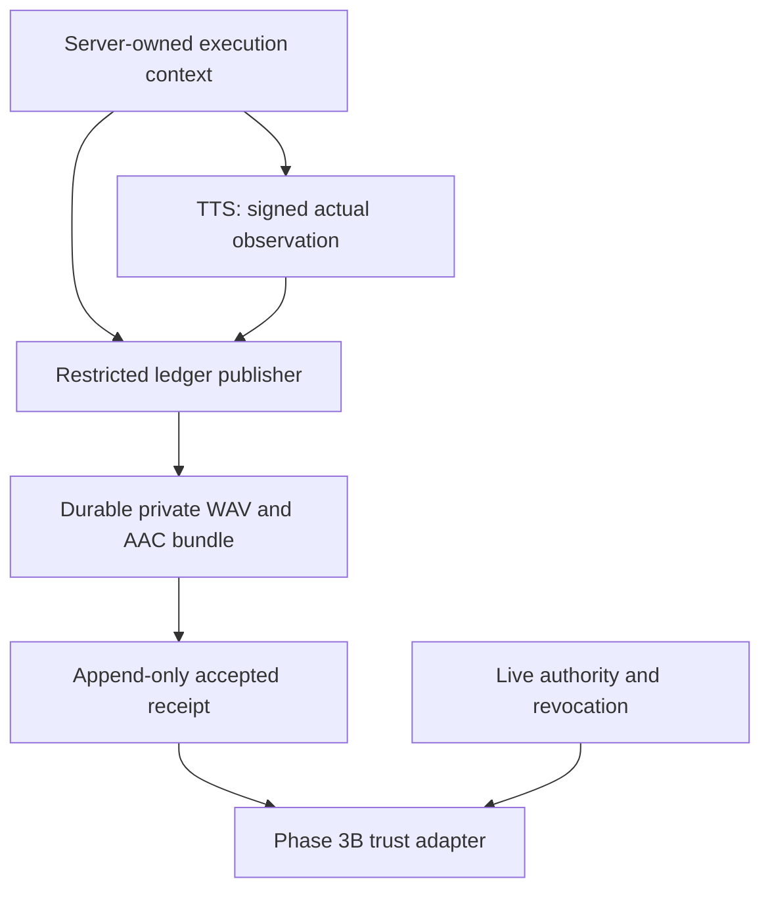

# Production audio provenance and private preview readiness — design review

Originally reviewed: 25 October 2026. Repository: `VisusVision/TalkingSlides`.
Original source HEAD: `601979df71ed0e75e5075006a7be719f6a70910e`.
P1 revised after the partial-rerender audit on 25 October 2026, Europe/Istanbul;
local HEAD, tracking ref and live GitHub ref matched
`ea04701d9495da290c173a3bc3101a9a5dd6a1ec`, branch
`feature/ai-visual-designer`. No runtime source changed between those commits,
so the source anchors below remain valid. The index/tracked files were clean;
the existing untracked integration review was preserved byte for byte.

**Recommendation: P1_REVISION_READY_FOR_IMPLEMENTATION**, limited to the
[revised P1 specification](AI_VISUAL_DESIGNER_PROVENANCE_P1_REVISED_SCOPE.md).
It resolves the [integration audit's](AI_VISUAL_DESIGNER_PARTIAL_RERENDER_INTEGRATION_REVIEW.md)
earlier `REVISE_P1_BEFORE_IMPLEMENTATION` conclusion; the historical audit remains
unchanged. This revision changes this design and adds that specification only.
It does not authorize implementation or establish a real trust source. No
producer, deployment enrollment, TTS behavior, private preview availability or
publication is enabled by this review. Each subsequent phase needs separate scope
authorization. Existing `_producer_dependencies()` remains `None` and
`_deployment_ready()` remains `False`.

## 1. Verified production path and evidence index

Read together with the [original Phase 3B design](AI_VISUAL_DESIGNER_PHASE3B_DESIGN.md),
[consolidated status](AI_VISUAL_DESIGNER_PHASE3B.md),
[3B-2 eligibility](AI_VISUAL_DESIGNER_PHASE3B2.md),
[3B-3 control plane](AI_VISUAL_DESIGNER_PHASE3B3.md) and
[3B-6 deployment evidence](AI_VISUAL_DESIGNER_PHASE3B6.md). Historical green CI
establishes the implemented engineering boundary; it does not authenticate audio
generated by the current production TTS path.

Full paths are repository-relative. In abbreviated module references,
`worker/`, `scripts/`, `tts_service/` and `core/` mean `services/worker/`,
`services/scripts/`, `services/tts_service/` and `services/api/core/` respectively.
Line anchors refer to the reviewed HEAD, not
earlier implementation reports. A source-observed fact is distinguished from a
proposed control throughout this document.

| Stage | Verified implementation and location | Actual behavior / provenance consequence |
|---|---|---|
| Extract authored narration | `services/scripts/pptx_extract.py::extract_speaker_notes` at 1603 (notes/fallback at 1634), `worker/tasks.py::export_project` and `_sync_transcript_pages_from_export` at 3531 | Speaker notes, otherwise extracted slide text, become export descriptors; saved active pages can override narration. Export can regenerate mutable workspace assets. |
| Reserve ordinary render | `services/api/core/views.py::_reserve_transcript_rerender_job` at 6979, `ProjectRerenderView.post` at 10907 | A `video_export` Job, upload path, voice ID and settings are passed to the existing Celery pipeline. `_get_voice_id` at 5225 reads the current profile's ID; rerender calls explicitly select client mode `service`. A provider choice in `VoiceProfile` is not itself proof of the engine used. |
| Resolve draft / active content | `worker/tasks.py::process_pptx_to_video` at 10287, `_build_render_slides_from_draft` at 3718, `_draft_render_tts_settings` at 3700 | Draft pages and settings are reread in separate queries at worker start. Active rendering syncs current rows with exported content. These are not an immutable render execution record. |
| Establish task text | `worker/tasks.py::synthesize_and_render_slide` at 8877, especially 8923–8996 | Narration can fall back to notes or editor paragraphs. `notes_text_prepared` strips surrounding whitespace and invents `Slide N.` for an empty value. Protected snapshot text must not be reconstructed from that fallback. |
| Client preprocessing | `services/scripts/tts_client.py::_prepare_text_with_settings` at 134 and `synthesize_with_service_with_metadata` at 138 | `prepare_effective_tts_input` applies project overrides, normalization, language rules and chunking. HTTP payload includes chunks/pauses and `already_prepared=True`; it does not include owner, project, Job, page, authenticated run or expected resource identities. |
| Preprocessing resources | `tts_service/tts_preprocess/effective_input.py::prepare_effective_tts_input` at 120; `normalizer.py::prepare_text_for_tts` at 329; `config.py::get_preprocess_config` at 51 | Environment supplies enable flags, chunk sizes, pauses and glossary location. EN/TR number, symbol and abbreviation rules and project overrides influence spoken text. The helper's no-filesystem docstring is narrower than actual transitive behavior: glossary/config/resolver loaders read resources. |
| Pronunciation dictionaries | `tts_preprocess/glossary.py::load_glossary` at 98; `deterministic_resolver.py::load_resolver_data` at 51; `tr_normalizer.py::build_spoken_text_tr` at 263 | Glossary JSON, `acronym_pronunciations.json`, `en_technical_terms.json`, `tr_known_words.txt`, regex/code and override order matter. Resolver data is process-cached with `lru_cache(1)`; hashing current files later does not identify an already-loaded dictionary. |
| Service effective input | `tts_service/main.py::SynthesizeRequest` at 130, `_prepared_text_from_chunks` at 477, `_ensure_xtts_safe_chunks` at 515, `_prepare_request_for_tts` at 980, `synthesize` at 1199 | Service resolves language, cleans chunks, supplies missing pauses, resplits oversized chunks and filters chunks without alphabetic content. Received client metadata and service-normalized text are not necessarily the exact ordered engine calls. |
| Provider and voice | `main.py::synthesize` at 1239; `_synthesize_xtts_v2` at 737 | `auto` or `xtts_v2` plus a voice ID attempts XTTS. Missing/failed XTTS can use gTTS, then silent MP3. `_synthesize_gtts` at 929 uses `gTTS(..., slow=False)`; no selected cloned speaker is used by that engine. A response can be HTTP 200 for fallback. If silence generation itself fails, the endpoint raises 500. |
| Model / sample | `main.py::_get_xtts_model` at 643, `_get_xtts_model_cpu` at 701, `_synthesize_xtts_v2` at 753–798 | Coqui loads a named `xtts_v2` model into cached process globals. The current call does not expose a complete loaded weight/config/tokenizer identity. `STORAGE_ROOT/voices/{voice_id}.wav` is opened by mutable name. GPU selection depends on runtime availability; chunk recovery can switch to another CPU-loaded model. |
| Incomplete generation | `main.py::_synthesize_xtts_v2` at 804–926; `_synthesize_xtts_v2_with_recovery` at 1082 | Failed chunks are retried as pieces. Some failed pieces can be skipped while others succeed; a nonempty `concat_items` is enough to return audio. No durable complete-coverage transcript exists. Model-level retries also delete partial output and reset loaded state. Provider=`xtts_v2` and fallback=false do not establish complete narration. |
| Service bytes | `main.py::_new_audio_path` at 220; `_synthesize_xtts_v2` at 784–919; `serve_audio` at 1576 | Temporary chunk WAVs plus inserted gaps become a UUID MP3 in `TTS_AUDIO_DIR`; temporary WAVs are removed. Response returns an audio URL and metadata. The inspected synthesis/audio routes have no receipt authentication mechanism in their handlers. This is not a claim about uninspected external network protection. |
| Client download / alternatives | `tts_client.py:96–131,216–281,301–389` | Downloaded MP3 overwrites `out_path`. Readiness timeout can create local silent/empty fallback. Direct audio responses get generic provider `direct_audio`. Optional `mode='eleven'` uses a requested ElevenLabs model ID and settings; ordinary rerender uses `service`. No authenticated model execution claim is returned by these paths. |
| Worker postprocessing | `worker/tasks.py:9047–9059`; `scripts/ffmpeg_helpers.py::trim_trailing_silence` at 84 | Optional trailing-silence removal reverses audio, removes silence and reverses again, re-encodes MP3, then replaces the original file. Failure logs and uses the original. Duration is reprobed, then a configured visual hold is added. No immutable raw→trimmed receipt records which branch actually happened. |
| Legacy video encoding | `ffmpeg_helpers.py::create_slide_video` at 150, legacy branch at 205 | Ordinary MP3 input becomes AAC in a part MP4; hold may pad audio with silence. This is distinct from Phase 3B's explicitly opted-in AAC-copy branch. An existing MP3 or complete lesson MP4 is not an eligible one-page AAC receipt. |
| Result and timing | `worker/tasks.py:9266–9293`, `_build_page_timeline_from_render_results` at 1212, `_fallback_cues_from_render_results` at 1449, `concat_and_finalize` around 9470–9483 | Task results contain page/source/split, text, spoken metadata, paths and duration. The existing `allocate_chunk_timings` apportions authored chunks by length, not forced alignment. Finalization derives page offsets and saved timing. Hold is excluded from the caption window. |
| Persisted ordinary output | `tasks.py::_sync_lesson_segments` at 6238; playback construction at 9560–9604; `_write_playback_sidecar` at 9832; Job completion at 9882 | `LessonSegment.segment_tts_path` and playback `tts_audio`/`tts_normalization` preserve paths and useful metadata, not an authenticated immutable producer association. Normal finalization can promote the then-current draft and write a project sidecar; no exact-revision publication guarantee is inferred. |
| Partial reuse | `tasks.py::recompose_visual_only_slide_segment` around 8530–8654, narration recomposition at 8660–8855, merge path at 9995–10115, dirty result recorder at 10191–10281 | Visual reuse can label provider `cached` and empty normalization/fallback metadata. Narration recomposition swaps temporary files into existing paths. Merge reads previous playback data; auto dirty work may mark a Job done while retaining baseline outputs. None independently authenticates reused audio. |
| Planning | `core/render_planner.py::_global_render_inputs` at 362; `worker/partial_render_manifest.py` around 245–320 and 394–480 | Planner fingerprints include normalized requested settings and optional actual metadata. Existing opt-in private dependency descriptors can bind authenticated dependencies, but a reuse classification is not producer authority. |

Relevant records: `core/models.py::VoiceProfile` at 132 holds mutable provider,
voice ID, language, speed and pitch; `Project` holds mutable `tts_settings` and
`draft_data`; `Job` at 498 holds status/task ID/result URLs, without a production
audio execution manifest; `TranscriptPage` at 874 holds mutable source/split/page
identity, text and timing; `LessonSegment` at 1242 is order/path based.
`VisualRenderSnapshot` and `VisualSegmentRun` provide immutable **private**
snapshot/request identities; the ordinary production synthesizer does not consume
those as an authenticated execution recipe. `visual_render_snapshots._capture`
at 80 includes voice, settings, timing and visual state in its revision identity.

### Consequences verified from the trace

1. Requested voice/provider/settings, returned metadata and actual model calls are
   distinct observations. VoiceProfile speed/pitch and project speed/gain metadata
   do not prove those controls were applied: the inspected service request and
   XTTS call do not pass them as corresponding engine controls.
2. Raw MP3, potentially trimmed MP3, AAC in a padded ordinary part, and the AAC
   required by Phase 3B are different artifacts. Hashes must identify each edge.
3. Current sidecars, successful Jobs, cache fingerprints, duration and audio energy
   do not prove speaker/text/model association, complete text coverage or current
   permission. A current checksum cannot establish a past causal event.
4. `tts_cache.py::TTSHashCacheStore` exists, including file/sidecar replacement and
   TTL deletion, but repository search found no production call from `main.py` or
   `tts_client.py` to that store. Do not invent a deployed service cache path.
   Actual partial-render file reuse above is present and remains unauthenticated.
5. Shared paths, draft rereads, source-index truthiness fallbacks (notably
   `tasks.py:3739,3747`), current voice sample names and model/resource caches admit
   races. Producer capture must reject a mismatched tuple; it must not certify the
   first-template/position fallback as the intended page.

## 2. Smallest recommended trust boundary

Use the existing PostgreSQL control plane for an **append-only producer ledger**,
an authenticated TTS observation and a narrowly privileged audio-artifact
publisher. Reuse the current TTS engine, pure caption allocator, private storage
primitives and existing render queue. Do not create another video pipeline or
provider stack. The ledger publisher may run from the existing API image as a
separate internal process/role; a public API process must not inherit its writer
credentials or signing key. Process separation is needed for authority, not a new
general-purpose workflow service.

### Alternatives and decision

| Candidate | What it establishes | Decision |
|---|---|---|
| Rehash legacy path / unsigned sidecar / ordinary Job metadata | Present bytes and caller assertions only | Reject; cannot establish past synthesis. |
| One ordinary Django process writes an immutable-looking model using its existing broad DB role | Application validation, without an independent writer boundary | Insufficient as the production authority. ORM save restrictions alone do not constrain other SQL writers. |
| Trusted TTS directly inserts all final receipts into the platform DB | Could authenticate engine observations, but overprivileges TTS and cannot know final artifact/caption acceptance by itself | Reject as the initial topology. TTS receives no platform DB credentials. |
| Dedicated ledger roles plus authenticated service messages, no persistent signatures | Viable if immutable ingress records and transport identity are inseparable and restore trust is carefully preserved | Smaller cryptographic surface, but harder independent replay/restore verification. |
| Signed TTS observation + restricted ledger publisher and signed accepted bundle | Separates actual synthesis observation, scoped authority and artifact finalization; independently verifiable after restart/restore | **Recommend.** Use two issuer purposes and separate keys, not a shared signing secret across API, worker and TTS. |
| Remote attestation service / transparency log / general event platform | Stronger compromise detection or fleet evidence | Later improvement, not an initial requirement. |

The independent root is an **operator-controlled issuer/deployment registry**,
provisioned outside render requests and ordinary app SQL. It binds public key,
issuer purpose, approved immutable image and loaded resource profile. It must not
accept the image/model hash claimed by a request as its own allowlist. An
operator-controlled launcher/inspection process measures running image identity;
resource loaders bind approved immutable manifests to the actual loaded objects.
Trust bootstrap and real key installation are rollout prerequisites, not facts
established by this document.

Trusted computing base: approved TTS instrumentation/model loader, ledger
publisher/validator, operator enrollment/revocation control, PostgreSQL authority
owners and host/storage administration. Signatures prove issuer statements and
byte association, not acoustic correctness or protection from a compromised
approved producer, root administrator or signing key. Caller-controlled metadata,
public files, ordinary API DB writes and broker messages are outside the authority.

### Wire authentication and durable records

Propose strict `production-tts-observation.v1` and
`production-audio-receipt.v1` envelopes. Use Ed25519 through a maintained library,
fixed algorithm/purpose allowlists, an operator-known `key_id`, canonical UTF-8
payload bytes and distinct domain prefixes. Reject duplicate JSON keys, unknown
fields/versions, nonfinite values, oversized/chunk-count-over-limit payloads and
noncanonical encodings. Hash and signature cover the same canonical bytes; the
key is selected from the registry, never from a caller-supplied URL/JWK. This is
application protocol design using RFC 8032, not a claim that the RFC defines the
application envelope. Preserve signed bytes in the ledger. [R1]

Use mutually authenticated TLS for the internal observation/artifact channel and
separate producer certificate identities from browser authentication. The issuer
registry binds certificate identity and signing purpose; forwarded certificate
headers from untrusted ingress are rejected. No OAuth server is required just to
deploy mTLS; RFC 8705 is background on the distinction between client identity and
bearer tokens. [R2] Synthesis contexts carry a server-issued nonce, audience,
expiration, execution ID and attempt generation. TTS authenticates the context;
ledger ingestion authenticates TTS and verifies the nonce/generation against its
own outstanding context. Replaying an identical accepted observation is idempotent;
a different claim for the same attempt is a conflict, not a replacement.

The restricted publisher also issues the scoped context after reading and locking
authoritative project/Job/page/voice/settings state and comparing the proposed
consumed worker payload. A worker may request a context over authenticated internal
ingress, but cannot sign one or choose its authoritative owner/source values.
Publisher context and receipt signatures have separate domain/purpose bindings;
the TTS signing key cannot issue contexts or accepted ledger receipts.

Worker preparation metadata is not an independent attestation. Before acceptance,
the publisher replays the existing preparation helper from captured protected
text/settings and the approved frozen preprocessing resource bundle. Compare exact
prepared text, ordered chunks and pauses with the signed service observation and
actual completed engine-call plan. Initial eligibility rejects additional service
filtering, dropped content or recovery reshaping that fails this equality. Package
the existing `tts_preprocess` implementation for the publisher; do not import the
whole TTS service or execute a model there. The current default API image does not
automatically supply this preparation package, so publisher image/import verification
is a P3 prerequisite. This adds neither a third worker signing authority nor a
parallel normalization algorithm.

Revised P1 has six inactive tables. The linked specification fixes their
relationships, deletion semantics, constraints, writers and real PostgreSQL gates;
these are proposals, not models implemented by this review:

| Record | Authority and mutability |
|---|---|
| `AudioProducerExecution` | Immutable original page-synthesis context: existing owner/project/origin Job IDs, exact page/source/split and source capture, planned speech identity and original order as audit metadata. Reuse creates no new synthesis execution. Actual inference belongs to a signed attempt observation. It is not `VisualSegmentRun`. |
| `AudioProducerAttempt` | Append-only resolved original observation/outcome, including failure/ineligibility, referencing execution and the previously issued context event/generation/nonce. Outstanding issuance lives in control/events, not a blank observation patched to success. |
| `AudioProducerReceipt` | Immutable original accepted outer envelope, unchanged SegmentAudioProof/hash, signed TTS parent, resource/caption/asset references and qualification. One accepted original per execution. Only restricted publisher can append; no P1 accepted production records. |
| `AudioProducerAuthority` | Immutable operator-signed issuer/key/purpose/image/resource enrollment statement; public keys only. Current policy is separate. |
| `AudioProducerControl` | Mutable epoch/deny projection for exactly one authority, execution or receipt; execution generation/nonce/deadline/acceptance pointer only through narrow routines. No duplicate Job status machine. |
| `AudioProducerControlEvent` | Append-only typed enrollment/control/revocation/attempt-issuance/acceptance events, atomically committed with projection changes. No generic event platform. |

P1 validates pure original-to-reuse and presentation structures but defers their
tables and actual acceptance. A later bounded `AudioProducerUse` may reference
one accepted original receipt and an explicitly captured consuming Job/page;
it is not another synthesis or audio copy. Publication/transfer/lease/outbox
records are deferred to P3, where actual durability operations justify them.
Use fixed typed receipt artifact references first; no generic artifact graph,
second broker queue, new narration store or durable chunk cache in P1.

Database enforcement must include separate non-login object owner/migration role;
no ordinary API/worker/TTS INSERT/UPDATE/DELETE/TRUNCATE/DDL privileges on receipt
tables; restricted publisher INSERT only through validated publication; immutable
row checks/triggers and explicit FK/lifecycle policy. Model methods remain useful,
but are not the authority. Owners/superusers remain trusted because they can alter
objects/privileges. PostgreSQL privilege rules and real-role tests matter. [R3]

Existing owner/project/Job/page IDs are scalar historical references in immutable
new records, checked against live authoritative rows at future capture/use;
there are no cascading ledger FKs to mutable application rows. Internal ledger
FKs are protected. Hard-deleted source/consumer Jobs, owner/project or unavailable
page mapping deny new private use while preserving signed history; normal delete
behavior remains unchanged. See the revised scope for this deliberate tradeoff.

Current policy reads must serialize with revocation. Extend the existing lock
order to owner → Project → source/control rows → producer authority controls →
existing parent receipt controls → execution control → Job → Run, sorting peer
IDs. Global producer revocation locks only its authority/control
rows and does not acquire Project locks afterward; affected Runs fail at their
next live check. Per-receipt revocation uses authority-before-receipt ordering.
An ordinary SELECT-only ledger reader cannot simply use `SELECT FOR UPDATE`:
PostgreSQL also requires UPDATE privilege for row locking. Propose a narrowly
scoped lock-and-authorize function owned by a non-login control role, not broad
UPDATE grants on receipt data. Lock lifetime must be the caller's control
transaction, not a prior separate HTTP call. Harden a SECURITY DEFINER function
with fixed trusted search path, schema-qualified objects, no dynamic SQL and
revoked PUBLIC execution; exercise its privileges with real PostgreSQL roles.
An alternative explicit lock mechanism needs equivalent concurrency evidence.
[R3, R4] SQLite success cannot establish this property.

## 3. Receipt contents and who establishes each field

The richer production envelope contains the unchanged v1 SegmentAudioProof as a
strict nested projection. Do not append fields to that proof, change its canonical
hashes or insert fabricated values to make it validate. The outer envelope binds
its projection hash, parent observation hash, immutable context and artifact
manifest. `ProducerTrustSource.lookup()` derives its expected digest from this
independently accepted ledger record, never from the supplied proof.

| Field / identity | Creator and verification |
|---|---|
| Schema, receipt UUID, issuer/key/purpose, acceptance timestamp | Publisher allocates UUID before cue construction; timestamps/acceptance sequence come from ledger authority. Signed canonical envelope; no mutable JSON sidecar authority. |
| Owner/project and baseline Job | Server context capture checks owned project and exact Job purpose/FK; service echoes authenticated context hash. Publisher rejects cross-owner/project or a Job substitution. |
| Producer run / execution / generation | Original logical synthesis context UUID and immutable manifest plus actual attempt nonce/generation/observation. Reuse retains these and adds a consuming-use identity, not a new model event. Distinct from Celery task ID/private Run. Baseline Job `done` alone does not qualify a result. |
| Stable page/source/split/order | Authoritative page tuple and exact consumed mapping; explicit integers preserving zero. Order is separately captured origin/consumer presentation metadata, not automatically speech identity. Reject positional fallback and tuple substitution; genuine authorized reordering does not itself require TTS. |
| Protected narration and source identities | Capture original exact authored string/hash separately from worker `.strip()`/fallback string; include full source observation and audio-semantic binding. Service signs its actual input association. A stripped/invented string cannot be relabeled verbatim protected text. |
| Prepared / effective speech | Trusted preparation record hashes original, normalized, spoken, ordered chunks, pauses and rule/resource identities. TTS observes exact ordered successful engine inputs, transformations, coverage and language; discrepancies produce ineligibility. |
| Language | Record requested hint, preparation language and actual concrete engine language separately. Proof contains actual supported language, never `auto`. Mismatch with frozen snapshot voice policy is ineligible. |
| Selected and actual provider / voice | Capture requested profile/mode/preference; service signs actual executed provider, actual speaker/sample and fallback/recovery trace. Proof projects actual provider/voice, `fallback='none'`; do not rewrite the profile or requested provider to hide a fallback. |
| Supported controls | Record requested values, effective resolved engine arguments/defaults and capabilities. Initial v1 eligibility requires neutral speed=1, pitch=1, gain=0, with no unsupported nondefault request. Metadata-only controls are not evidence of application. Hold/pause between slides is not speech speed. |
| Model and config | Loader measures the approved immutable files actually loaded: weights, tokenizer/vocabulary, configuration, library/build and resolved inference defaults. `model_hash` and `config_hash` commit manifests of those exact resources. A model name or newly hashed download cache is insufficient. |
| Voice sample | Resolve owner-authorized enrolled sample; snapshot exact WAV into a private immutable object before inference and pass that same snapshot to every model call. Sign its hash/size and sample/consent version. Hashing `{voice_id}.wav` and then letting Coqui reopen the original mutable path is insufficient. |
| Preparation / pronunciation | Record loaded in-memory resource identities, code/build version, effective env configuration, exact override maps and priority, dictionary/glossary digests and chunk/pauses digest. `preparation_hash` / `pronunciation_hash` commit explicit manifests, not arbitrary placeholders. Restart/reload on drift; do not attribute fresh file hashes to stale cached resolver data. |
| Original producer bytes and completeness | TTS signs both its normal MP3 output hash and retained lossless joined PCM/WAV hash derived from the exact successful chunk sequence, gap policy and full coverage record. Empty, silent fallback, omitted/retried/mixed-model chunks are not eligible under the initial profile. |
| Processing lineage | Outer receipt records original observations and every derivative edge. Nested v1 processing begins at the retained WAV, with actual `aac_encode.v1` or `resample_aac_encode.v1` operations, implementation/settings/input/output hashes ending at eligible M4A. Raw MP3 and legacy trim events stay separate and are not invented as supported v1 operations. |
| Final eligible AAC | Restricted publisher reads authenticated sealed WAV, performs bounded canonical audio finalization and pins AAC-LC M4A in a producer-private namespace. Independently probe format, bytes, packets, decoded duration, stream origin and sample/channel limits using approved native identities; record original-to-final linkage. This happens at producer publication, never as a private-preview repair of legacy audio. |
| Duration / audible window | Publisher measures final AAC and finite nonempty activity window using a versioned approved measurement recipe; service duration is diagnostic, not authority. Energy establishes activity, not words/voice correctness. Captions use final eligible audio, not later mutable row values. |
| Caption provenance | Separate immutable authored subtitle array/hash and page-local cues, allocator/policy identity, exact final audio and cue hash plus baseline Job/run. Distinct from actual engine chunks and speech fingerprint. Use existing `allocate_chunk_timings`; exact authorized text/window, no acoustic alignment claim. |
| Permission and resource policy | Receipt records issuance-time policy/consent/authority version; current issuer, receipt, sample consent and security-denylist checks remain separate live authority. Hash alone never grants permission. |

Avoid hash cycles: capture execution manifest and its hash before observations;
allocate receipt UUID, calculate local cues (whose hash covers page identity and
cues), then proof and outer envelope. The manifest does not contain its own proof
hash or acceptance signature. The receipt ID can appear in cue provenance without
placing the outer receipt hash inside its own hash input.

### Initial supported production profile

Recommend only **newly observed, complete local XTTS v2 synthesis**, concrete
language and enrolled cloned WAV, measured loaded resources, neutral controls,
no provider substitution, no chunk recovery/drop or mixed CPU/GPU model execution.
Either a qualified CPU or GPU model instance can be enrolled; hardware is not an
authentication mechanism. Actual acoustic/model acceptance is separate from
baseline CI. All other normal TTS results may continue through ordinary rendering
but receive an ineligible observation instead of an accepted producer receipt.

Signed complete joined WAV is retained before temporary chunks disappear. The
eligible AAC is a new immutable **producer derivative of that genuine production
synthesis**, not a claim of byte identity with the ordinary trimmed MP3 or padded
part-MP4 AAC. Normal MP3 encoding, trimming, fallback and lesson finalization stay
unchanged. This is the recommended initial scope: it avoids trusting a generic
render worker to assert arbitrary postprocessing and avoids pretending MP3 is an
accepted v1 input type. If product requirements instead demand the *exact*
post-trim ordinary narration, stop P3 and separately design an authenticated,
replay-verifiable trim/encode producer chain. Never map trimming to `identity.v1`.

The publisher can finalize retained WAV into eligible AAC without owning a TTS
model or generating speech. Use existing bounded FFmpeg/private asset patterns;
no scene/video orchestration is added. Fail if retained sources, permissions,
duration, supported encoding, 16 MiB per supporting audio/sample object or the
existing 64 MiB private attempt budget cannot be satisfied. Producer-vault quotas
must additionally cover raw evidence and outstanding capture leases; do not raise
existing contract limits to admit an oversized bundle.

gTTS and optional ElevenLabs remain ineligible initially: the inspected responses
do not establish actual remote model/configuration identity or the full required
voice/resource dependency set. Hashing a requested remote model name does not fill
that gap. No requirement to add those providers, iOS or unrelated avatar support.

## 4. Lifecycle, publication and recovery

1. **Capture:** after ordinary source resolution, register an exact server-owned
   producer context under appropriate source/owner locks. Compare the actual
   worker payload with captured authoritative page/source/voice/settings, including
   blank/whitespace behavior and source index zero. An incoherent legacy read is
   not repaired by substituting current values; decline provenance capture and
   leave normal rendering behavior unchanged. Sign/authorize a short-lived
   context nonce for exactly one producer attempt.
   Parent orchestration must carry the explicit captured Job/run/page handle through
   its child tasks and result descriptors; current child signatures do not provide
   a complete authenticated Job association. Add an optional internal context
   argument only in the separately authorized instrumentation phase; never use a
   latest-Job lookup. Each actual repeated synthesis gets a new bounded attempt
   generation/nonce (initial proposal: at most three observed attempts per execution).
   A later use of this audio instead references its original context/observation;
   it must not allocate a synthetic new generation or call TTS just for a receipt.
   Idempotent observation ingestion is not a claim that today's synthesis HTTP
   endpoint is idempotent. Duplicate calls without a fresh permitted attempt cannot
   earn another receipt; their ordinary behavior is not silently changed to caching.
2. **Observe at synthesis:** TTS authenticates context, validates approved loaded
   resources and uses a pinned sample. Record the actual prepared chunk plan and
   each engine attempt. Initial eligibility requires exact complete coverage and
   the supported execution profile. Persist/hash raw audio and lossless joined WAV
   while the generating process still owns them; sign their association before
   returning a provenance handle. Instrumentation must not promote an HTTP success
   or metadata echo into a completion claim.
3. **Retain and transfer:** keep an immutable sealed producer object with a lease
   until publisher acknowledgement. Transfer by authenticated opaque object ID,
   checking expected signed size/hash; no arbitrary URL/path import, no use of the
   existing public-style `/audio/{filename}` as a trust grant. TTS need not mount
   the API/worker private segment volume. Its separate staging storage must have
   bounded retention/capacity. Missing or failed capture may leave ordinary MP3
   rendering successful but no eligible receipt.
4. **Finalize privately:** publisher verifies signature, context, nonce, complete
   coverage, actual resources and permission. It copies verified WAV/sample into
   the approved private producer vault, finalizes AAC once and validates it. It
   seals caption allocation from immutable authored chunks and final audio, then
   constructs the strict proof and outer envelope. Before accepting, recheck issuer
   and receipt-control epochs and current authorization under the shared lock order.
5. **Publication barrier:** bounded staging → flush/fsync files and directories →
   atomic no-overwrite object publication → read/rehash/probe → one DB transaction
   appends accepted receipt, its baseline qualification binding, artifact references
   and publication event after the qualification below. The
   accepted DB receipt is the logical visibility point. A filesystem rename and
   DB commit are **not** one distributed transaction. Crash before commit leaves
   noneligible leased/orphan objects; commit before notification leaves a valid
   discoverable receipt. Dispatch/notification can be reconciled from persisted
   intent, not inferred from a filename. Never commit eligibility before durability.
6. **Baseline qualification:** initial scope requires a corresponding successful
   completed full ordinary render Job and exact captured execution lineage.
   `record_dirty_render_dispatch_result`'s done status with old baseline URLs does
   not qualify. A failed final lesson can retain a historical synthesis observation
   but cannot be relabeled an accepted successful baseline. Qualification may be
   represented by an append-only binding record committed with acceptance; do not
   mutate signed content. Until the corresponding full-render result is qualified,
   retain only an unavailable candidate/observation and its leased references, not
   a consumer-visible accepted receipt. Bind the exact TTS response observation
   actually consumed by the successful child result, including its downloaded raw
   MP3 hash before legacy trimming. A timed-out earlier synthesis or successful
   sibling/retry with the same text cannot substitute for that result association.
7. **Consume:** private reservation names receipt UUID only. Server lookup returns
   immutable proof, independent expected digest and scoped import handles; existing
   byte/proof/control/native verification still runs. Claim/completion/delivery
   recheck live authority. Existing generation/token/lease fencing remains mandatory.
8. **Revoke/recover:** append issuer/receipt/sample-consent revocation and advance
   current control epoch. No destructive deletion is needed to deny use. Bounded
   reconciliation resumes only the same immutable pending publication/attempt;
   superseded generations cannot replace an accepted receipt. After loss/restore,
   revalidate objects and re-enroll deployment; never recover authority by scanning
   legacy paths and signing whatever is found.

Ordinary API/worker success must not depend on producer capture availability in
the observational rollout. Provenance capture has explicit byte/deadline limits;
on failure it records no eligible receipt and normal rendering retains its existing
policy. Conversely, private preview eligibility always fails closed. These are
different outcomes; a normal render being allowed to finish never authorizes a
private receipt. Prove compatibility before enabling observation hooks.

| Event | Required result |
|---|---|
| Synthesis fails / incomplete chunks / partial download | Failure or ineligible observation; no accepted proof, no audio repair or silent eligible result. |
| Provider fallback or nonneutral unsupported request | Preserve normal fallback result; reject private eligibility even if audible and HTTP 200. |
| Voice sample/model/dictionary changes mid-call | Consume pinned loaded version or reject drift; never label old audio with newly hashed resources. |
| Repeat request / broker duplication | Identical accepted nonce/payload returns same receipt; conflicting payload fails. New synthesis attempt gets new generation and receipt lineage. |
| Identical bytes across Jobs | CAS deduplication may share physical bytes, but each authorized Job/page association needs a genuine captured execution or an explicit parent-receipt reuse binding. A hash match cannot transfer ownership/provenance. |
| Authenticated future cache hit | Revalidate original accepted receipt, semantic dependencies and current authority; preserve original actual provider and parent chain. Do not call it provider=`cached`. Initial profile excludes cache/partial paths. |
| Existing cached/path-only/sidecar audio | Remains ineligible indefinitely. No backfill migration, rehash enrollment or retroactive certification. |
| Source changes A→B during rendering | Receipt remains history of consumed A. Current private snapshot must match relevant audio semantics and live source policy; it cannot receive A's proof by replacing its text with B. Legacy lesson promotion is not certified by this design. |
| Visual-only selection changes | Audio may be reusable if protected text, exact page mapping, voice/settings/chunks and current policy still match. Do not require old complete visual snapshot identity to equal the new visual revision. |
| Broker/storage/ledger unavailable | Ordinary output may finish; private receipt remains unavailable. Bounded same-context reconciliation only; no fresh TTS fallback. |
| Normal key rotation / compromise | Retired-valid issuance keys may validate historical signed records under current policy; compromised/revoked keys deny dependent receipts. TLS certificate expiry prevents new authenticated calls; receipt history is governed by explicit current issuer policy, not a blanket lifetime guess. |

The initial full-render qualification/cache exclusion is an acceptance restriction,
not a policy to resynthesize whole lessons to obtain receipts. Existing partial
rendering continues normally without accepted producer evidence. A future
authenticated use must reference a genuinely accepted original parent and the
exact consuming capture; it cannot promote a dirty-only/no-op Job into a new
qualified synthesis. Bare observations do not authorize final-AAC reuse.

## 5. Phase 3B integration and compatibility boundaries

`visual_segment_artifacts.py:304–360` defines `ProducerArtifact`,
`ProducerAssociation`, `ProducerTrustSource.lookup/currently_authorized` and
`ApprovedProducerArtifacts`. Proposed adapter:

- Read only accepted ledger receipts; verify outer signature and the nested proof
  digest against the stored authoritative record and enrolled issuer. Return
  `engineering_only=False` **only** for this verified production chain.
- Fill owner/project/page/source/split, baseline Job/run/manifest and exact
  narration/source-WAV/sample artifact handles from accepted records. Imports use
  the existing approved namespace/owner/project/baseline-run layout. Public MP3
  paths are never opaque approved handles merely because they have been hashed.
- `proof_lookup(receipt_id)` returns the exact immutable projection;
  `currently_authorized(association)` checks current issuer, receipt, consent,
  deployment policy and denylist. Exceptions/outage mean unavailable. Content
  caches may cache signature verification by digest, not stale positive permission.
- `_producer_current` at `visual_segment_runs.py:287` already compares a fresh
  lookup with the prepared association. Add authority epoch locking at all control
  transitions; do not mistake today's separate predicate call for atomic producer
  revocation serialization. Existing visual-evidence revocation remains distinct.

Initial reuse policy is strict about current dependencies: resolve the current
operator-approved synthesis/preparation/pronunciation/sample profile for that
owner/voice independently of the old receipt. Compare its required identities
with the proof, not just `snapshot_tts_settings_hash`. A global lexicon or model
change need not alter saved Project JSON, so snapshot equality alone cannot detect
it. Advancing the required profile advances the authority epoch and denies reuse
and subsequent control/delivery checks of mismatching receipts. Do not rewrite
their historical hashes. The versioned internal dependency resolver/control lookup
is part of P4; today's `_producer_dependencies` does not already do this. Keeping
multiple old profiles eligible would be a later explicit policy decision, not an
automatic fallback to whatever produced cached audio.

### Explicit contract fit and gaps

`SegmentAudioProof` (`segment_contracts.py:176–276`) already supports production
attestation kind, concrete provider/voice, neutral controls, model/config/
preparation/pronunciation hashes, WAV sample, AAC-LC M4A and a bounded WAV→AAC
processing chain. The richer envelope carries signature/coverage/context/raw-MP3
evidence externally. Its nested proof uses only supported fields/operations.
The retained joined WAV is explicitly identified as this proof's processing
input, not mislabeled as an original untouched MP3. Existing proof/snapshot golden
hashes and request/receipt v1 schemas must remain unchanged.

There is a **caption integration prerequisite**: `visual_segment_runs._request`
at 111 currently requires saved start time/chunk timeline and constructs only
`frozen_baseline.v1`. Pure `_captions` at `segment_contracts.py:370` also recognizes
`result_allocator.v1`, but this is not wired as a production reservation path.
Canonical producer AAC can differ in duration from ordinary trimmed/padded media;
therefore never substitute its bytes while retaining incompatible baseline cues.

Recommend a separately authorized private-only adapter extension in P4: retrieve
publisher-sealed `result_allocator.v1` cues through a versioned internal dependency
lookup, verify cue hash against the authoritative receipt and its proof's
`baseline.cues_hash`, and compare the exact authored chunk array with the frozen
page. Recompute using the existing allocator to validate the record, not to invent
new cues after dispatch. Quantize to millisecond boundaries inside the measured
audible window, offset allocator times by that window's start, preserve exact text
and reject stripped/empty/markup-invalid chunks rather than silently editing them.
The existing allocator strips text, so initial eligible chunks must already be
canonical under that operation. Keep `frozen_absolute` verbatim even when local
producer cues differ. Do not write active/draft timing or transcripts.

This requires deliberate `_request`/dependency changes and tests, not merely
configuring `_producer_dependencies`. The current pure allocator policy checks
structure/bounds/provenance identifiers; the proposed production adapter must also
enforce equality with the ledger's authenticated cue payload/hash for this policy.
Retain the existing baseline-cue path unchanged for genuine matching baselines and
engineering regression fixtures. No browser-provided cue/expected hash or generic
production Boolean may select an unsafe alternative.

Speech semantics have a new separate hash: exact protected and actual spoken
input, actual ordered **engine** chunks/pauses, language, resolved controls and
provider/voice/sample/model/configuration/preparation/pronunciation identities.
It excludes subtitle presentation, visual choices, order and absolute timing
unless they actually change the resolved speech input. A separate scoped hash
binds owner/project/stable page/source/split; signed origin and consumption
contexts bind Jobs. A semantic equality never transfers permission.
Authored subtitle chunks and local cues have a distinct presentation/caption hash.
Preserve the full original capture revision for audit and the current private
Run's full source revision for live checks; finer dependency identities do not
weaken `_current_preflight` or enable ordinary draft promotion.

Initial migrations are additive with no data backfill. Internal ledger references
are protected; immutable captured application IDs do not cascade or SET_NULL when
ordinary rows disappear. Project/account/origin-or-consumer Job deletion denies
new private use and needs separately reviewed lifecycle retention, never silent
authority erasure or remaining permission grants. Planner opt-ins in
`segment_dependencies.py`, `render_planner.py` and `partial_render_manifest.py`
receive descriptors only after authenticated native validation. Legacy manifest
hashes/classifications stay unchanged when the opt-ins are absent.

## 5A. Coexistence with existing partial rerendering — revised P1 foundation

The [integration review](AI_VISUAL_DESIGNER_PARTIAL_RERENDER_INTEGRATION_REVIEW.md)
verified persisted per-output-page MP3, selected visual-only recomposition and
selected narration-only recomposition in current code. These are existing
capabilities on GitHub, not missing pipelines. Auto dirty rendering can still
resynthesize a dirty visual page, and render-required drafts can render all pages.
P1 adds no scheduling change, no new worker and no alternative narration storage.

`Job` identifies the existing originating/consuming work. `TranscriptPage` supplies
the existing stable key/source/split tuple, frozen under authority because it is
mutable. `LessonSegment.segment_tts_path`, current MP3/part paths, sidecars and
partial manifests supply locators/candidate input metadata. They do not prove
past engine activity. Reference these identities and capture only required facts;
do not duplicate ordinary page/job state machines or infer history from hashes.

The revised foundation separates four contracts:

1. **Speech semantics and original execution:** planned then observed actual
   speech input/resources, with origin Job/context and actual attempt lineage.
   Changed video/font/order/subtitle grouping alone does not change the speech
   hash. A dynamically spoken slide number does: capture its resolved text and
   preparation dependency, not an unexplained exemption for order.
2. **Original observation:** immutable signed statement by TTS that actual calls
   executed, with genuine original bytes and complete ordered coverage. An audio
   reuse never produces another observation; actual provider remains XTTS/etc.,
   not `cached`. Matching semantics across two real inferences does not collapse
   their different event/audio identities.
3. **Reuse association:** a pure P1 structure binds an accepted original parent,
   exact audio, authorized same-owner/project/stable-page consumer Job/capture and
   current resource/consent/control epochs. It is not a new synthesis. Its table
   and accepted issuance are deferred to P3/P4; no unrelated Job or cross-scope
   association follows from equal hashes. No arbitrary graph/chaining initially.
4. **Presentation/captions:** scene, display order, authored subtitle grouping,
   audio-local timing and video recipe are distinct from TTS chunks. P1 represents
   them without persisting/accepting new presentations. A new caption binding does
   not mutate the original proof's baseline or cue hash. Until a later strict P4
   extension can authenticate it, changed-cue private requests deny; they do not
   invoke speech merely to work around a binding mismatch.

Existing snapshot/planner adapters and FFmpeg/allocator helpers are reused later.
Encoded part reuse requires matching frame/audio/video/timing dependencies; reuse
of narration alone is insufficient. Moving lesson offsets may require assembly
or captions without page TTS. Current producer-bearing dependency descriptors can
change when a receipt/control binding changes even if speech does not; future
action selection must distinguish revalidation from synthesis, while retaining
existing strict v1 descriptors/hashes.

See the [self-contained revised P1 scope](AI_VISUAL_DESIGNER_PROVENANCE_P1_REVISED_SCOPE.md)
for the exact regeneration matrix, six-table rationale/writers/deletion policy,
pure reuse/presentation shapes, PG role/lock requirements and complete assignment
of T01–T22 and A01–A32 to P1 versus later phases. The audit remains unchanged as
historical input; its tests were not executed by either design review.

Unknown historical/cached audio remains ineligible. A valid existing **future
authenticated** narration may be reused through these parent/current-policy
checks while ordinary partial rendering keeps today's behavior. Neither the
ledger nor smaller dependency hashes weaken private owner isolation, immutable
snapshot/request semantics, producer/evidence revocation, attempt fencing or
publication safety. Normal AI-design integration and Phase 3C remain excluded.

## 6. Deployment enrollment is a separate authority

Producer authenticity answers who made an audio association. Deployment enrollment
answers whether this live API/worker/storage/broker/proxy installation is approved
to execute/deliver it. Neither proof implies the other. Engineering
`deployment-evidence.json` and test fixture injection are not production roots.

Propose `private-preview-enrollment.v1` signed by an operator/deployment authority
whose key is absent from API, TTS and worker containers. It binds environment ID,
purpose/audience, monotonically increasing enrollment epoch, nonce, approved image
digests, application/recipe/native/font hashes, approved mount/volume identity,
numeric UID/GID, broker endpoint identity/DB/queue, permitted worker identity,
proxy/config policy, resource limits, issuer, issue/not-before/expiry and applicable
producer authority profile. An immutable approved policy plus **fresh measured
observations** is required, not a server signing its own requested JSON.

| Requirement | Minimum initial control / test IDs |
|---|---|
| Independent enrollment | Operator agent observes image digests/config and performs signed challenge probes; application cannot issue/renew its own enrollment. Reject wrong environment/audience, replay, expired/not-yet-valid epochs and untrusted keys. A20, A21 |
| Approved images and native recipe | Use immutable digest-pinned API/worker/publisher images. Verify actual linked runtime, FFmpeg/FFprobe, fonts and pinned recipe against enrolled hashes. The slim API mismatch seen in 3B-6 remains incompatible. No replacing expected hashes from current runtime to pass. A14, A22 |
| Shared private volume | Agent issues nonce; API writes bounded 0600 probe through its real no-follow private root, worker reads/acknowledges and vice versa. Verify mount identity, expected volume generation, UID/GID 1000:1000, root 0700, disjoint public roots and restart persistence. Device/inode numbers alone are not a stable cross-host enrollment identity. A23 |
| Worker / render queue | A bounded challenge on the existing render queue must be consumed by the enrolled worker identity with DB claim acknowledgement; a cached Celery ping or broker TCP connection is insufficient. Broker credentials/TLS and Redis persistence are operator-validated without exposing credentials in evidence. A24 |
| Freshness / revocation | Proposed pilot bounds: observation/heartbeat every 10 s, maximum age 30 s; signed enrollment lease at most 5 min; local drift invalidates immediately when observed. Include clock-skew tolerance and deny time uncertainty, old epoch, restart without fresh nonce, missing mount and dependency outage. These are proposed acceptance targets, not measured guarantees. A20–A24 |
| Producer availability | Fresh authenticated control lookup and authorization epoch; database/cache/service failure cannot leave positive readiness cached indefinitely. No producer trust means no private work even if infrastructure is healthy. A15, A25 |
| Gate coverage | Future implementation must evaluate at reservation/dispatch, worker claim, receipt completion and HTTP open/stream rechecks. Producer locks serialize producer revocation; deployment loss is enforced according to stated freshness bounds. API-only availability is insufficient. A15, A18, A21–A25 |
| Recovery | Restart closes readiness; operator reacquires live evidence before bounded reconciliation of existing Runs. Preserve immutable input/generation identities and accepted receipts. Never reset fences, infer success from output files, auto-reenroll from a passing report or resurrect revoked producer grants. A18, A19, A24, A29 |

No component can detect an unobserved remote failure instantly; distinguish actual
change time, observation deadline and enforced stop time. A late negative heartbeat
must invalidate new operations and the next stream boundary within the advertised
budget. Enrolled broker loss may block delivery conservatively as well as work;
the initial policy should keep one fail-closed readiness rule rather than silently
serve on partially healthy infrastructure. Later execution/delivery capability
separation needs its own review.

This phase leaves `_deployment_ready()` literally false. The later enrollment
implementation must add an explicit completion-boundary check, not assume the
dispatcher call alone covers loss during rendering. No live preview activation
belongs in producer-receipt engineering or enrollment implementation acceptance.

## 7. Minimum proxy, streaming and retention acceptance

### Mandatory before the first real private preview

- Owner-authenticated GET/HEAD/single/open/suffix Range through the **actual** TLS
  terminator and proxy chain; exact status/length/type, private no-store headers,
  cookies/Authorization handling, source/owner/producer revocation and error
  behavior. Reject multi/invalid/sidecar ranges per existing API semantics. Do not
  expose private storage by aliases, X-Accel-Redirect, shared links, content hashes,
  ordinary Job tokens, public MP4/HLS routes or CDN cache. Test every actual edge.
- Proposed private-route policy: response buffering and proxy caching off, client
  abort propagated, no disk-spooling of private responses, no transformations that
  invalidate Range semantics. Nginx documents buffering as enabled by default and
  allows an `X-Accel-Buffering` response header to affect it; explicit operator
  configuration and end-to-end observation are required. `proxy_ignore_client_abort`
  also controls upstream closure behavior. These settings are design requirements,
  not deployed configuration in this repository. [R5]
- Existing Django stream reads 64 KiB and rechecks authority before the next chunk
  after 256 KiB or one second; timeouts are checked when iteration resumes, not by
  an always-running revocation timer. Test deliberately throttled **large** streams,
  stalled clients and socket resets through the real proxy. Application checks do
  not recall bytes already buffered or sent, nor prove the same bound at the client.
- Define and measure an additional in-flight buffer budget across WSGI, proxy,
  kernel and client. Proposed pilot acceptance: at most 30 s authority-observation
  staleness, then the existing resumed-iteration check plus a measured maximum
  additional 512 KiB server-side in-flight allowance after denial. This is a target
  requiring instrumented tests, not a claim of instantaneous revocation. If it
  cannot be demonstrated, tighten buffering/capacity or remain blocked. Never
  claim control over bytes already downloaded to a client's device.
- Proposed pilot limits: one stream per owner, four per API instance, zero waiting
  queue, 180 s absolute stream lifetime, 15 s idle-write timeout. Refuse excess
  admission before opening media; bounded 429/503 response with no descriptor leak.
  Determine actual FD cost of `_InputGuard` and supporting assets rather than
  assuming one descriptor per stream. Set process limits from measured peak cost,
  concurrency and 2x safety margin; leave ordinary routes' budgets unchanged.
- Reserve bytes/inodes for producer captures, immutable references, private attempts
  and maximum concurrent staging before accepting work. Maintain an operator-sized
  emergency margin sufficient for admitted in-flight work and logs. ENOSPC/quota/
  inode exhaustion must deny new work and preserve accepted/live objects. Don't
  delete history to make a test pass. Storage/node restart and failed-transfer
  behavior must pass on the intended persistent volume driver.
- Keep current private retention report-only and retain all references for the
  initial pilot. Extend future inventory to producer execution/observation/WAV/
  sample/AAC/cue/receipt references, active transfer/capture/publication leases,
  accepted and historical/revoked private Runs and snapshots. Existing
  `visual_segment_retention.py` knows only snapshots/Runs; this review does not
  claim it already traverses a future producer ledger.
- Back up ledger records, artifact bytes, trusted public-key history and revocation
  epochs together with a recoverable consistency point. Encrypt/restrict voice
  samples and narration; keep signing secrets outside ordinary data backups under
  the operator's key recovery policy. Test restoration on an isolated target;
  missing bytes or unverifiable authority keep previews closed. After restore,
  re-enroll deployment and fence any old queued worker attempts before reuse.

The preceding limits are conservative **proposals to test**. They do not silently
change existing contract byte/duration limits or establish service capacity.
Operator values must be approved and measured before rollout.

### Later operational improvements

Destructive orphan cleanup is not required for a capacity-bounded initial pilot.
Leave it disabled. Later require a complete reference graph, expired capture/pin/
attempt leases, backup/grace policy longer than the maximum retry/lease/restore
window, immutable quarantine inventory and a second locked reference check.
Pin creators and deletion must participate in the same artifact/reference lock;
an object currently unreferenced before its DB commit is not necessarily orphaned.
Use bounded batches, exact CAS identities, no-follow descriptors, deletion audit
events and crash/recovery tests. Never use only TTL, filename scans, project
directory deletion or the unrelated TTS cache cleanup helper on the producer vault.
Automation, larger concurrency, remote-object stores, cross-host fleets, cache
receipt reuse and richer observability can follow separate acceptance.

## 8. Adversarial acceptance matrix

These are **proposed tests, not executions performed by this review**. Every
control above must map to a concrete case below; no approval follows from naming
a test. PG means real PostgreSQL with separate production-like runtime roles;
containers use actual Redis and separate API/worker/publisher processes.

| ID | Attack or failure / concrete action | Required invariant and evidence |
|---|---|---|
| A01 | Post self-hashed proof, unsigned envelope, unknown/test key, expired/wrong-audience context or unissued nonce | No accepted ledger receipt or private reservation; expected hash cannot come from caller. Production rejects engineering issuer purposes and accepts no unregistered attempt context. |
| A02 | Mutate signed payload/algorithm/purpose; duplicate keys, NaN, oversized chunks; key URL injection | Strict parse/signature failure before artifact publication; no algorithm/key discovery from message. |
| A03 | Use ordinary API/worker/TTS DB roles to INSERT accepted receipt, UPDATE/DELETE/TRUNCATE rows, bypass ORM or shadow the lock function | PG denies operation; owner/migration role separate; function search-path/PUBLIC privilege tests pass. |
| A04 | Replace audio/WAV/sample with same-sized bytes and matching unsigned sidecar; swap after hashing or use symlink | Signed expected digest, descriptor confinement and postcopy verification reject replacement; no successful proof. |
| A05 | Swap page key/source zero/split, forge captured order, duplicate/omit source or use positional fallback; separately test genuine authorized reorder | Reject tuple/context substitution. Same speech at a different authorized presentation order retains speech identity; spoken order-dependent text changes it. Preserve `[0,2,0]` source mapping without positional provenance. |
| A06 | Submit valid receipt/context for another owner, project, Job or environment; cross-owner identical bytes | Reject association; CAS dedup cannot create authority. No public media path or metadata leak. |
| A07 | Voice profile/sample replaced after registration or mid-model call; later sample consent revoked | Consume enrolled immutable sample actually passed to model, or reject. Current consent revocation blocks subsequent private gates. |
| A08 | Loaded model differs from disk manifest, CPU fallback uses another instance, inference default or required model profile changes | Unknown/mixed/drifting loaded dependency fails initial profile; old receipts cannot satisfy a new required profile. Never hash current files and attribute them to old in-memory state. |
| A09 | Change glossary/env/override priority or active pronunciation profile while resolver cache holds old data and Project JSON is unchanged | Receipt names actual loaded resources; independent current-profile comparison rejects old reuse. Warm/cold paths record the exact resources actually consumed. |
| A10 | Force XTTS→gTTS→silent/local fallback, generic direct_audio, remote unknown-model result | Ordinary response behavior stays baseline-compatible; no eligible production proof despite HTTP 200/nonzero duration. |
| A11 | Fail one chunk, one smaller retry piece, or filter a numeric-only planned chunk while others succeed | Complete-coverage profile rejects eligibility; no full-text signed success. Existing ordinary rendering behavior remains unchanged. |
| A12 | Set nondefault speed/pitch/gain only in metadata; substitute provider/voice | Unsupported controls and actual-vs-captured mismatch fail eligibility; no invented neutral attestation. |
| A13 | Tamper raw→WAV→AAC processing, encode twice, pad/trim after sealing or label trim as identity | Validate each signed/producer-derived edge; v1 operations/limits enforced; final AAC container and packet payload match before/after private segment composition. |
| A14 | Wrong FFmpeg/ffprobe/library/font/recipe or incompatible API image | Live runtime differs from approved frozen evidence; no claim/receipt/delivery. Positive matched variant and negative slim variant exercised. |
| A15 | Revoke issuer/receipt/required profile after pinning, during render, at completion or before first/next stream chunk; also rotate an uncompromised key normally | PG control transaction serializes with claim/completion; history survives, future use stops under bounds. Test retired-valid issuance versus compromised-key denial separately; authority outage fails closed. |
| A16 | Edit source A→B, voice/settings/authored chunks after context or private reservation | A remains immutable history and current Run source checks still reject conflicts. A new authorized visual/caption presentation can compare unchanged speech independently; neither equal speech nor a new Job transfers permission or mutates A's observation. |
| A17 | Replace caption payload/hash, use MP3 timings with new AAC, strip authored text, forge allocator metadata | Exact ledger cue binding, recomputation, audible bounds and frozen chunk equality fail; no transcript/timeline rewrite. |
| A18 | Resume stale producer or private worker generation after newer success/cancellation | No accepted receipt replacement; old generation/nonce/token cannot win; include real PG race and paused worker. |
| A19 | Duplicate broker delivery, replay signed observation, or reuse accepted speech in another captured Job | One accepted original per execution; exact ingestion replay idempotent, conflicts fail. A later use retains original actual provider and has an explicit consumer binding, not a synthetic generation. No ledger replay invokes TTS; current synthesis HTTP retries are not claimed idempotent. |
| A20 | Spoof/expire enrollment, restore old epoch, wrong audience, untrusted signing key, clock uncertainty | Readiness false; denial at all gate boundaries, not just API health; a passed engineering report grants nothing. |
| A21 | Application attempts to self-enroll/renew, substitute its own image hash or disable independent agent | Its keys/DB role cannot write independent authority. Missing fresh observation becomes closed within declared observation budget. |
| A22 | Native binary/config drifts after enrollment, or restart reuses old positive result | Immediate local mismatch or bounded heartbeat invalidation; no replacing expected digest with observed digest. |
| A23 | Remove/shared-mount split-brain, readonly/wrong owner/GID/mode, public overlap, stale probe nonce, volume replacement | Bidirectional nonce challenge and actual no-follow I/O fail; generic TCP health cannot admit storage. |
| A24 | Redis unavailable/AOF recovery, worker listens on wrong queue, replay heartbeat from old process | Fresh queue challenge and worker identity/DB acknowledgement required; bounded same-Run reconciliation after re-enrollment. |
| A25 | Producer lookup/DB/control read fails while deployment otherwise healthy | No positive permission cached through outage; existing error contracts remain fail-closed. |
| A26 | Reuse legacy cache, old sidecar, unrelated Job audio or done dirty-dispatch result | Ineligible; no migration/backfill receipt. Valid future cache reuse preserves original provider and explicit parent association. |
| A27 | GET/HEAD/Range anonymously/foreign owner or via ordinary Job/share/token/HLS/CDN/guessed hash | Correct owner API works; all public routes deny on actual proxy topology with no cached cross-owner response. |
| A28 | Slow/stalled clients, midstream revocation, disconnect and repeated failed authorization; exceed concurrency | Instrument upstream reads/client delivery; validate stated staleness/in-flight/idle/lifetime/FD budgets. Existing small-fixture reset test alone cannot pass this gate. |
| A29 | Kill before/after file fsync, object publication, receipt DB commit or notification; restore old DB/bytes/queue | Either durable accepted bundle or ineligible staged objects; same-context reconciliation, no lost accepted data, fresh deployment epoch and worker fences after restore. |
| A30 | Disk/inodes/quota exhausted; inventory limit; candidate orphan races with pin commit; attempted project-wide GC | Refuse new work without deleting live/history objects; bounded inventory fails rather than approving partial deletion. No destructive GC in initial phases. |
| A31 | Disable/fail observation service during ordinary full/draft/partial rendering | Legacy providers/output/timing/finalizer behavior remains compatible; provenance unavailable only. Hooks must be resource bounded and cannot secretly alter normal Save & Rerender. |
| A32 | Test keys/fixtures copied into production image; use ordinary endpoint to request certifiable context | Production startup/enrollment refuses test issuer/profile, unsigned context and synthetic proof; no key material or fixtures in runtime image. |

Baseline CI uses deterministic engine stubs to test message authenticity, coverage
and races, plus existing genuine spoken fixtures for real FFmpeg validation. It
must label those test-only and never issue production ledger authority. Real model
capture/resource identity and acoustic acceptance run separately on an available
enrolled CPU/GPU target. Missing hardware blocks that acceptance, not the protocol
unit suite. Preserve existing legacy, private, PG and browser regressions.

## 9. Bounded implementation sequence

All paths/names below are **proposals**, not new files/modules from this review.
Any dependency addition requires explicit justification; use existing crypto
support only if it meets the signed protocol and key-management requirements.

### P1 — Pure contracts and non-active authority schema

- Authoritative boundary: [revised P1 specification](AI_VISUAL_DESIGNER_PROVENANCE_P1_REVISED_SCOPE.md).
  Pure planned/actual speech, context, original observation/receipt, reuse-lineage
  and presentation structures; purpose-separated Ed25519 verification using test
  registries; six empty execution/attempt/receipt/authority/control/event tables
  and real PostgreSQL privilege/lock constraints. No TTS hooks, accepted production
  records, actual reuse certification or dependency wiring.
- Prerequisites: reviewed field/schema/role/lock ordering above; exact expected
  migration number inspected at implementation time (do not reserve a number here).
- Likely files: new `core/visual_design/producer_contracts.py`,
  explicitly registered `core/audio_producer_models.py` or declarations in
  `core/models.py`, additive migration(s), narrow role/trigger/control-function SQL,
  pure/schema/real-PG role tests and narrowly necessary CI/dependency declarations.
  No new crypto implementation or assumed transitive packaged dependency.
- Compatibility: no changes to snapshot, SegmentAudioProof or legacy planner
  schemas/hashes, per-page MP3 storage, partial scheduler, existing rows/delete
  behavior or publication. Tables start empty, no legacy backfill, production
  issuers or keys; `_producer_dependencies` stays None and readiness false.
- Deferred: actual observations/accepted parent reuse, use/presentation tables,
  publication/transfer/artifact-intent operations, producer trust adapter, dynamic
  regeneration, durable chunk cache, deployment enrollment and rollout.
- Invariants/tests: revised N01–N11 and **mandatory PG01–PG08** with separate real
  roles/connections; section 8 A01–A32 and audit T01–T22 are fully phase-assigned
  there. Structural fixtures do not execute the later media/producer/deployment
  gates. An unavailable/skipped PG role job is a blocker, not a P1 pass.
- Stop: owner/runtime role cannot be separated, signature/canonicalization remains
  ambiguous, tuple/parent/generation semantics require fallback, locking cannot be
  proved, existing hashes would change or any hook would alter runtime behavior.
  Contracts and DB constraints do not observe a model; production stays unavailable.

### P2 — Authenticated production observation, shadow collection only

- Scope: server-owned producer context for newly consumed ordinary full-render
  inputs; authenticated context validation and TTS observation at actual model
  calls, complete chunk coverage, pinned sample/loaded-resource manifests and
  retained signed raw MP3/joined WAV. No eligible receipts or private adapter.
- Prerequisites: P1 and operator-owned service identities/key mounts/resource
  enrollment; explicit authorization for opt-in instrumentation of TTS/worker call
  sites. Approve the retained-WAV derivative policy before adding capture overhead.
- Likely files: narrow helpers beside `scripts/tts_client.py`, `tts_service/main.py`
  and `tts_preprocess/`; worker context hooks in `worker/tasks.py`, approved model/
  sample loader helpers, internal ingestion routes in an isolated URL/settings
  surface, Docker secret/network configuration. No unrelated avatar code.
- Reuse the existing normal-page and narration-only synthesis calls through one
  observation protocol. Visual-only reuse carries original parent identity and
  does not manufacture another model call/event. Initial full-render qualification
  remains separate; expanding partial observation/qualification needs explicit scope.
- Migration: no duplicate observation/attempt tables; justify any additional
  operational capture state. No historical data certification.
- Compatibility: legacy endpoint/call defaults, fallback and media behavior unchanged
  when not observed; bounded capture failure cannot turn an ordinary success into
  private eligibility. Do not claim "observation only" if output-affecting hooks
  change arguments or loaded samples without explicit compatibility acceptance.
- Tests: A05–A12, A16, A18–A19, A26, A31–A32; service/client integration with stubs,
  followed by separately available real XTTS target tests. Baseline CI needs no GPU.
- Stop: full ordered model-call coverage, actual loaded resources or same sample
  bytes cannot be observed; covert output change or unbounded capture overhead.
  Remaining risk: captured observations are not final AAC artifacts.

### P3 — Restricted artifact publication and accepted receipts

- Scope: publisher role verifies signed newly captured observations, derives and
  validates bounded AAC from authenticated WAV, seals local cues and publishes
  immutable bundle/receipt with crash-safe intent. Separate internal process,
  existing queue/explicit reconciliation only. Private previews remain closed.
- Prerequisites: P2 real observation acceptance; approved publisher image/native
  recipe, private producer vault, quota/leases and ledger writer isolation.
- Likely files: `core/audio_producer_ledger.py`, `core/audio_producer_publication.py`,
  a narrow management/reconciliation command, existing media validation/storage
  helpers and publisher Compose/secret role configuration; isolated tests.
- Migration: only actual artifact/publication intent, lease, qualification or typed
  consuming-use relationship needed for this phase; these are deferred from P1.
  No generic graph, duplicate narration cache, historical rewrite or Job URL change.
- Compatibility: legacy MP3/trimmed/video outputs untouched. Accepted WAV→AAC proof
  fits strict v1 operations; no pretend MP3/trim provenance or second video encoder.
- Tests: A04, A06, A10–A14, A17–A19, A24, A26, A29–A32; real media and actual
  PostgreSQL/Redis/container crash windows. Missing/oversized artifacts fail closed.
- Stop: durability/publication visibility or baseline generation binding is ambiguous,
  required processing exceeds v1 semantics or real provenance is unavailable.
  Remaining risk: no production consumer/readiness activation yet.

### P4 — Production trust adapter and private caption bridge, still closed

- Scope: authenticated `ProducerTrustSource`/proof/artifact lookup, current-control
  epoch locking and sealed result-allocator caption lookup described in section 5.
  Wire only for isolated integration acceptance, without a live availability switch.
- Prerequisites: P3 accepted real producer chain, P1 role/lock acceptance and explicit
  agreement that private producer AAC may differ from normal trimmed/padded media.
- Likely files: new producer trust adapter, `core/visual_segment_runs.py`, narrow
  dependency wiring, `core/visual_segment_artifacts.py` only where necessary;
  existing planner opt-ins if descriptors need integration; private API/media tests.
- Migration: normally none beyond reference/control linkage; justify any addition.
- Compatibility: existing pure v1 schemas/golden fixtures stay stable; existing
  baseline-cue route preserved. New internal dependency API version is explicit;
  no browser cue input, synthetic production opt-in, active timeline write or
  ordinary Save & Rerender integration. `_deployment_ready()` remains false.
- Tests: A01–A09, A13–A19, A25–A28, A31–A32 including PG revocation/completion races,
  native packet-copy validation and default no-dependency regressions.
- Stop: cue binding requires schema weakening, current source checks would be bypassed
  or producer revocation can race an accepted receipt. Remaining risk: deployment
  policy and real proxy acceptance still absent.

### E1 — Independent deployment enrollment engineering

- Scope: independent signed policy/lease, image/runtime/mount/queue/broker probes,
  epochs, bounded live checks and operator re-enrollment/recovery. Test a proposed
  readiness evaluator; default production gate stays false until separate acceptance.
- Prerequisites: operator trust/key ownership, deployment topology, immutable images,
  measurable worker/storage identities and declared heartbeat/freshness policy.
- Likely files: new deployment-policy evaluator/management commands, narrowly scoped
  `visual_segment_dispatch.py`, worker claim/completion and delivery gates,
  Docker/operator configuration, `tests/deployment/visual_segments/` extensions.
- Migration: authority enrollment/control/epoch tables if PostgreSQL-backed; signed
  operator evidence is not writable by ordinary application roles.
- Compatibility/invariants: no environment Boolean/self-signed app report fallback;
  producer and deployment roots remain separate; no public/legacy routing changes.
- Tests: A14–A15, A18–A25, A29–A32 with real process kill, stale heartbeat, volume drift,
  unavailable broker and denied completion/stream. No stub-only enrollment acceptance.
- Stop: app can enroll itself, actual topology cannot be measured or revocation
  budget is unprovable. Remaining risk: public edge/operational acceptance.

### E2 — Real proxy, capacity, retention inventory and restore acceptance

- Scope: actual deployment edge and resource tests from section 7; extend report-only
  inventory to producer references/leases; no destructive GC.
- Prerequisites: E1 candidate images and real isolated proxy/storage target;
  selected limits, backup policy and operator access.
- Likely files: deployment-specific proxy/Compose configuration, extended
  `visual_segment_retention.py` inventory, operational commands/docs and deployment
  tests; no new Studio controls or publication route.
- Migration: only explicit resource admission/retention reference/lease records if
  required; must not delete historical data or alter ordinary storage cleanup.
- Compatibility/invariants: owner-only private route, bounded FD/stream/storage
  admission, current authorization, conservative retention and recoverability.
- Tests: A15, A20–A30, A32 through real proxy; lost client, slow stream, sustained
  saturation, disk/inodes, backup/restore and nondeletion under concurrent pinning.
- Stop: buffer/FD/revocation bounds fail or restore cannot authenticate references.
  Remaining risk: actual activation/product availability requires separate approval.

### R1 — Separate reviewed activation proposal

No activation is part of this review or P1–E2. Require their exact committed-tree
results, real producer acceptance, signed operator enrollment and E2 edge/resource
acceptance, then request a separately authorized limited rollout plan with rollback
to **closed** readiness. Identify exact config/availability changes and owner scope.
No automatic rollout after CI, no historical certification, no public video, no
Phase 3C, no merge or normal rerender integration. Destructive GC and additional
providers remain independent later work.

## 10. Decisions, blockers and review validation

The architecture chooses its authority: operator-enrolled TTS observations and a
separately privileged PostgreSQL ledger publisher. An unknown existing signer is
not assumed. This is enough specificity for bounded P1 implementation, while
**all real production eligibility remains unavailable today**.

Before P2/P3: name the operator/key custodian, isolate DB/process roles, select real
model/sample manifests and consent policy, and explicitly accept the initial
pre-legacy-trim producer-WAV derivative. If the exact ordinary post-trim/part AAC
is required instead, or no independent authority owner can be assigned, stop that
implementation phase for design/trust resolution. The current code does not
resolve these questions by itself.

Before P4: agree the sealed allocator bridge and audio-semantic/current-source
policy, including canonical authored chunks, unsupported captions and whitespace.
Before E1/E2: identify actual deployment/proxy/storage topology, clocks/heartbeat
targets, resource budgets, backup/retention/privacy constraints and recovery
ownership. The proposed numeric limits require measurement; they are not
production promises. Consent erasure versus immutable audit retention also needs
an explicit operator policy without retaining sample bytes indefinitely by accident.

Original review validation was source/path/AST/patch inspection; no production
calls, synthesis, GPU experiment, audio conversion, migration, deployment or runtime
acceptance test was run. This P1 revision reads the complete integration audit,
this design, original Phase 3B design and consolidated report, then checks relevant
current source and PostgreSQL primary references. Post-edit validation covers
links, source anchors, Markdown, all 22 audit/32 adversarial cases and their phase
assignment, six-table purpose/deletion/role rationale, preserved integration-review
bytes and documentation-only diff. The two revised deliverables remain uncommitted
and unpushed. No test/CI pass is claimed for the proposed P1 implementation.
Historical CI/container evidence cannot establish actual producer trust or activate
private previews.

**Final recommendation: P1_REVISION_READY_FOR_IMPLEMENTATION**, limited to the
inactive contracts/schema/role-test boundary in the linked revised specification.
Await separate authorization before P1 code or any model, TTS, producer integration,
enrollment, dynamic scheduling, Phase 3C or rollout change.

## Primary technical references

These sources inform the proposed mechanisms, not evidence that TalkingSlides
currently deploys them. Repository findings above come from the verified source
commit. Accessed 25 October 2026; external design recommendations remain subject to
implementation-time version review.

- **R1:** [RFC 8032 — EdDSA / Ed25519](https://www.rfc-editor.org/rfc/rfc8032.html).
- **R2:** [RFC 8705 — mutual TLS client identity and certificate-bound tokens](https://www.rfc-editor.org/rfc/rfc8705.html).
- **R3:** [PostgreSQL 16 privileges, ownership and row-lock privileges](https://www.postgresql.org/docs/16/ddl-priv.html).
- **R4:** [PostgreSQL 16 CREATE FUNCTION, SECURITY DEFINER safety](https://www.postgresql.org/docs/16/sql-createfunction.html).
- **R5:** [Nginx proxy buffering and client-abort directives](https://nginx.org/en/docs/http/ngx_http_proxy_module.html).
- [PostgreSQL transaction isolation](https://www.postgresql.org/docs/current/transaction-iso.html) — explicit locks/rechecks or serialization handling are needed; a file write is not part of a PostgreSQL transaction.
